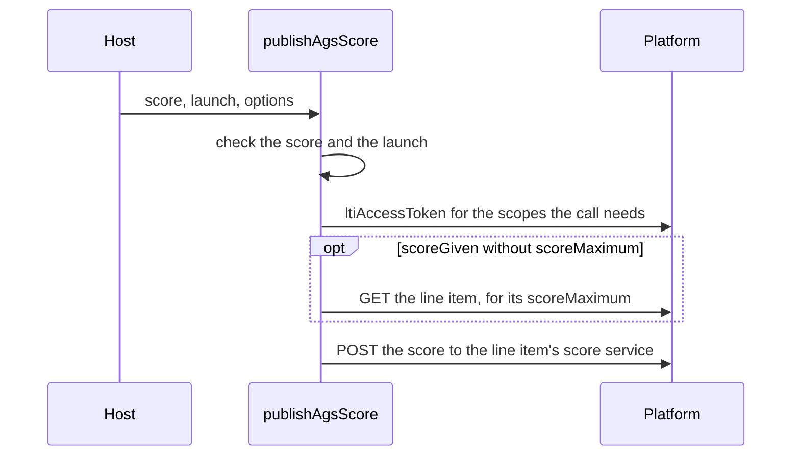

# LTI tool role

`@interopkit/tool-integration/tool` lets a learning platform launch your application as an LTI 1.3 tool. It runs on a
server or an edge runtime, with [jose](https://github.com/panva/jose) for the tokens and the key sets. LTI 1.0 to 1.2
launches (OAuth 1.0a, retired on 2022-06-30) are refused. The root subpath, `@interopkit/tool-integration`, holds what both
roles share: `LtiError` and `createJwksCache`. The request and answer types are in
[`@interopkit/core/http`](../core/http.md).

```mermaid
sequenceDiagram
  participant P as Platform
  participant B as Browser
  participant T as Tool<br/>(the host's routes)
  P->>B: send to the tool's login URL
  B->>T: login (iss, login_hint, target_link_uri, ...)
  T->>T: ltiLogin: state and nonce into the LtiStore
  T-->>B: redirect to the authentication request, or the storage page
  B->>P: authentication request
  P-->>B: form_post of the id_token to the redirect URI
  B->>T: POST id_token and state
  T->>T: ltiLaunch: signature, claims and nonce; delete the login
  T-->>B: the launch
  opt Deep Linking request
    T->>P: deepLinkResponse: a signed JWT posted to the return URL
  end
  opt Grade passback
    T->>P: ltiAccessToken, then publishAgsScore to the line item
  end
```

| Function                                      | Does                                                                                          |
| --------------------------------------------- | --------------------------------------------------------------------------------------------- |
| `ltiLogin(request, options)`                  | Answers the platform's third-party initiated login with the authentication request            |
| `ltiLaunch(request, options)`                 | Validates the `id_token` and returns the launch, or the verification page of the storage path |
| `deepLinkResponse(launch, items, options)`    | Signs the response to a Deep Linking request                                                  |
| `ltiAccessToken(deployment, scopes, options)` | Requests an access token for the platform's services (client-credentials grant, JWT)          |
| `publishAgsScore(score, launch, options)`     | Publishes a score to the line item of the launch                                              |
| `createJwksCache(options)`                    | Creates the cache of the platforms' key sets that `ltiLaunch` verifies signatures with        |

The handlers take an `HttpRequest` and return an `HttpResponse` of [`@interopkit/core/http`](../core/http.md), plain objects that a host builds from any web framework. The
host owns the routes, the sessions, the database and the keys. The [example](../../examples/tool-integration/README.md) runs a tool
and a platform against each other in one process.

## Sources

| Specification                                                                                                                                                                                                  | Used for                                                              |
| -------------------------------------------------------------------------------------------------------------------------------------------------------------------------------------------------------------- | --------------------------------------------------------------------- |
| [LTI 1.3 Core](https://www.imsglobal.org/spec/lti/v1p3)                                                                                                                                                        | Login parameters, launch claims, token endpoint                       |
| [LTI Security Framework 1.1](https://www.imsglobal.org/spec/security/v1p1)                                                                                                                                     | Authentication request, `id_token` validation, key sets, assertions   |
| [LTI Deep Linking 2.0](https://www.imsglobal.org/spec/lti-dl/v2p0)                                                                                                                                             | Deep Linking request and response                                     |
| [LTI Assignment and Grade Services 2.0](https://www.imsglobal.org/spec/lti-ags/v2p0)                                                                                                                           | The `endpoint` claim of a launch, the line item and the score service |
| [LTI Client Side OIDC 0.1](https://www.imsglobal.org/spec/lti-cs-oidc/v0p1)                                                                                                                                    | `state` and `nonce` in the platform's browser storage                 |
| [RFC 6749](https://www.rfc-editor.org/rfc/rfc6749), [RFC 7515](https://www.rfc-editor.org/rfc/rfc7515), [RFC 7518](https://www.rfc-editor.org/rfc/rfc7518), [RFC 7523](https://www.rfc-editor.org/rfc/rfc7523) | OAuth 2.0, JWS, RS256, the JWT assertion                              |

## Example

A host builds the registration of each platform, the store of logins and the options. It generates its key in the sample; a real
host keeps the key that the platform's administrator registered. The routes of the host turn the request of its web framework into
an `HttpRequest` (with the header names in lower case, as `Object.fromEntries(request.headers)` gives them, and the body as
bytes, as `new Uint8Array(await request.arrayBuffer())` gives it) and the `HttpResponse` back into a response.

```ts
import { createJwksCache } from "@interopkit/tool-integration";
import { ltiLogin } from "@interopkit/tool-integration/tool";

const keys = await crypto.subtle.generateKey(
  { name: "RSASSA-PKCS1-v1_5", modulusLength: 2048, publicExponent: new Uint8Array([1, 0, 1]), hash: "SHA-256" },
  false,
  ["sign"],
);
const registration = {
  issuer: "https://lms.example.edu",
  clientId: "962fa4d8-bcbf-49a0-94b2-2de05ad274af",
  deploymentIds: ["07940580-b309-415e-a37c-914d387c1150"],
  authenticationUrl: "https://lms.example.edu/auth",
  jwksUrl: "https://lms.example.edu/jwks",
  accessTokenUrl: "https://lms.example.edu/token",
  redirectUri: "https://tool.example.com/lti/launch",
  keyId: "tool-1",
  signingKey: keys.privateKey,
};

const logins = new Map();
const store = {
  put: async (state, record) => void logins.set(state, record),
  get: async (state) => logins.get(state),
  delete: async (state) => logins.delete(state),
};
const options = {
  registration: async (issuer, clientId) =>
    issuer === registration.issuer && (clientId === undefined || clientId === registration.clientId)
      ? registration
      : undefined,
  clock: { now: () => Date.now() },
  store,
  jwks: createJwksCache({ fetch }),
};

// The route of the tool's login URL, for a platform that starts the login with a GET.
const login = new URL("https://tool.example.com/lti/login");
login.search = new URLSearchParams({
  iss: registration.issuer,
  login_hint: "user-1",
  target_link_uri: "https://tool.example.com/lti/launch",
  client_id: registration.clientId,
}).toString();
const response = await ltiLogin({ method: "GET", url: login.href, headers: {}, body: new Uint8Array() }, options);
response.status; // => 302
const authentication = new URL(response.headers.location);
authentication.origin + authentication.pathname; // => "https://lms.example.edu/auth"
authentication.searchParams.get("scope"); // => "openid"
logins.size; // => 1
```

The route of the redirect URI passes the platform's post and, on the storage path, the verification page's post to `ltiLaunch`.
It returns a launch, or a response that the host sends.

## Registrations

`options.registration(issuer, clientId, callOptions)` returns the `PlatformRegistration` of a platform, or `undefined`. `clientId` is
`undefined` unless the platform names it (`client_id`, LTI 1.3 Core section 4.1.3). The returned registration is checked on every
call and must match the issuer and the client.

| Property            | Meaning                                                                                                      |
| ------------------- | ------------------------------------------------------------------------------------------------------------ |
| `issuer`            | The `iss` of the platform: an `https` URL without query or fragment                                          |
| `clientId`          | The OAuth 2.0 client identifier that the platform gave the tool                                              |
| `deploymentIds`     | The deployments that the tool accepts; the `deployment_id` of a launch must be one of them                   |
| `authenticationUrl` | The platform's OIDC authentication endpoint                                                                  |
| `jwksUrl`           | The platform's key set                                                                                       |
| `accessTokenUrl`    | The platform's token endpoint, also the `aud` of the client assertion unless `audience` is set               |
| `audience`          | Optional: the `aud` of the client assertion, for a platform that wants a value other than its token endpoint |
| `redirectUri`       | The tool's launch URL. The route of `ltiLaunch` must answer it                                               |
| `keyId`             | The `kid` of the tool's public key in the key set that the platform fetches                                  |
| `signingKey`        | The tool's private RSA key (`RSASSA-PKCS1-v1_5`, SHA-256, usage `sign`)                                      |

Every URL is `https` (LTI 1.3 Core section 3.5). The platform needs the tool's public key under `keyId`: the host publishes it, and the sample does not.

## The login store

`LtiStore` keeps the logins in progress, by `state`. `ltiLogin` calls `put`, `ltiLaunch` calls `get` and then `delete`.

| Method                        | Contract                                                                                          |
| ----------------------------- | ------------------------------------------------------------------------------------------------- |
| `put(state, record, options)` | Saves the `LoginRecord`: `nonce`, `issuer`, `clientId`, `storageTarget` and `expiresAt`           |
| `get(state, options)`         | Returns the record, or `undefined`                                                                |
| `delete(state, options)`      | Deletes the record and returns whether there was one. Of two concurrent calls, one returns `true` |

A login is valid for 600 seconds (`expiresAt`). The host may delete expired records. `delete` must be atomic: it is what makes
a login complete once.

## Login and launch

The platform sends the browser to the login URL (Security Framework section 5.1.1.1). `ltiLogin` creates a `state` and a `nonce`
of 160 random bits each, saves them in the store and answers with the authentication request (section 5.1.1.2): `scope=openid`,
`response_type=id_token`, `client_id`, `redirect_uri`, `login_hint`, `state`, `response_mode=form_post`, `nonce`,
`prompt=none`, and `lti_message_hint` unchanged when the platform sent it. The initiation may be a GET or a form POST.

The tool must tie the launch to the browser that logged in, or an attacker could make a victim's browser launch with the
attacker's token (login CSRF, Security Framework 1.1 section 7.4.1). There are two ways.

| Path    | When                                       | The answer of `ltiLogin`                                                                                                           | What binds the browser                                                                      |
| ------- | ------------------------------------------ | ---------------------------------------------------------------------------------------------------------------------------------- | ------------------------------------------------------------------------------------------- |
| Cookie  | The initiation has no `lti_storage_target` | A 302 to the authentication request, with `__Host-lti_state_<state>=<state>; Max-Age=600; Path=/; Secure; HttpOnly; SameSite=None` | The cookie, which the launch compares with `state`                                          |
| Storage | The initiation has `lti_storage_target`    | A page that stores `state` and `nonce` in the platform with `lti.put_data`, then redirects                                         | The platform's storage, which the verification page reads with `lti.get_data` at the launch |

The storage path works in an iframe whose browser blocks third-party cookies. The `__Host-` prefix keeps a sibling subdomain
from setting the cookie, and the name holds the `state`, so that several launches in one browser do not collide.

### The storage path

LTI Client Side OIDC 0.1 sections 2.3 to 2.7 and section 3 define the messages. The page stores `state_<state>` and `nonce_<nonce>` in the
frame named by `lti_storage_target` (`_parent` for the parent), waits for `lti.put_data.response`, and navigates to the
authentication request. A message counts only when it comes from the origin of `authenticationUrl`, has the subject
`<subject>.response` and answers the page's `message_id`. If the platform answers with an error, names no such frame or is
silent for 10 seconds, the page shows a message and stops.

At the launch, the platform posts the `id_token` to the redirect URI. `ltiLaunch` answers with the verification page: it
fetches `state_<state>` and `nonce_<nonce>` with `lti.get_data` and submits the form with `id_token`, `state`, `stored_state`
and `stored_nonce` to the same URL. That second request completes the launch, so the host routes both to `ltiLaunch`. It must
pass the `origin` header, because `ltiLaunch` accepts the second request only from the origin of the redirect URI: without
cookies, nothing else stops a cross-site form from posting a token of the attacker's with values of its own.

The scripts of the two pages use only features that Chromium 111, Firefox 115 and Safari 16.4 have, and later versions. Both pages carry a CSP that allows their one script by hash (`default-src 'none'; script-src 'sha256-...'; base-uri 'none';
form-action 'self'`), `Cache-Control: no-store` and `X-Content-Type-Options: nosniff`, and every value in them is
HTML-encoded. `ltiLaunch` echoes the `id_token` of the platform's post into the verification page before it verifies it, and
only for a `state` that the tool issued.

### What `ltiLaunch` checks

A request that is not a POST of a form with `id_token` and `state` is a `DataError`. Then, in this order, a failure throws
`LtiError` with the reason in the table. The login stays in the store until the launch succeeds or expires.

| Check                                                                                                                           | Reason                                            |
| ------------------------------------------------------------------------------------------------------------------------------- | ------------------------------------------------- |
| The form has no `oauth_consumer_key`, which an LTI 1.0 to 1.2 launch carries                                                    | `legacy-launch`                                   |
| `state` names a login in the store, made of base64url characters                                                                | `state-unknown`                                   |
| The login has not expired                                                                                                       | `state-expired`                                   |
| The platform is still registered                                                                                                | `platform-unknown`                                |
| Cookie path: the state cookie equals `state`                                                                                    | `state-cookie`                                    |
| Storage path: the second post comes from the redirect URI's origin, with `stored_state` and `stored_nonce` equal to the login's | `origin-mismatch`, `storage-mismatch`             |
| The token has three canonical base64url parts, a JSON header and a JSON payload; no `crit` header                               | `token-malformed`                                 |
| `alg` is one of RS256, RS384, RS512, ES256, ES384 and ES512; `none`, the HMAC algorithms and every other are refused before a key is fetched | `algorithm-unsupported` |
| The header has a `kid` that one key of the key set has, a key for the algorithm: RSA of 2,048 bits or more, or EC on P-256, P-384 or P-521 | `key-unknown` |
| The signature verifies with that key                                                                                            | `signature-invalid`                               |
| `iss` equals the registration's issuer                                                                                          | `issuer-mismatch`                                 |
| `aud` holds the client identifier and names no other party; a token with several audiences has `azp`; `azp`, when present, is the client identifier | `audience-mismatch`, `audience-untrusted`, `authorized-party-missing`, `authorized-party-mismatch` |
| `exp` is later than the time minus 60 seconds; `iat` is not later than the time plus 60 seconds                                 | `token-expired`, `issued-in-future`               |
| `nonce` is present and equals the login's                                                                                       | `nonce-mismatch`                                  |
| The message type is one of the five that a platform sends (see [messages](model.md)); the version is `1.3.0`                    | `message-type-unsupported`, `version-unsupported` |
| `deployment_id` is one of the registration's                                                                                    | `deployment-unknown`                              |
| The claims of the message type have the shape of the specifications                                                             | `claim-missing`, `claim-invalid`                  |
| The store deletes the login                                                                                                     | `state-reused`                                    |

A host answers with the `status` of an `LtiError`, which the table of errors below gives, and with 400 for a `DataError`.

### The launch

`ltiLaunch` returns an `LtiMessage` or an `HttpResponse`: the second post of the storage path is answered with the verification page, which the route sends to the browser as it is. Tell them apart with `"status" in result`, which is true for the `HttpResponse`; an `LtiMessage` has a `messageType`. A launch that fails a check does not return: it throws an `LtiError` with a `reason` and a `status`, and the route answers with them.

An `LtiMessage` is a union by `messageType`; [Messages and vocabularies](model.md) lists every property. The ones a tool reads first:

| Property                             | Meaning                                                                                                                  |
| ------------------------------------ | ------------------------------------------------------------------------------------------------------------------------ |
| `issuer`, `clientId`, `deploymentId` | The platform, the tool's client and the deployment                                                                       |
| `targetLinkUri`                      | The `target_link_uri` claim. The tool relies on it, not on the unsigned parameter of the login                           |
| `user`                               | `subject`, the user's `sub`, absent in an anonymous launch, and the identity claims: names, email, picture, locale       |
| `roles`                              | The role URIs, as the platform sent them; `canonicalizeRole` maps a deprecated simple name to its URI                    |
| `context`, `platform`, `presentation` | The `context`, `tool_platform` and `launch_presentation` claims                                                         |
| `custom`                             | The custom properties of the link, a `Map`                                                                               |
| `services`                           | The service claims: `grades` has `scopes`, `lineitems` and `lineitem`; a service the platform does not offer is absent  |
| `claims`                             | Every claim of the token as JSON, vendor claims among them                                                               |
| `resourceLink`                       | `LtiResourceLinkRequest`: `id`, `title`, `description`                                                                   |
| `settings`                           | `LtiDeepLinkingRequest`: the ten settings of Deep Linking 4.4.1, `returnUrl`, `acceptTypes` and `data` among them        |

A message holds a `Map`; a host that stores it converts `custom` to an array of entries.

## Deep Linking

When `ltiLaunch` returns a Deep Linking request, the host lets the user choose, then calls `deepLinkResponse(launch, items,
options)`. The result is the signed `LtiDeepLinkingResponse`, the value of the form parameter `JWT`. The host sends the browser
to `launch.settings.returnUrl` with an auto-submitted form POST (Deep Linking 2.0 section 2.3), also when no item was chosen.

An item is an LTI resource link:

| Property   | Meaning                                                                                                     |
| ---------- | ----------------------------------------------------------------------------------------------------------- |
| `title`    | The title of the link                                                                                       |
| `text`     | A description                                                                                               |
| `url`      | The URL to launch, sent back as `target_link_uri`; the tool's base LTI URL when absent                      |
| `custom`   | A `Map` of strings that the platform sends with each launch of the link, such as the identifier of the test |
| `lineItem` | `scoreMaximum` (above 0), `label`, `resourceId` and `tag`: the line item that the platform may create       |

The response has `iss` (the client identifier), `aud` (the platform), `exp` (300 seconds after `iat`), `iat`, a `nonce`, the
deployment, the message type, the version, the `data` of the request when it had one, and `content_items`. It is signed with
RS256 and the registration's key, and its header has `keyId` as `kid`. `deepLinkResponse` throws `DataError` when the platform does not accept
`ltiResourceLink` or, for several items, does not say `accept_multiple: true`.

## Access tokens

`ltiAccessToken(deployment, scopes, options)` posts a form to `accessTokenUrl` with `grant_type=client_credentials`,
`client_assertion_type=urn:ietf:params:oauth:client-assertion-type:jwt-bearer`, `client_assertion` and `scope`
(space-separated), as Security Framework section 4.1.1 describes. The assertion has `iss` and `sub` equal to the client
identifier, `aud` equal to the token endpoint (or the `audience` of the registration), `iat`, `exp` (300 seconds later), a new
`jti` and the deployment claim (LTI 1.3 Core section 6.2.1). `deployment` is a launch or any object with `issuer`, `clientId` and `deploymentId`.

The result is an `AccessToken`: `value`, `expiresAt` (milliseconds, absent when the platform sent no `expires_in`) and `scopes`,
which are those requested, or the subset the platform granted. A service request carries `Authorization: Bearer <value>`. The
tool may keep the token until `expiresAt`, or until a service refuses it when there is none; the function keeps none.

## Publishing a score

`publishAgsScore(score, launch, options)` gives the learning platform a score: the tool posts it to the score service of the
line item that the launch offered ([LTI AGS 2.0](https://www.imsglobal.org/spec/lti-ags/v2p0#score-publish-service)).
`launch` is the resource link launch that started the activity. `options` are those of `ltiAccessToken`. The function asks
for an access token for the scopes it needs on every call and keeps none.

| Property of the score | Meaning                                                                                                                                            |
| --------------------- | -------------------------------------------------------------------------------------------------------------------------------------------------- |
| `activityProgress`    | `Completed`                                                                                                                                        |
| `gradingProgress`     | `FullyGraded`; `Pending` while a service must still score; `PendingManual` while a person must                                                     |
| `timestamp`           | ISO 8601 with a time zone. A resend takes a later one (see below)                                                                                  |
| `scoreGiven`          | The score, from 0. Default: none, which tells the platform that there is no score yet                                                              |
| `scoreMaximum`        | The highest score, above 0, with a `scoreGiven`. Default: the `scoreMaximum` of the line item, which the function reads when `scoreGiven` has none |
| `comment`             | Text for the user. Default: none                                                                                                                   |

The body also carries the `userId`, the `sub` of the launch.



**Timestamps.** AGS 3.4.9 says that a tool must not send two updates of one line item and user with the same timestamp, and
that timestamps increase strictly. The call is not idempotent: a resend needs a later `timestamp`, even when the first attempt
is in doubt after a timeout. A host takes the time from the last attempt, not the last success, and records it before the
request, so that a crash between the request and its record cannot repeat a time.

**In doubt.** A timeout, or a `signal` that aborts while the request is in flight, leaves the score in doubt: the platform may
have received it.

| Error                              | When                                                                                                                           |
| ---------------------------------- | ------------------------------------------------------------------------------------------------------------------------------ |
| `DataError`                        | An argument has the wrong type, the score is not valid (see the property table), or the line item has no usable `scoreMaximum` |
| `LtiError` `line-item-unavailable` | The launch has no grade services, or offers no line item                                                                       |
| `LtiError` `scope-unavailable`     | The launch does not offer the `score` scope, or the scope to read the line item when the score has no maximum                  |
| `LtiError` `subject-unavailable`   | The launch is anonymous                                                                                                        |
| `LtiError` `scope-denied`          | The platform granted fewer scopes than the call needs                                                                          |
| `ServiceError`                     | The token endpoint, the line item or the score service did not answer with a success                                           |
| The `reason` of the signal         | The caller aborted                                                                                                             |

## The key set cache

`createJwksCache({ fetch })` holds a remote key set of jose for each URL, which comes from a registration and never from a
token. `cache.keySet(url, options)` returns the function that resolves the public key of a token from its header, and
`jwtVerify` of jose takes it. The `signal` of `options` ends the wait of the caller that holds the function; the fetch is shared
work and runs on to its own timeout.

| Option           | Meaning                                                                  |
| ---------------- | ------------------------------------------------------------------------ |
| `fetch`          | The `fetch` that gets the key sets                                       |
| `ttlSeconds`     | How long a set stays cached. Default: `3600`.                            |
| `refreshSeconds` | The least time between two fetches of a set that answers. Default: `60`. |
| `timeoutMs`      | The most time one fetch may take. Default: `10000`.                      |

A set that is older than `ttlSeconds` is fetched again. A `kid` that the cached set lacks fetches it again only after
`refreshSeconds` (Security Framework section 6.4: the platform adds a rotated key under a new `kid`), so a token with an invented
`kid` cannot make the tool fetch on every request while the platform's key set answers. A key set that fails is not held back: each request that needs it fetches it again, so limit the rate of requests to the launch URL. Requests that wait for one fetch share it. The set resolves the key that
has the `kid` and is meant for signing with the algorithm of the token (`use` is `sig` or absent, `alg` is that algorithm or absent, `key_ops` has
`verify` when present); a `kid` that two keys share, and a set that is not a JWK Set (RFC 7517 section 5), are refused. A key of
fewer than 2,048 bits does not verify (RFC 7518 section 3.3). The cache reads the time of the system, as jose does.

## Calls to the platform

`fetch` is an option and nothing else calls the network. The functions that do (`createJwksCache`, `ltiAccessToken`,
`publishAgsScore`) go through `callService` of [`@interopkit/core`](../core/service.md): a time limit, no redirect (it could
leave HTTPS) and at most 64 KiB of the answer. A failure is a `ServiceError`: its
`status` is the HTTP status, or `0` when the platform did not answer. An answer that is not what the specification describes is
a `DataError`.

Nothing checks where a request goes beyond the `https` scheme, and the key set, the token endpoint and the line item come from a
registration or from a claim of a platform. A tool that serves many platforms, whose administrators it does not control, passes a
`fetch` that refuses loopback, private and link-local addresses. The check must be on the address that the connection resolves
to and not on the host name, or DNS rebinding gets through: a name that is public when it is checked can be private when the
connection is made. Resolve the name once, refuse the address if it is in one of those ranges (the metadata address
`169.254.169.254` among them, and an IPv4 address written as IPv6), and connect to that address; in Node.js that is a `lookup`
function in the options of the connection. See [SECURITY](../../SECURITY.md).

## The clock

`clock.now()` answers whole milliseconds, as `Date.now()` does ([clock](../core/clock.md)). The functions read no other clock,
except that the key set cache of jose reads the time of the system.

## Deployment

- Serve every route over HTTPS, and limit the size of a request body: the handlers read what the host gives them.
- Route the login URL to `ltiLogin`, and the redirect URI to `ltiLaunch` for both requests of the storage path.
- Pass the `origin` header, and the `cookie` header for the cookie path, in lower case.
- Check `launch.targetLinkUri` against your own routes before you redirect to it.
- Make `LtiStore.delete` atomic, and delete expired records.
- Start the host's own session after `ltiLaunch` returns a launch; the state cookie serves the login only.
- Keep the tool's private key in the host's key store, and publish its public key to the platform under the `keyId`.

## Options

| Option         | Default                                             | Meaning                                                     |
| -------------- | --------------------------------------------------- | ----------------------------------------------------------- |
| `registration` | required                                            | Looks up the registration of a platform (see Registrations) |
| `clock`        | required                                            | The source of the time                                      |
| `store`        | required for `ltiLogin` and `ltiLaunch`             | The store of logins                                         |
| `jwks`         | required for `ltiLaunch`                            | The cache of key sets                                       |
| `fetch`        | required for `ltiAccessToken` and `publishAgsScore` | The `fetch` that calls the platform                         |
| `timeoutMs`    | `DEFAULT_TIMEOUT_MS`, 10,000 ms                     | The most time a call to the platform may take               |
| `signal`       | none                                                | Ends this caller's wait (see Signals)                       |

| Limit                                   | Value        |
| --------------------------------------- | ------------ |
| Lifetime of a login                     | 600 seconds  |
| Lifetime of a client assertion          | 300 seconds  |
| Lifetime of a Deep Linking response     | 300 seconds  |
| Leeway for clock skew                   | 60 seconds   |
| Most bytes of an answer of the platform | 65,536       |
| Key set `ttlSeconds`, `refreshSeconds`  | 3,600 and 60 |

## Failure paths

| Port or call                       | Fails                                                                                                                                  | Hangs                                                                                | Called again                                                                                                      |
| ---------------------------------- | -------------------------------------------------------------------------------------------------------------------------------------- | ------------------------------------------------------------------------------------ | ----------------------------------------------------------------------------------------------------------------- |
| `registration`                     | Rejects: the call rejects. `undefined`: `platform-unknown`                                                                             | It receives the `signal` and bounds itself                                           | Pure; a host may cache                                                                                            |
| `LtiStore.put`                     | `ltiLogin` rejects and sends no redirect                                                                                               | It receives the `signal` and bounds itself                                           | Each login has a new `state`                                                                                      |
| `LtiStore.get`                     | `ltiLaunch` rejects; the login stays                                                                                                   | The same                                                                             | Reads only                                                                                                        |
| `LtiStore.delete`                  | `ltiLaunch` rejects after validation, and the platform may post again until the login expires                                          | The same                                                                             | Atomic: of two calls one gets `true`, and the other is `state-reused`. An unfinished login expires at `expiresAt` |
| The key set                        | Fresh keys are unaffected. Past `ttlSeconds` the call rejects with `ServiceError`: launches fail closed, and stale keys are never used | Shared work: it runs to `timeoutMs`; one caller's abort ends only that caller's wait | An unknown `kid` fetches once, at most every `refreshSeconds`, then `key-unknown`. Callers share one fetch        |
| The call to the platform (`fetch`) | `ServiceError` with the status, or 0 when there was no answer                                                                          | `timeoutMs`, then `ServiceError` with status 0                                       | A token request is safe: a new `jti`. A score needs a later timestamp                                             |

## Signals

| Point                                          | Effect of an aborted signal                                                                                                 |
| ---------------------------------------------- | --------------------------------------------------------------------------------------------------------------------------- |
| `ltiLogin`, before `put`                       | Rejects with `signal.reason`; nothing is saved. After `put`, an orphan record expires                                       |
| `ltiLaunch`, before `store.delete`             | Rejects with `signal.reason`; the login stays, and the platform may post again. After `delete` starts, the launch completes |
| `deepLinkResponse`, in the registration lookup | Rejects with `signal.reason`                                                                                                |
| `ltiAccessToken`, in flight                    | Rejects with `signal.reason`; each request has a new `jti`, so a repeat is safe                                             |
| `publishAgsScore`, in flight                   | In doubt: rejects with `signal.reason`. Resend with a later timestamp                                                       |
| A key set fetch                                | One caller's abort ends that caller's wait. The fetch runs on for the others, to `timeoutMs`                                |

## Errors

| Error                                                                                                                                                                                                                 | When                                                                        | Status                                         |
| --------------------------------------------------------------------------------------------------------------------------------------------------------------------------------------------------------------------- | --------------------------------------------------------------------------- | ---------------------------------------------- |
| `LtiError` `token-malformed`, `algorithm-unsupported`, `key-unknown`, `signature-invalid`, `issuer-mismatch`, `audience-mismatch`, `authorized-party-mismatch`, `token-expired`, `issued-in-future`, `nonce-mismatch` | The `id_token` fails validation                                             | 401                                            |
| `LtiError` `state-unknown`, `state-expired`, `state-reused`, `state-cookie`, `origin-mismatch`, `storage-mismatch`                                                                                                    | The launch is not bound to a login of the tool                              | 403                                            |
| `LtiError`, other reasons                                                                                                                                                                                             | The platform broke the protocol, or a scope or a line item is not available | 400                                            |
| `DataError`                                                                                                                                                                                                           | An argument or a request has the wrong shape                                | 400                                            |
| `ServiceError`                                                                                                                                                                                                        | The platform did not answer, or answered with an error                      | 502 or 504 for a host that proxies the failure |

## Data flows

| Data                                                        | Comes from                         | Goes to                                                            | Kept by the package                    |
| ----------------------------------------------------------- | ---------------------------------- | ------------------------------------------------------------------ | -------------------------------------- |
| The claims of a launch: `sub`, roles, names, e-mail, custom | The platform's `id_token`          | The `LtiMessage` that `ltiLaunch` returns to the host               | No                                     |
| `state` and `nonce` of a login                              | `ltiLogin`                         | The host's `LtiStore`, and the browser (the cookie or the storage) | Only in the store, until used or 600 s |
| The client assertion                                        | Signed with the tool's private key | The platform's token endpoint                                      | No                                     |
| The access token                                            | The platform's token endpoint      | The score service and the line item, in the `Authorization` header | No: each call asks for its own         |
| A score                                                     | The host                           | The platform's score service                                       | No                                     |
| The answer of a service that failed                         | The platform                       | `ServiceError.body`, to the host: treat it as untrusted text       | No                                     |

## Differences from the references

The references were read for what they do where a specification leaves room; [spec-gaps](spec-gaps.md) lists where the text and
an example disagree.

| Reference                               | What it does                                                                            | What this package does                                                           |
| --------------------------------------- | --------------------------------------------------------------------------------------- | -------------------------------------------------------------------------------- |
| PyLTI1p3                                | Does not read `expires_in` of a token response; names the audience with `auth_audience` | Reads `expires_in` when it is there; the registration has an optional `audience` |
| PyLTI1p3                                | Appends `/scores` to the line item URL after handling a trailing slash                  | The same: one trailing slash is dropped first                                    |
| A launch from Canvas, published in 2020 | Sends `null` for a title and a description, and a number in `custom`                    | Reads `null` as absent and a number or a boolean as its text                     |

## Not included

| What                                                                                                            | Reason                                                                       |
| --------------------------------------------------------------------------------------------------------------- | ---------------------------------------------------------------------------- |
| LTI 1.0 to 1.2, Basic Outcomes                                                                                  | 1EdTech retired them; a launch of that form is refused                       |
| An access token cache                                                                                           | A cache of tokens is shared work with its own rules; the function keeps none |
| Optional claims of Core 5.4 (`context`, `tool_platform`, `launch_presentation`), identity claims, vendor claims | Not read yet; see [supported](supported.md)                                  |
| Names and Role Provisioning, Dynamic Registration, Submission Review, Proctoring, Context Groups                | See [supported](supported.md)                                                |
| Sessions, routes, a database, a UI for Deep Linking                                                             | The host's                                                                   |
