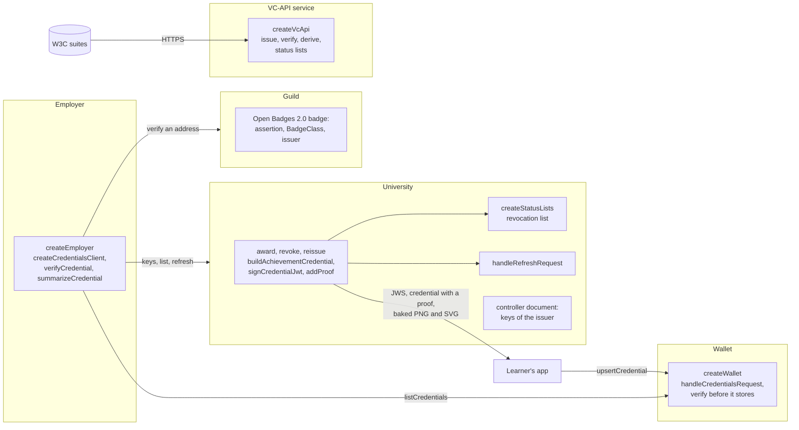

# A university, a wallet, an employer and a VC-API service

A university awards Open Badges 3.0, a learner's wallet holds them behind the Open Badges API, an employer reads them from the
wallet and verifies each as Open Badges 9 says, and a VC-API service wraps the same functions for the interoperability suites of
the W3C. The university signs with `@interopkit/achievement-credentials`, the wallet answers with its provider, the employer asks
with its client and its verifier, and all of them use `@interopkit/core`. They reach each other through an in-memory network, so
the scenario needs no server; `serve.ts` puts the VC-API service on a port with TLS for a suite.



| File                  | Holds                                                                                                                                                             |
| --------------------- | ----------------------------------------------------------------------------------------------------------------------------------------------------------------- |
| `src/university.ts`   | `createUniversity`: awards a credential as a JWS or with an `eddsa-rdfc-2022` proof, with a place in its revocation list and a refresh service; revokes; reissues |
| `src/status-lists.ts` | `createStatusLists`: a list for each purpose as plain data, a free index at random, and the list credential issued over a `Signer`                                |
| `src/wallet.ts`       | `createWallet`: the Open Badges API over a store in memory, which verifies a credential before it keeps it and replaces one with a newer one                      |
| `src/employer.ts`     | `createEmployer`: lists the credentials of a wallet with the client, verifies each for the learner, and shows what a wallet shows                                 |
| `src/hosted-badge.ts` | The three documents of an Open Badges 2.0 badge that a guild hosts, which the package reads and verifies and never writes                                         |
| `src/vc-api.ts`       | `createVcApi`: the VC-API over `addProof`, `verifyProof`, `verifyCredentialStatus` and `deriveDisclosure`, and the status lists that it fills                     |
| `src/keys.ts`         | `createSigningKey`: an Ed25519 or a P-256 key in memory, its JWK, its Multikey and its `did:key`, and the `Signer` over it                                        |
| `src/contexts.ts`     | `createStandInContexts`: a small context for each address, at its pin, so that the scenario needs no download                                                     |
| `src/network.ts`      | `createNetwork`: a `fetch` that reaches the handler of an origin and nothing else                                                                                 |
| `src/server.ts`       | `serve`: the handler of a host over `node:http` or `node:https` on the loopback address                                                                           |
| `scenario.ts`         | `runScenario`: the learner's uploads, the review, the revocation, the refresh, the images, the Open Badges 2.0 badge and the VC-API flows                         |
| `serve.ts`            | Starts the VC-API service with TLS for a suite; the environment names the key, the certificate, the contexts and the port                                         |
| `test/`               | The tests, which CI runs, and the flows against the public validator of 1EdTech, which `pnpm validator` runs                                                      |

## Rules of the example

| Rule                      | Value                                                                                                                                                                    |
| ------------------------- | ------------------------------------------------------------------------------------------------------------------------------------------------------------------------ |
| Issuer binding            | The university publishes its keys in the document at its `id`; a credential signed by a key that it does not publish is refused by the wallet with 422                   |
| Revocation                | The university sets the entry of a credential in its list; the employer's verification fails the `status` check and no other                                             |
| Refresh                   | The university reissues a credential under a new name; the employer's copy refreshes to it, verified as any credential                                                   |
| Both proofs               | A credential is a compact JWS (ES256, with the issuer's key by `kid`) or has an `eddsa-rdfc-2022` proof; the wallet keeps both, and the employer verifies both           |
| Images                    | A credential baked into a PNG and an SVG verifies as the JWS it came from                                                                                                |
| Open Badges 2.0           | A guild hosts an assertion, a BadgeClass and an issuer; `verifyCredential` verifies the address within the verification policy of the issuer                             |
| Contexts                  | The scenario serves a small stand-in for each context, at its pin; a host serves the real ones, which `KNOWN_CONTEXTS` pins, and never loads a context from a credential |
| Where a real host differs | Its keys are in a KMS, its tokens come from an authorization server, its stores are databases, and its `fetch` refuses private addresses after resolution                |

To run the scenario, build the packages, then start it. It prints what the employer saw, as JSON:

```sh
pnpm build
pnpm --filter @interopkit/example-achievement-credentials start
```

The tests run with the rest of the repository (`pnpm test`), or alone with
`pnpm exec vitest run --project example-achievement-credentials`. The VC-API service runs against the suites of the W3C with
`pnpm w3c-suites` ([validation/w3c-suites](../../validation/w3c-suites/README.md)), and the credentials go through the public
validator of 1EdTech with `pnpm validator` ([validation/1edtech-validator](../../validation/1edtech-validator/README.md)). The
scenario uses web standards only, so the runtimes of `compat/` run it unchanged.

W3C® is a trademark of the World Wide Web Consortium.
interopkit is not affiliated with, endorsed by or approved by 1EdTech Consortium, Inc. or W3C.
