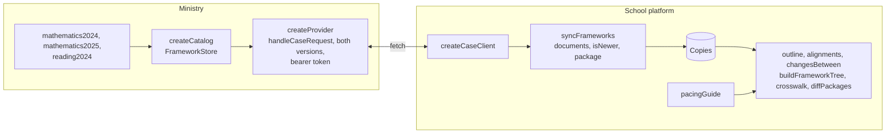

# A ministry and a school platform

A ministry that publishes its standards as CASE frameworks, and a school platform that keeps copies of them, finds what
changed, reads their outline and aligns its own pacing guide with them. The ministry uses the provider of
`@interopkit/competency-frameworks`, the platform uses its client and its graph functions, and both use `@interopkit/core`. They
reach each other through an in-memory network, so the example needs no server, and the handler is the one a host would route a
request to.



| File                       | Holds                                                                                                         |
| -------------------------- | ------------------------------------------------------------------------------------------------------------- |
| `src/ministry.ts`          | The two editions of the mathematics framework, with every class and property of CASE 1.1, and a plain reading framework |
| `src/district.ts`          | The pacing guide of a district, aligned with the standards of the ministry by `exactMatchOf` and `isRelatedTo` |
| `src/identifiers.ts`       | Identifiers, and the addresses that `buildEntityUri` builds                                                    |
| `src/catalog.ts`           | `createCatalog`: a `FrameworkStore` over frameworks in memory, and `publish` for a new edition                |
| `src/provider.ts`          | `createProvider`: the handler for both versions, the check of the bearer token, and a `fetch` that reaches it  |
| `src/consumer.ts`          | `syncFrameworks`, `outline`, `alignments` and `changesBetween`                                                |
| `scenario.ts`              | `runScenario`: the platform against the ministry, from the first listing to the second edition                |
| `test/`                    | The tests, which CI runs, the conformance tests that read the downloaded schemas, and the flows against OpenSALT |

## Rules of the example

| Rule                | Value                                                                                                                                       |
| ------------------- | ------------------------------------------------------------------------------------------------------------------------------------------- |
| Freshness           | A copy is fetched when the `lastChangeDateTime` of the document is later than its own (`isNewer`); the list of documents alone says so      |
| Both versions       | The ministry serves `/ims/case/v1p1` and `/ims/case/v1p0`; a consumer of 1.0 gets 12 of the 14 associations, since 1.0 cannot say two of them |
| Credentials         | The provider asks for `Authorization: Bearer <token>` on everything but the discovery file; no credential is 401 and a wrong one is 403   |
| Discovery           | The host supplies the OpenAPI file of 1EdTech; the scenario uses a stand-in with its shape, since a specification file is not committed    |
| A set               | A concept, a subject and an item type are answered with the entity and its children one level down                                         |
| Text                | Statements are Markdown and LaTeX; the example carries them and renders nothing, as the model guide tells a consumer to render them safely  |
| Where a real host differs | Its frameworks are in a database, its token comes from an authorization server, and its discovery file is the one 1EdTech publishes |

To run the scenario, build the packages, then start it. It prints what the platform saw, as JSON:

```sh
pnpm build
pnpm --filter @interopkit/example-competency-frameworks start
```

The tests run with the rest of the repository (`pnpm test`), or alone with
`pnpm exec vitest run --project example-competency-frameworks`. The conformance tests read the schemas and the OpenAPI file of
CASE (`pnpm schemas`, then `pnpm exec vitest run --project example-competency-frameworks-corpus`): every endpoint of the OpenAPI
file answers with a body its schema accepts, in both versions, and every property of every class is in the data. The flows
against OpenSALT run with `pnpm opensalt` ([validation/opensalt](../../validation/opensalt/README.md)). The scenario uses web
standards only, so the runtimes of `compat/` run it unchanged.

CASE® is a trademark of 1EdTech® Consortium, Inc. (1edtech.org).
interopkit is not affiliated with, endorsed by or approved by 1EdTech Consortium, Inc.
