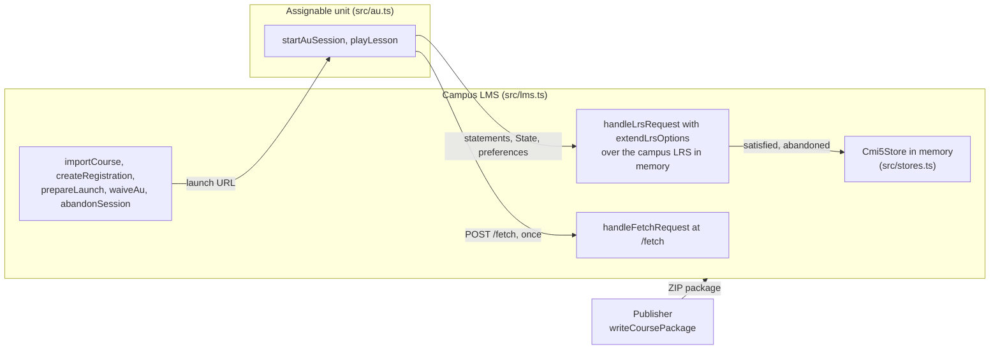

# A cmi5 LMS and its units

A campus that launches cmi5 courses. A publisher writes a geology course as a ZIP package, the campus LMS reads it, imports it,
registers Ana and Budi, and launches its units; each unit starts from its launch URL with the runtime of
`@interopkit/course-launch/au` and plays its session against the LMS. The LMS is `@interopkit/course-launch/lms` over the campus
LRS in memory of `examples/learning-records`, made the LRS of cmi5 by `extendLrsOptions`. Everything reaches everything else
through an in-memory network, so the scenario needs no server.



| File            | Holds                                                                                                                                               |
| --------------- | --------------------------------------------------------------------------------------------------------------------------------------------------- |
| `src/lms.ts`    | `createLms`: the store, the LMS's own client of xAPI in the same process, the LRS of cmi5, the fetch URL and the administrator who reads everything |
| `src/stores.ts` | `createMemoryCmi5Store`: the `Cmi5Store` in memory, whose puts compare the revision                                                                 |
| `src/au.ts`     | `openUnit` and `playLesson`: what the page of a unit does with the runtime                                                                          |
| `src/course.ts` | The `cmi5.xml` of the geology course                                                                                                                |
| `scenario.ts`   | `runScenario`: the package, the registrations, a lesson, a reload, a review, a relaunch and a waiver                                                |

```bash
pnpm --filter @interopkit/example-course-launch start
```

IEEE is a trademark of the Institute of Electrical and Electronics Engineers, Inc.
interopkit is not affiliated with, endorsed by or approved by IEEE or ADL.
