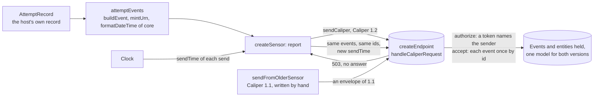

# A sensor and an endpoint for learning analytics

A host that reports an attempt at an assessment and its grade as Caliper events, sends them again when the endpoint fails, and
receives them at an endpoint of its own, with an older sensor that still sends Caliper 1.1. It uses
`@interopkit/learning-analytics` and `@interopkit/core` and nothing else: its `AttemptRecord` is the host's own record, and the
mapping from it to Caliper events is the part that a host writes for its product.



| File                    | Holds                                                                                                  |
| ----------------------- | ------------------------------------------------------------------------------------------------------ |
| `src/attempt.ts`        | `AttemptRecord`: the attempt as the host keeps it                                                      |
| `src/attempt-events.ts` | `attemptEvents`: Started, Submitted and Graded events from a record, with identifiers from the attempt |
| `src/sensor.ts`         | `createSensor`: sends the events, sends them again after a failure that a resend can cure, and pings the endpoint |
| `src/endpoint.ts`       | `createEndpoint`: `handleCaliperRequest` over a table of tokens and a store in memory, and a `fetch` for a sender in the same process |
| `src/legacy-sensor.ts`  | `sendFromOlderSensor`: posts an envelope of Caliper 1.1 as an older product writes it, with `callService` |
| `scenario.ts`           | `runScenario`: the sensor reports to an endpoint that answers 503 and then 200; an older sensor reports; two senders are refused |
| `test/`                 | The tests, which CI runs                                                                               |

## Rules of the sensor

| Rule                | Value                                                                                                                       |
| ------------------- | --------------------------------------------------------------------------------------------------------------------------- |
| Identifiers         | `mintUrn` of the kind of event and the attempt: reporting an attempt again gives the same identifiers                       |
| What an attempt has | Started always; Submitted once `submittedAt` is set; Graded once `grade` is set                                             |
| Resend              | After status 0 or 500 and above, at most `MAX_ATTEMPTS` (3) sends in all, with the same events and the time of the new send |
| No resend           | After any other status (401, 415, 422, a redirect) and after an abort: the same envelope would get the same answer          |
| Backoff             | None. A host puts the delay of its own queue between the sends                                                              |
| Token               | Optional: an endpoint that asks for none gets no `Authorization` header                                                     |
| Size                | `maxPayloadBytes`, from the configuration that `ping` reads: an envelope above it is refused before any request and not sent again |
| Actor               | The opaque IRI of the learner, never an email address or a name                                                             |
| Data                | Times, IRIs and the score. No response and no answer key                                                                    |

## Rules of the endpoint

| Rule                | Value                                                                                                                                      |
| ------------------- | ------------------------------------------------------------------------------------------------------------------------------------------ |
| Who sends           | `authorize` finds the token in the table and names the sender; the `sensor` of the envelope is only what the sender says of itself        |
| An event            | Kept once by its `id`; a copy that arrives again is counted and dropped, since Caliper defines no deduplication                           |
| An entity describe  | Replaces the entity of that `id`; an entity with no `id` is not kept, since it means something only inside another entity                  |
| Both versions       | An envelope of 1.2 or of 1.1 is read into the same model; `versions` limits what the endpoint reads, and the rest is answered 422        |
| What does not read  | Left out of what is kept, and the endpoint records the findings with their paths inside the envelope                                      |
| Address             | `fetch` answers one URL: the origin and path it was made for                                                                              |
| Storage             | Memory. A host keeps the events in the store of its own                                                                                    |

To run the scenario, build the packages, then start it. It prints the status, the time of sending and the item identifiers of
each send, what the endpoint holds for each sender, and the refusals:

```sh
pnpm build
pnpm --filter @interopkit/example-learning-analytics start
```

The tests run with the rest of the repository (`pnpm test`), or alone with
`pnpm exec vitest run --project example-learning-analytics`. The scenario uses web standards only, so the runtimes of
`compat/` run it unchanged.
