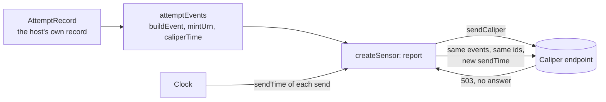

# A sensor for learning analytics

A host that reports an attempt at an assessment and its grade as Caliper events, and sends them again when the endpoint
fails. It uses `@interopkit/learning-analytics` and `@interopkit/core` and nothing else: its `AttemptRecord` is the host's
own record, and the mapping from it to Caliper events is the part that a host writes for its product.



| File                    | Holds                                                                                                  |
| ----------------------- | ------------------------------------------------------------------------------------------------------ |
| `src/attempt.ts`        | `AttemptRecord`: the attempt as the host keeps it                                                      |
| `src/attempt-events.ts` | `attemptEvents`: Started, Submitted and Graded events from a record, with identifiers from the attempt |
| `src/sensor.ts`         | `createSensor`: sends the events, and sends them again after a failure that a resend can cure          |
| `scenario.ts`           | `runScenario`: an endpoint that answers 503 and then 200, and the sensor that reports to it            |
| `test/`                 | The tests, which CI runs                                                                               |

## Rules of the sensor

| Rule                | Value                                                                                                                       |
| ------------------- | --------------------------------------------------------------------------------------------------------------------------- |
| Identifiers         | `mintUrn` of the kind of event and the attempt: reporting an attempt again gives the same identifiers                       |
| What an attempt has | Started always; Submitted once `submittedAt` is set; Graded once `grade` is set                                             |
| Resend              | After status 0 or 500 and above, at most `MAX_ATTEMPTS` (3) sends in all, with the same events and the time of the new send |
| No resend           | After any other status (401, 415, 422, a redirect) and after an abort: the same envelope would get the same answer          |
| Backoff             | None. A host puts the delay of its own queue between the sends                                                              |
| Actor               | The opaque IRI of the learner, never an email address or a name                                                             |
| Data                | Times, IRIs and the score. No response and no answer key                                                                    |

To run the scenario, build the packages, then start it. It prints the status, the time of sending and the event identifiers of
each send:

```sh
pnpm build
pnpm --filter @interopkit/example-learning-analytics start
```

The tests run with the rest of the repository (`pnpm test`), or alone with
`pnpm exec vitest run --project example-learning-analytics`. The scenario uses web standards only, so the runtimes of
`compat/` run it unchanged.
