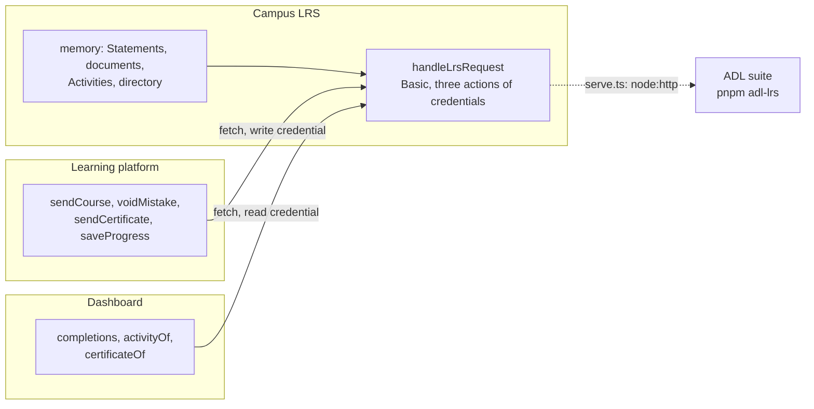

# A campus LRS

A campus that keeps its learning records in an LRS. Its learning platform sends what two learners did in a course, a signed
certificate and the page each learner reached, and its dashboard reads them. The LRS answers with `handleLrsRequest` of
`@interopkit/learning-records/store` over stores in memory, with HTTP Basic; the platform and the dashboard use
`createLrsClient`. They reach each other through an in-memory network, so the scenario needs no server; `serve.ts` puts the same
LRS on a port for a conformance suite.



| File                | Holds                                                                                                                        |
| ------------------- | ---------------------------------------------------------------------------------------------------------------------------- |
| `src/lrs.ts`        | `createLrs`: the handler over the stores, the check of the Basic credentials, and a `fetch` that reaches it                  |
| `src/statements.ts` | `createMemoryStatements`: a `StatementStore` and an `ActivityStore` in memory                                                |
| `src/documents.ts`  | `createMemoryDocuments` and `createDirectory`: a `DocumentStore` and an `AgentStore` in memory                               |
| `src/server.ts`     | `serve`: the adapter of `node:http` to the handler, which a host writes for its web framework                                |
| `src/campus.ts`     | The learners, the course, the verbs, and the ids that come from an event                                                     |
| `src/platform.ts`   | What the learning platform sends: the course, a voided mistake, a signed certificate with its Attachment, and progress       |
| `src/dashboard.ts`  | What the dashboard asks: completions in pages, the verbs of a learner as `ids`, and a certificate with its signature checked |
| `scenario.ts`       | `runScenario`: the platform and the dashboard against the LRS, from the first request to the last                            |
| `serve.ts`          | Starts the LRS on the loopback address with the user and password of the environment                                         |
| `test/`             | The tests of the stores, the scenario and the LRS over HTTP                                                                  |

## Rules of the example

| Rule                      | Value                                                                                                                                                    |
| ------------------------- | -------------------------------------------------------------------------------------------------------------------------------------------------------- |
| Credentials               | HTTP Basic through `readBasicAuthorization`; no credential and a wrong one are 401 with a `WWW-Authenticate`, and a credential without the action is 403 |
| Actions                   | The platform may read and write; the dashboard may read                                                                                                  |
| About                     | Answered to anyone, with no credential: the host's `access` allows it, as the ADL suite asks it without one                                              |
| Ids                       | A Statement has an id that comes from its event, so that a resend of a batch is the same Statements and nothing is stored twice                          |
| Voiding                   | The platform voids a mistake with `buildVoidingStatement`; a query by id no longer finds it, and a query for voided Statements does                           |
| Concurrency               | Progress is a State document: created with `If-None-Match: *`, replaced under the tag that was read, so a stale copy is 412                              |
| Activities                | The first sender of an Activity defines it, only that authority adds to it, and the languages of every Statement are joined                              |
| Where a real host differs | Its stores are a database with an index on what a query filters by, its credentials come from an account system, and its clock is the system's           |

To run the scenario, build the packages, then start it. It prints what the platform and the dashboard saw, as JSON:

```sh
pnpm build
pnpm --filter @interopkit/example-learning-records start
```

To put the LRS on a port, `LRS_USER=me LRS_PASSWORD=secret LRS_PORT=8080 pnpm --filter @interopkit/example-learning-records serve`
prints its address. The tests run with the rest of the repository (`pnpm test`), or alone with
`pnpm exec vitest run --project example-learning-records`. The conformance suite of ADL runs with `pnpm adl-lrs`
([validation/adl-lrs](../../validation/adl-lrs/README.md)). The scenario uses web standards only, so the runtimes of `compat/` run
it unchanged.

interopkit is not affiliated with, endorsed by or approved by ADL.
