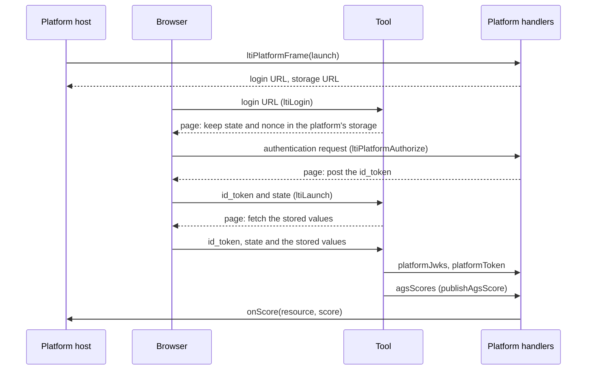

# A platform and a tool

A platform that launches a tool, and the tool that validates the launch and publishes a score, in one process. The platform uses
the platform role of `@interopkit/tool-integration`, the tool uses the tool role, and both use `@interopkit/core`. They reach each
other through an in-memory network, so the example needs no server, and each handler is the one a host would route a request to.



| File              | Holds                                                                                                                                     |
| ----------------- | ----------------------------------------------------------------------------------------------------------------------------------------- |
| `src/platform.ts` | `createPlatform`: the keys, the registration of the tool, the ledger of single-use identifiers, and one handler for the platform's origin |
| `src/tool.ts`     | `createTool`: the registration of the platform, the store of logins, and one handler for the tool's routes                                |
| `src/network.ts`  | `connect`: a `fetch` that reaches the handler of an origin, and `plainRequest`                                                            |
| `src/keys.ts`     | The RSA and HMAC keys that each side generates for itself                                                                                 |
| `scenario.ts`     | `runScenario`: the steps of the browser, and what each side saw                                                                           |
| `test/`           | The tests, which CI runs                                                                                                                  |

## Rules of the example

| Rule                      | Value                                                                                                                                   |
| ------------------------- | --------------------------------------------------------------------------------------------------------------------------------------- |
| Keys                      | Generated at each run with Web Crypto; the platform has the tool's public key, not a URL of the tool's key set                          |
| Time                      | A fixed `Clock`, so that the tokens of both sides agree                                                                                 |
| Single use                | The platform's `once` is a set: the same authentication request a second time is `hint-used`                                            |
| Where a real host differs | Its stores are shared across processes, its routes sit behind its own sessions, and the page of the client-side login runs in a browser |

To run the scenario, build the packages, then start it. It prints what each side saw:

```sh
pnpm build
pnpm --filter @interopkit/example-tool-integration start
```
