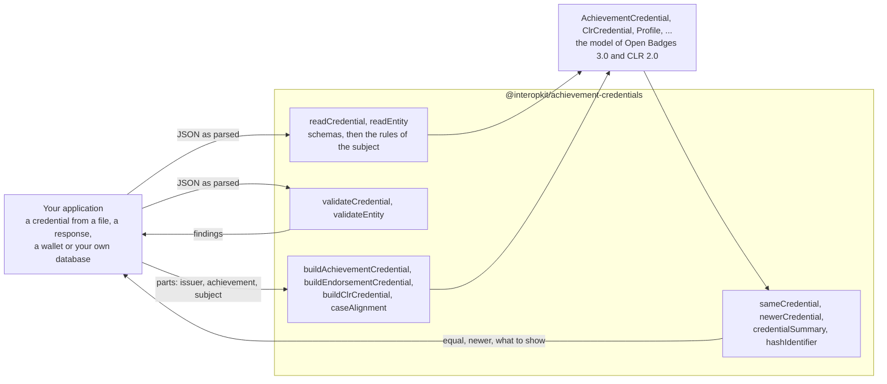

# @interopkit/achievement-credentials

Open Badges [3.0](https://www.imsglobal.org/spec/ob/v3p0/main/) and the Comprehensive Learner Record
[2.0](https://www.imsglobal.org/spec/clr/v2p0/main/): the model of an achievement credential, of a CLR and of the APIs that
exchange them, under both versions of the Verifiable Credentials Data Model, and readers that check them against the JSON
schemas of 1EdTech and the rules of the specifications. Validators list every finding. Builders write the credentials that an
issuer awards, and functions hash the identity of a recipient, compare two credentials and summarize one for display. It knows
nothing of any product: the host says where a credential comes from and what it is for.



It runs in Node.js, browsers, Deno, Bun and edge runtimes such as Cloudflare Workers: it uses web standards only, reads no
environment variable, writes no log and makes no request. Its dependencies are `@interopkit/core`,
[valibot](https://valibot.dev) and [@noble/hashes](https://github.com/paulmillr/noble-hashes).

```bash
npm install @interopkit/achievement-credentials
```

## API

| Subpath                               | Exports                                                                                                                                                                                                            |
| ------------------------------------- | ------------------------------------------------------------------------------------------------------------------------------------------------------------------------------------------------------------------ |
| `@interopkit/achievement-credentials` | `readCredential`, `readEntity`, `ReadOptions`: read a credential or another object of the model, and throw `DataError` on an error                                                                                 |
|                                       | `validateCredential`, `validateEntity`, `CredentialIssue`: judge a value and return every finding, errors and warnings, as data                                                                                    |
|                                       | `buildAchievementCredential`, `buildEndorsementCredential`, `buildClrCredential`, `AchievementCredentialInput`, `EndorsementCredentialInput`, `ClrCredentialInput`: write a credential from its parts and check it |
|                                       | `caseAlignment`, `CaseItem`: the `Alignment` of an achievement to an item of a CASE framework                                                                                                                      |
|                                       | `hashIdentifier`, `matchesIdentifier`, `IdentityObjectV2`, `KnownIdentity`: the `sha256$` hash of a recipient's identity, and whether a recipient is a known identity                                              |
|                                       | `sameCredential`, `newerCredential`, `credentialSummary`, `CredentialSummary`: equality and replacement as Open Badges 10, and what a wallet shows                                                                 |
|                                       | `AchievementCredential`, `EndorsementCredential`, `ClrCredential`, `VerifiableCredential`, `Achievement`, `Profile` and the other classes of Open Badges and CLR: the model                                        |
|                                       | `AchievementCredentialV1p1`, `EndorsementCredentialV1p1`, `ClrCredentialV1p1`, `VerifiableCredentialV1p1`: the credentials under the Verifiable Credentials Data Model 1.1                                         |
|                                       | `GetOpenBadgeCredentialsResponse`, `GetClrCredentialsResponse`, `ImsxStatusInfo`, `ServiceDescriptionDocument`, `Multikey`, `JWK`, `JWKS`: the models of the APIs and of keys                                      |
|                                       | `CREDENTIAL_KINDS`, `ENTITY_KINDS`, `CONTEXTS`, `ACHIEVEMENT_TYPES`, `ALIGNMENT_TARGET_TYPES`, `IDENTIFIER_TYPES`, `RESULT_TYPES`, `AUTHORIZATION_ERRORS` and the other vocabularies                               |
|                                       | `IssuableCredential`, `CredentialV1p1`, `AnyCredential`, `Entity`, `CredentialKind`, `EntityKind`, `ExtensionTerm` and the types of the vocabularies                                                               |

```ts
import { readCredential, validateCredential } from "@interopkit/achievement-credentials";

const input = {
  "@context": ["https://www.w3.org/ns/credentials/v2", "https://purl.imsglobal.org/spec/ob/v3p0/context-3.0.3.json"],
  id: "https://example.edu/credentials/3732",
  type: ["VerifiableCredential", "OpenBadgeCredential"],
  issuer: { id: "https://example.edu/issuers/565049", type: ["Profile"], name: "Example University" },
  validFrom: "2024-06-13T18:46:03Z",
  credentialSubject: {
    type: ["AchievementSubject"],
    identifier: [
      { type: "IdentityObject", hashed: false, identityHash: "learner@example.edu", identityType: "emailAddress" },
    ],
    achievement: {
      id: "https://example.edu/achievements/1",
      type: ["Achievement"],
      name: "Introduction to Fractions",
      description: "Understands fractions as numbers.",
      criteria: { narrative: "Pass the final assessment." },
    },
  },
  evidence: { type: ["Evidence"], narrative: "A portfolio of worked problems." },
};
const credential = readCredential(input);
credential.evidence?.length; // => 1
Object.is(credential, input); // => false

validateCredential(credential); // => []
validateCredential({ ...input, validFrom: "2024-06-13", credentialSubject: { type: ["AchievementSubject"] } }).map((finding) => `${finding.severity} ${finding.rule} at ${finding.path}`); // => ["error missing-property at credentialSubject.achievement", "error invalid-format at validFrom"]
```

`readCredential` and `readEntity` return the model, or throw a `DataError` that names the path of the first error and counts
the others. `validateCredential` and `validateEntity` do not throw for a value, and return each finding with its `path`, its
`rule`, a `message` and its `severity`. A warning does not keep a value from being read. The result is the data model: a list
that the compacted form of JSON-LD writes as its only member is a list in it.

## What this version includes

| Part of Open Badges and CLR           | Included                                                                                                                                               |
| ------------------------------------- | ------------------------------------------------------------------------------------------------------------------------------------------------------ |
| Credential classes, 3.0 and CLR 2.0   | Every class of OB B.1 and CLR B.1: the credentials, subjects, profiles, achievements, results, alignments, evidence, proofs and the rest               |
| Verifiable Credentials Data Model 1.1 | The eight classes of OB B.9 and their CLR counterparts: `issuanceDate`, `expirationDate`, contexts 3.0.0 to 3.0.2                                      |
| API, key and security models          | The answers of `getCredentials`, `imsx_StatusInfo`, the service description, Multikey, JWK, JWKS, the CLR JWT payloads and the OAuth error terms       |
| Vocabularies                          | The five enumerations with `ext:` terms, the CLR association types, the codes of a status                                                              |
| Rules of the specifications           | A subject that something identifies, an identity hash in a form that the specification names                                                           |
| Builders                              | An AchievementCredential, an EndorsementCredential and a ClrCredential, or the payload of a CLR in a JWT, with the contexts, types and official schema |
| Recipients and comparison             | `sha256$` hashes, `sha256$` and `md5$` matching, credential equality and the newer credential, a summary for display                                   |

[The model guide](https://github.com/interopkit/interopkit/blob/main/docs/achievement-credentials/model.md) and
[the builders guide](https://github.com/interopkit/interopkit/blob/main/docs/achievement-credentials/issue.md) have the options with
their defaults, the findings and their rules, the limits, the errors and what to do about them, what is not included and
why, and the differences from the references.

## License

[Apache-2.0](LICENSE). Copyright Fariz Wakan. Open Badges, CLR and 1EdTech are trademarks of 1EdTech Consortium, Inc.; see
[NOTICE](NOTICE). This package implements Open Badges 3.0 and CLR 2.0 and is not certified by 1EdTech.
