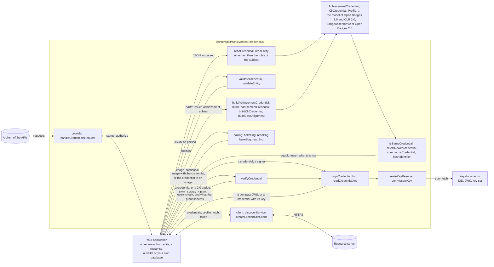

# @interopkit/achievement-credentials

Open Badges [3.0](https://www.imsglobal.org/spec/ob/v3p0/main/) and the Comprehensive Learner Record
[2.0](https://www.imsglobal.org/spec/clr/v2p0/main/): the model of an achievement credential, of a CLR and of the APIs that
exchange them, under both versions of the Verifiable Credentials Data Model, and readers that check them against the JSON
schemas of 1EdTech and the rules of the specifications. Validators list every finding. Builders write the credentials that an
issuer awards, and functions hash the identity of a recipient, compare two credentials and summarize one for display. A credential
can be baked into a PNG or an SVG image and read out of one, a client talks to the Open Badges and CLR APIs of a server, and a
provider answers them as the server, over the host's stores. Keys
resolve from DIDs and HTTPS documents, a key is bound to the issuer that publishes it, and a credential is signed and read as a
JSON Web Token. A credential, its endorsements and the credentials of a CLR are verified as Open Badges and CLR say: the proof,
the issuer's hold on the key, the status, the validity and the recipient. The readers also read [Open Badges 2.0](https://www.imsglobal.org/sites/default/files/Badges/OBv2p0Final/index.html)
assertions with their BadgeClass and issuer, which are read, found in images and verified, hosted or signed, and never written. It knows nothing of any product: the host says where a credential comes from and what it is for.



It runs in Node.js, browsers, Deno, Bun and edge runtimes such as Cloudflare Workers: it uses web standards only, reads no
environment variable and writes no log. It reaches the network only through a `fetch` that you pass. Its dependencies are
`@interopkit/core`, [valibot](https://valibot.dev), [@noble/hashes](https://github.com/paulmillr/noble-hashes),
[saxes](https://github.com/lddubeau/saxes), which `/baking` loads, [jose](https://github.com/panva/jose), the key and Data Integrity
libraries of the [Interop Alliance](https://github.com/interop-alliance) and `@interopkit/selective-disclosure`; it needs Node.js 24
or later.

```bash
npm install @interopkit/achievement-credentials
```

## API

| Subpath                               | Exports                                                                                                                                                                                                            |
| ------------------------------------- | ------------------------------------------------------------------------------------------------------------------------------------------------------------------------------------------------------------------ |
| `@interopkit/achievement-credentials` | `readCredential`, `readEntity`, `ReadOptions`: read a credential or another object of the model, and throw `DataError` on an error                                                                                 |
|                                       | `validateCredential`, `validateEntity`, `CredentialIssue`: judge a value and return every finding, errors and warnings, as data                                                                                    |
|                                       | `buildAchievementCredential`, `buildEndorsementCredential`, `buildClrCredential`, `AchievementCredentialInput`, `EndorsementCredentialInput`, `ClrCredentialInput`: write a credential from its parts and check it |
|                                       | `buildCaseAlignment`, `CaseItem`: the `Alignment` of an achievement to an item of a CASE framework                                                                                                                      |
|                                       | `hashIdentifier`, `matchesIdentifier`, `KnownIdentity`: the `sha256$` hash of a recipient's identity, and whether a recipient of 3.0 or 2.0 is a known identity                                                    |
|                                       | `isSameCredential`, `selectNewerCredential`, `summarizeCredential`, `CredentialSummary`: equality and replacement as Open Badges 10, and what a wallet shows                                                                 |
|                                       | `AchievementCredential`, `EndorsementCredential`, `ClrCredential`, `VerifiableCredential`, `Achievement`, `Profile` and the other classes of Open Badges and CLR: the model                                        |
|                                       | `AchievementCredentialV1p1`, `EndorsementCredentialV1p1`, `ClrCredentialV1p1`, `VerifiableCredentialV1p1`: the credentials under the Verifiable Credentials Data Model 1.1                                         |
|                                       | `BadgeAssertionV2`, `AssertionV2`, `BadgeClassV2`, `ProfileV2`, `IdentityObjectV2`, `VerificationObjectV2` and the other classes of Open Badges 2.0, which the readers read and nothing writes                       |
|                                       | `GetOpenBadgeCredentialsResponse`, `GetClrCredentialsResponse`, `ImsxStatusInfo`, `ServiceDescriptionDocument`, `Multikey`, `JWK`, `JWKS`: the models of the APIs and of keys                                      |
|                                       | `KeyResolver`, `VerificationKey`, `VerificationCheck`, `VerificationResult`, `ProofResult`, `ContextLoader`, `DataIntegritySuite`, `SuiteVerifyOptions`, `JsonLdIssue`, `KEY_RELATIONSHIPS`, `VERIFICATION_CHECKS`, `CHECK_OUTCOMES`: the terms of verification |
|                                       | `CREDENTIAL_KINDS`, `ENTITY_KINDS`, `CONTEXTS`, `ACHIEVEMENT_TYPES`, `ALIGNMENT_TARGET_TYPES`, `IDENTIFIER_TYPES`, `RESULT_TYPES`, `AUTHORIZATION_ERRORS`, `IDENTITY_TYPES_V2`, `VERIFICATION_TYPES_V2` and the other vocabularies |
|                                       | `IssuableCredential`, `CredentialV1p1`, `AnyVerifiableCredential`, `AnyCredential`, `Entity`, `CredentialKind`, `EntityKind`, `ExtensionTerm` and the types of the vocabularies                                      |
|                                       | `BakedCredential`, `BakedKind`, `FoundKind`: a credential read from an image, and its kind                                                                                                                                      |
|                                       | `CredentialApi`, `CREDENTIAL_APIS`, `CredentialsClient`, `CredentialsClientOptions`, `ServiceDescription`, `DiscoverOptions`: the types of the client                                                               |
|                                       | `CredentialsProviderOptions`, `CredentialsAccess`, `CredentialStore`, `CredentialsPage`, `CredentialList`, `ReceivedCredential`, `UpsertOutcome`, `ProfileStore`: the types of the provider                        |
| `@interopkit/achievement-credentials/client` | `discoverService`, `createCredentialsClient`, `readStatusInfo`: find the OAuth endpoints of an Open Badges or CLR server, list, add and replace its credentials, and read and replace the profile |
| `@interopkit/achievement-credentials/baking` | `bakePng`, `readPng`, `bakeSvg`, `readSvg`, `BakeImageOptions`, `ReadImageOptions`: write a credential into a PNG or an SVG image and read it out, for Open Badges 3.0 and CLR 2.0, and read an Open Badges 2.0 assertion out |
| `@interopkit/achievement-credentials/keys` | `createKeyResolver`, `KeyResolverOptions`: resolve the key of a `kid` or a verification method (`did:key`, `did:web`, an HTTPS address) and read what an issuer publishes |
|                                       | `verifyIssuerKey`: check that a key belongs to an issuer, as an `issuer` check                                                                                                                                      |
| `@interopkit/achievement-credentials/jwt` | `signCredentialJwt`, `JwtSignOptions`: sign a credential as a JWT over a `Signer`, as Open Badges 8.2 asks                                                                                                         |
|                                       | `readCredentialJwt`, `JwtReadOptions`: verify a compact JWS and read its credential, with the key bound to the issuer                                                                                              |
| `@interopkit/achievement-credentials/data-integrity` | `addProof`, `ProofOptions`: sign a credential with `eddsa-rdfc-2022`, or write the base proof of `ecdsa-sd-2023`                                                                  |
|                                       | `deriveDisclosure`, `DisclosureOptions`: derive a disclosure from a base proof                                                                                                                                      |
|                                       | `verifyProof`, `DataIntegrityVerifyOptions`: verify the proofs of a credential, with the key bound to the issuer                                                                                                  |
|                                       | `validateJsonLd`: what JSON-LD safe mode would drop                                                                                                                                                                 |
|                                       | `createContextLoader`, `ContextLoaderOptions`, `KNOWN_CONTEXTS`: contexts only at their pins                                                                                                                       |
| `@interopkit/achievement-credentials/status` | `createStatusList`, `allocateStatusIndex`, `setCredentialStatus`, `StatusList`: a Bitstring Status List as plain data, a free index at random, an entry set or cleared                  |
|                                       | `issueStatusListCredential`, `StatusListCredentialInput`, `StatusIssueOptions`: the credential that holds the list, as a JWS or with a Data Integrity proof                               |
|                                       | `verifyCredentialStatus`, `StatusCheckOptions`, `createStatusListCache`, `StatusListCache`: the validate algorithm with its codes, and list credentials kept across verifications          |
| `@interopkit/achievement-credentials/refresh` | `refreshCredential`, `RefreshOptions`: get the newer version of a credential from its refresh service                                                                              |
|                                       | `handleRefreshRequest`, `RefreshHandlerOptions`: answer a request to refresh, for the issuer                                                                                                        |
| `@interopkit/achievement-credentials/verify` | `verifyCredential`, `VerifyOptions`, `KnownRecipient`: verify a credential, an endorsement or a CLR as Open Badges 9 and CLR 8 say, or a 2.0 badge as Open Badges 2.0 says, and return every check as data |
| `@interopkit/achievement-credentials/provider` | `handleCredentialsRequest`, `CredentialsProviderOptions`: answer the Open Badges API or the CLR Standard API as the resource server, over a `CredentialStore`, a `ProfileStore` and the host's `authorize` |
|                                       | `CredentialStore`, `CredentialsPage`, `CredentialList`, `ReceivedCredential`, `UpsertOutcome`, `ProfileStore`, `CredentialsAccess`: what the provider needs from the host |

```ts
import { readCredential, validateCredential } from "@interopkit/achievement-credentials";

const input = {
  "@context": ["https://www.w3.org/ns/credentials/v2", "https://purl.imsglobal.org/spec/ob/v3p0/context-3.0.3.json"],
  id: "https://example.edu/credentials/3732",
  type: ["VerifiableCredential", "OpenBadgeCredential"],
  issuer: { id: "https://example.edu/issuers/565049", type: ["Profile"], name: "Example University" },
  validFrom: "2024-06-13T18:46:03Z",
  credentialSubject: {
    type: ["AchievementSubject"],
    identifier: [
      { type: "IdentityObject", hashed: false, identityHash: "learner@example.edu", identityType: "emailAddress" },
    ],
    achievement: {
      id: "https://example.edu/achievements/1",
      type: ["Achievement"],
      name: "Introduction to Fractions",
      description: "Understands fractions as numbers.",
      criteria: { narrative: "Pass the final assessment." },
    },
  },
  evidence: { type: ["Evidence"], narrative: "A portfolio of worked problems." },
};
const credential = readCredential(input, { kind: "AchievementCredential" });
credential.evidence?.length; // => 1
Object.is(credential, input); // => false

validateCredential(credential); // => []
validateCredential({ ...input, validFrom: "2024-06-13", credentialSubject: { type: ["AchievementSubject"] } }).map((finding) => `${finding.severity} ${finding.rule} at ${finding.path}`); // => ["error missing-property at credentialSubject.achievement", "error invalid-format at validFrom"]
```

`readCredential` and `readEntity` return the model, or throw a `DataError` that names the path of the first error and counts
the others. `validateCredential` and `validateEntity` do not throw for a value, and return each finding with its `path`, its
`rule`, a `message` and its `severity`. A warning does not keep a value from being read. The result is the data model: a list
that the compacted form of JSON-LD writes as its only member is a list in it.

## What this version includes

| Part of Open Badges and CLR           | Included                                                                                                                                               |
| ------------------------------------- | ------------------------------------------------------------------------------------------------------------------------------------------------------ |
| Credential classes, 3.0 and CLR 2.0   | Every class of OB B.1 and CLR B.1: the credentials, subjects, profiles, achievements, results, alignments, evidence, proofs and the rest               |
| Verifiable Credentials Data Model 1.1 | The eight classes of OB B.9 and their CLR counterparts: `issuanceDate`, `expirationDate`, contexts 3.0.0 to 3.0.2                                      |
| API, key and security models          | The answers of `getCredentials`, `imsx_StatusInfo`, the service description, Multikey, JWK, JWKS, the CLR JWT payloads and the OAuth error terms       |
| Vocabularies                          | The five enumerations with `ext:` terms, the CLR association types, the codes of a status                                                              |
| Rules of the specifications           | A subject that something identifies, an identity hash in a form that the specification names                                                           |
| Builders                              | An AchievementCredential, an EndorsementCredential and a ClrCredential, or the payload of a CLR in a JWT, with the contexts, types and official schema |
| Recipients and comparison             | `sha256$` hashes, `sha256$` and `md5$` matching, credential equality and the newer credential, a summary for display                                   |
| Baking                                | A compact JWS or a credential with an embedded proof in an `iTXt` chunk of a PNG or an element of an SVG, for both kinds                                |
| API client                            | Service discovery, `getCredentials` with paging, `upsertCredential`, `getProfile` and `putProfile`, of the Open Badges API and the CLR Standard API        |
| API provider                          | The five operations of both APIs as the resource server: scopes, paging headers, JSON and compact JWS, created, replaced and unchanged, verification before storing |
| Open Badges 2.0                       | An assertion with its BadgeClass and issuer, embedded or as a `BadgeAssertionV2`; the aliases of its context; its rules; `sha256$` and `md5$` recipients; summaries; baked images; hosted and signed verification with the issuer's policy, keys and revocation list |

[The model guide](https://github.com/interopkit/interopkit/blob/main/docs/achievement-credentials/model.md) and
[the builders guide](https://github.com/interopkit/interopkit/blob/main/docs/achievement-credentials/issue.md) and
[the baking guide](https://github.com/interopkit/interopkit/blob/main/docs/achievement-credentials/baking.md) and
[the client guide](https://github.com/interopkit/interopkit/blob/main/docs/achievement-credentials/client.md) and
[the provider guide](https://github.com/interopkit/interopkit/blob/main/docs/achievement-credentials/provider.md) and
[the guide of Open Badges 2.0](https://github.com/interopkit/interopkit/blob/main/docs/achievement-credentials/open-badges-2.md) have the options with
their defaults, the findings and their rules, the limits, the errors and what to do about them, what is not included and
why, and the differences from the references.

[The comparators](https://github.com/interopkit/interopkit/blob/main/docs/achievement-credentials/comparators.md) map what the
validator of 1EdTech and other verifiers of verifiable credentials do against the package.

## License

[Apache-2.0](LICENSE). Copyright Fariz Wakan. Open Badges, CLR and 1EdTech are trademarks of 1EdTech Consortium, Inc.; see
[NOTICE](NOTICE). This package implements Open Badges 3.0 and CLR 2.0, reads and verifies Open Badges 2.0, and is not certified by 1EdTech.
