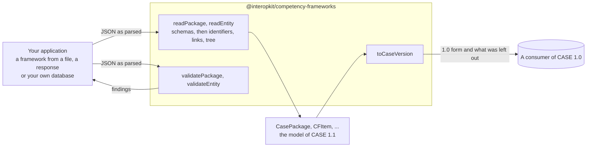

# @interopkit/competency-frameworks

CASE (Competencies and Academic Standards Exchange) [1.1](https://www.imsglobal.org/spec/case/v1p1) and
[1.0](https://www.imsglobal.org/spec/case/v1p0): the model of a competency framework package and of each entity that CASE
exchanges, readers that check them against the JSON schemas of 1EdTech and the rules of a package, validators that list
every finding, and the conversion of 1.1 data to the form of 1.0. It knows nothing of any product: the host says where a
framework comes from and what it is for.



It runs in Node.js, browsers, Deno, Bun and edge runtimes such as Cloudflare Workers: it uses web standards only, reads no
environment variable, writes no log and makes no request. Its dependencies are `@interopkit/core` and
[valibot](https://valibot.dev).

```bash
npm install @interopkit/competency-frameworks
```

## API

| Subpath                             | Exports                                                                                                                                                      |
| ----------------------------------- | ------------------------------------------------------------------------------------------------------------------------------------------------------------ |
| `@interopkit/competency-frameworks` | `readPackage`, `readEntity`, `ReadOptions`: read a package or an entity of either version into the model of 1.1, and throw `DataError` on an error           |
|                                     | `validatePackage`, `validateEntity`, `CaseIssue`: judge a value and return every finding, errors and warnings, as data                                       |
|                                     | `toCaseVersion`, `VersionedValue`, `Converted`: a package or an entity in the form of 1.0, and what was left out                                             |
|                                     | `CasePackage`, `CFPckgDocument`, `CFPckgItem`, `CFPckgAssociation`, `CFDocument`, `CFItem`, `CFAssociation`, `CFDefinition` and the other classes: the model |
|                                     | `ASSOCIATION_TYPES`, `ENTITY_KINDS`, `CaseVersion`, `CaseEntityKind`, `CaseEntity`, `ImsxStatusInfo` and the types of the vocabularies                       |

```ts
import { readPackage, toCaseVersion, validatePackage } from "@interopkit/competency-frameworks";

const input = {
  CFDocument: {
    identifier: "8f3e2a14-4c1b-4d77-9a3e-1b2c3d4e5f60",
    uri: "https://standards.example.org/ims/case/v1p1/CFDocuments/8f3e2a14-4c1b-4d77-9a3e-1b2c3d4e5f60",
    caseVersion: "1.1",
    creator: "Ministry of Education",
    title: "Mathematics",
    lastChangeDateTime: "2024-06-13T18:46:03+00:00",
  },
  CFItems: [
    {
      identifier: "2b6d1c9e-7a53-4e08-b1f4-5c8a9d0e3f21",
      uri: "https://standards.example.org/ims/case/v1p1/CFItems/2b6d1c9e-7a53-4e08-b1f4-5c8a9d0e3f21",
      fullStatement: "Understand fractions as numbers.",
      lastChangeDateTime: "2024-06-13T18:46:03+00:00",
    },
  ],
};
const pkg = readPackage(input);
pkg.CFItems?.length; // => 1
pkg === input; // => false

validatePackage(pkg).map((finding) => `${finding.severity} ${finding.rule} at ${finding.path}`); // => ["warning item-outside-tree at CFItems[0]"]

const old = toCaseVersion(pkg, "1.0");
old.dropped.map((finding) => finding.path); // => ["CFDocument.caseVersion"]
"caseVersion" in old.value.CFDocument; // => false

validatePackage({ CFDocument: { title: 5 } }).map((finding) => `${finding.path} ${finding.rule}`); // => ["CFDocument.identifier missing-property", "CFDocument.uri missing-property", "CFDocument.creator missing-property", "CFDocument.title wrong-type", "CFDocument.lastChangeDateTime missing-property"]
```

`readPackage` and `readEntity` return the model, or throw a `DataError` that names the path of the first error and counts the
others. `validatePackage` and `validateEntity` do not throw for a value, and return each finding with its `path`, its `rule`,
a `message` and its `severity`. A warning does not keep a value from being read.

## What this version includes

| Part of CASE                                  | Included                                                                                                                                                  |
| --------------------------------------------- | --------------------------------------------------------------------------------------------------------------------------------------------------------- |
| Classes of the Information Model, 1.1 and 1.0 | Every class: the package, its document, items, associations, definitions and rubrics, the entities outside a package, the five sets and `imsx_StatusInfo` |
| Vocabularies                                  | The ten association types, `ext:` terms, `targetType`, `caseVersion`, the codes of a status                                                               |
| Package rules                                 | One document, unique identifiers, links that resolve, `isChildOf` without loops, items in the tree                                                        |
| 1.0                                           | Reading it, and the conversion from 1.1 with a report of what 1.0 cannot hold                                                                             |

[The model guide](https://github.com/interopkit/interopkit/blob/main/docs/competency-frameworks/model.md) has the options with
their defaults, the findings and their rules, the limits, the errors and what to do about them, what is not included and
why, and the differences from the references.

## License

[Apache-2.0](LICENSE). Copyright Fariz Wakan. CASE and 1EdTech are trademarks of 1EdTech Consortium, Inc.; see
[NOTICE](NOTICE). This package implements CASE 1.1 and 1.0 and is not certified by 1EdTech.
