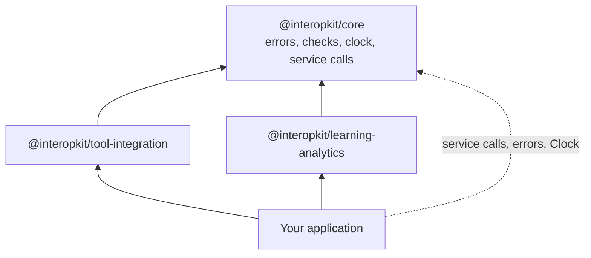

# @interopkit/core

The shared foundation of the interopkit packages: their errors, the checks of their arguments, a clock, and the call to a
service over HTTP with a deadline, a size limit and no redirects. Most users install
[`@interopkit/tool-integration`](https://github.com/interopkit/interopkit/tree/main/packages/tool-integration#readme) or
[`@interopkit/learning-analytics`](https://github.com/interopkit/interopkit/tree/main/packages/learning-analytics#readme),
which depend on it.



It runs in Node.js, browsers, Deno, Bun and edge runtimes such as Cloudflare Workers: it uses web standards only, reads no
environment variable, writes no log, and calls the network only through the `fetch` that the caller passes. Its one
dependency is [valibot](https://valibot.dev).

```bash
npm install @interopkit/core
```

## API

| Subpath                   | Exports                                                                                                                                                                                                                                    |
| ------------------------- | ------------------------------------------------------------------------------------------------------------------------------------------------------------------------------------------------------------------------------------------ |
| `@interopkit/core`        | `InteropkitError`, the base class; `DataError`, for invalid input; `ServiceError`, for a service that fails, with `status` and `body`                                                                                                      |
|                           | `Clock`, `SYSTEM_CLOCK`, `readClock`, `checkClock`                                                                                                                                                                                         |
|                           | `CallOptions`, the `signal` that ends a caller's wait, and `untilAborted`; `Fetch`, `ServiceCall`, `callService`, `DEFAULT_TIMEOUT_MS`                                                                                                     |
| `@interopkit/core/checks` | Checks of one value: `describe`, `isRecord`, `checkRecord`, `checkArray`, `checkFunction`, `checkProperties`, `checkString`, `checkNonEmptyString`, `checkHttpsUrl`, `checkNonNegativeInteger`, `checkPositiveInteger`, `checkAbortSignal` |
|                           | Schemas: `parseWith`, `issueText`, `guardSchema`, `looseRecord`, `mapSchema`, `methodsSchema`, `finiteSchema`, `httpsUrlSchema`, `nonEmptyStringSchema`, `nonNegativeIntegerSchema`, `positiveIntegerSchema`, `positiveSchema`             |

```ts
import { callService, DEFAULT_TIMEOUT_MS } from "@interopkit/core";

const fetch = async () => new Response('{"keys":[]}');
const body = await callService(
  { fetch, timeoutMs: DEFAULT_TIMEOUT_MS },
  "The key set at https://platform.example/jwks",
  "https://platform.example/jwks",
  { method: "GET", headers: { accept: "application/json" } },
);
// => '{"keys":[]}'
```

A call that fails rejects with a `ServiceError` whose `status` is the HTTP status, or 0 when the service did not answer. The
guides say more: [service calls](https://github.com/interopkit/interopkit/blob/main/docs/core/service.md),
[signals](https://github.com/interopkit/interopkit/blob/main/docs/core/signals.md),
[checks](https://github.com/interopkit/interopkit/blob/main/docs/core/checks.md),
[errors](https://github.com/interopkit/interopkit/blob/main/docs/core/errors.md) and
[clock](https://github.com/interopkit/interopkit/blob/main/docs/core/clock.md).

## License

[Apache-2.0](LICENSE). Copyright Fariz Wakan. LTI, Caliper Analytics and 1EdTech are trademarks of 1EdTech Consortium, Inc.;
see [NOTICE](NOTICE).
