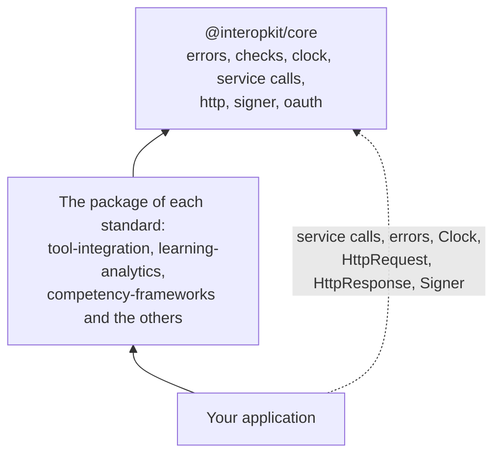

# @interopkit/core

The shared foundation of the interopkit packages: errors, argument checks, bounded HTTP service calls, plain request and
response types, a signing port and OAuth 2.0 clients.

Most users install the package of a standard, such as
[`@interopkit/tool-integration`](https://interopkit.wakan.dev/_interopkit/tool-integration/) or
[`@interopkit/competency-frameworks`](https://interopkit.wakan.dev/_interopkit/competency-frameworks/), which depends on it.

```bash
npm install @interopkit/core
```

## Quick start

```ts
import { callService, DEFAULT_TIMEOUT_MS } from "@interopkit/core";

const fetch = async () => new Response('{"keys":[]}');
const body = await callService(
  { fetch, timeoutMs: DEFAULT_TIMEOUT_MS },
  "The key set at https://platform.example/jwks",
  "https://platform.example/jwks",
  { method: "GET", headers: { accept: "application/json" } },
);
// => '{"keys":[]}'
```

A call that fails rejects with a `ServiceError` whose `status` is the HTTP status, or 0 when the service did not answer.

## Architecture



## API

| Subpath                   | Exports                                                                                                                                                                                                                                                                                                                                                                                                                                                                                                                                                          |
| ------------------------- | ---------------------------------------------------------------------------------------------------------------------------------------------------------------------------------------------------------------------------------------------------------------------------------------------------------------------------------------------------------------------------------------------------------------------------------------------------------------------------------------------------------------------------------------------------------------- |
| `@interopkit/core`        | `InteropkitError`, the base class; `DataError`, for invalid input; `LimitError`, for input over a limit, with `limit` and `maximum`, which a host answers with 413; `ServiceError`, for a service that fails, with `status` and `body`; each takes `ErrorOptions` with the `cause`                                                                                                                                                                                                                                                                               |
|                           | `Clock`, `SYSTEM_CLOCK`, `readClock`, `checkClock`; `Random`, `SYSTEM_RANDOM`; `Signer`, `createCryptoKeySigner`, `signCompactJws`                                                                                                                                                                                                                                                                                                                                                                                                                               |
|                           | `CallOptions`, the `signal` that ends a caller's wait, `raceAbort`, `createKeyedCache` with `KeyedCache` and `KeyedCacheOptions` for shared loads, and `callPort` with `PortOutcome`, which turns the failure of a port into a value; `Fetch`, `ServiceCall`, `ServiceInit`, `ServiceResponse`, `RequestOptions`, `HttpMethod`, `requestService`, `callService`, `DEFAULT_TIMEOUT_MS`, `DEFAULT_MAX_BYTES`; `requestWithCredential` with `CredentialServiceCall`, and `clientOptionsEntries`, for a client whose requests carry a token                          |
|                           | `hasNextPage`, `readRetryAfterSeconds`, `findLinkTarget`: the paging and retry headers of an answer; `readAnswerJson`, `ReadAnswerJsonOptions`, `readAnswer`, `readStatusInfo`, `StatusDetail`, `StatusInfo`, `StatusCodeMinor`, `StatusCodeMinorField`, `STATUS_CODES_MAJOR`, `STATUS_SEVERITIES`: the JSON, the data and the status of an answer, with the one `imsx_StatusInfo` of the REST bindings; `ServiceErrorOptions`, `CryptoKeySignerOptions`                                                                                                         |
| `@interopkit/core/oauth`  | `requestClientCredentialsToken`, `startAuthorization`, `exchangeCode`, `refreshAccessToken`, `revokeToken`, `registerClient`, `createTokenCache`, `TokenCacheOptions`, `GRANT_TYPES`, `GrantType`; `AuthorizationServer`, `OAuthClient`, `ClientAuthentication`, `OAuthCallOptions`, `AccessToken`, `PendingAuthorization`, `AuthorizationRequestParameters`, `ClientMetadata`, `RegisteredClient`                                                                                                                                                               |
| `@interopkit/core/http`   | `HttpRequest`, `HttpResponse`, `checkHttpRequest`, `basePathSchema`; `readText`, `readJson`, `ReadJsonOptions`, `readQuery`, `readForm`, `ReadFormOptions`, `readBearerToken`; `buildJsonResponse`, `JsonResponseOptions`; `readOffsetPage`, `buildPageLinks`, `OffsetPage`, `PageSizes`, `ListExtent`; `buildStatusInfoResponse`, `StatusInfoOptions`, `buildRefusalResponse`, `RefusalCodes`, `RefusalResponseOptions`; `AccessDecision`, `AccessRefusal`, `AccessRefusalReason`, `ACCESS_REFUSAL_STATUSES`, `readAccessDecision`, `ReadAccessDecisionOptions` |
| `@interopkit/core/checks` | Checks of one value: `describe`, `isRecord`, `checkRecord`, `checkArray`, `checkFunction`, `checkProperties`, `checkString`, `checkNonEmptyString`, `checkHttpsUrl`, `checkRemoteUrl`, `checkBaseUrl`, `checkNonNegativeInteger`, `checkPositiveInteger`, `checkAbortSignal`, `readCallOptions`                                                                                                                                                                                                                                                                  |
|                           | Schemas: `parseWith`, `formatIssuePath`, `describeIssue`, `guardSchema`, `looseRecord`, `openRecord`, `strictRecord`, `jsonObjectSchema`, `opaqueJsonObjectSchema`, `opaqueJsonValueSchema`, `abortSignalSchema`, `mapSchema`, `methodsSchema`, `finiteSchema`, `httpsUrlSchema`, `nonEmptyStringSchema`, `nonNegativeIntegerSchema`, `positiveIntegerSchema`, `positiveSchema`, `uuidSchema`, `dateSchema`, `dateTimeSchema`, `absoluteUriSchema`                                                                                                               |
|                           | Formats: `isDate`, `parseDateTime`, `formatDateTime`, `isDateTime`, `findInstant`, `findIsoInstant`, `isUuid`, `isAbsoluteUri`, `isLanguageTag`, `languageTagSchema`. JSON: `copyJson`, `isSameJson`, `JsonValue`, `JsonObject`, `JsonValueCopy`, `JsonObjectCopy`, `MAX_JSON_DEPTH`, `MAX_JSON_TOKENS`, `hasMoreTokensThan`, `findExceededJsonLimit`, `findPrototypeName`, `parseJsonText`, `JsonTextRefusals`, `endOfJsonString`; `Schema`                                                                                                                     |
|                           | Findings: `Finding`, `Issue`, `buildIssues`, `describeRefusal`, `createIssueSink`, `IssueSink`, `safeParseBounded`, `BoundedParse`, `DEFAULT_MAX_FINDINGS`; `JsonTextRefusals`                                                                                                                                                                                                                                                                                                                                                                                   |

## Supported

It runs in Node.js, browsers, Deno, Bun and edge runtimes such as Cloudflare Workers: it uses web standards only, reads no
environment variable, writes no log, and calls the network only through the `fetch` that the caller passes. Its dependencies are
[valibot](https://valibot.dev) and [oauth4webapi](https://github.com/panva/oauth4webapi).

## Documentation

[Choosing](https://interopkit.wakan.dev/_interopkit/core/choosing/) says when the package fits, when another library fits better,
and what each has that the package lacks.

[Performance](https://interopkit.wakan.dev/_interopkit/core/performance/) gives the speed of the hot paths, the size of each
entry point and the peak memory of the readers. The guides:

| Guide                                                                                                                          | Covers                                                                                      |
| ------------------------------------------------------------------------------------------------------------------------------ | ------------------------------------------------------------------------------------------- |
| [Service calls](https://interopkit.wakan.dev/_interopkit/core/service/)                                                        | `requestService`, `callService`, `requestWithCredential`, the headers and body of an answer |
| [Requests and answers](https://interopkit.wakan.dev/_interopkit/core/http/)                                                    | `HttpRequest`, `HttpResponse`, the readers, paging, `imsx_StatusInfo`, access decisions     |
| [Signing](https://interopkit.wakan.dev/_interopkit/core/signer/)                                                               | `Signer`, `createCryptoKeySigner`, `signCompactJws`                                         |
| [OAuth clients](https://interopkit.wakan.dev/_interopkit/core/oauth/)                                                          | The grants, PKCE, revocation, registration and the token cache                              |
| [Signals](https://interopkit.wakan.dev/_interopkit/core/signals/)                                                              | `signal`, `raceAbort`, `callPort`, `createKeyedCache`                                       |
| [Checks](https://interopkit.wakan.dev/_interopkit/core/checks/)                                                                | Checks of one value, schemas, findings, formats and JSON                                    |
| [Errors](https://interopkit.wakan.dev/_interopkit/core/errors/)                                                                | The classes and how a host answers them                                                     |
| [Clock](https://interopkit.wakan.dev/_interopkit/core/clock/), [random](https://interopkit.wakan.dev/_interopkit/core/random/) | `Clock` and `Random`, the ports of time and chance                                          |

## License

[Apache-2.0](https://github.com/interopkit/interopkit/blob/main/packages/core/LICENSE). Copyright Fariz Wakan. See [NOTICE](https://github.com/interopkit/interopkit/blob/main/packages/core/NOTICE).
