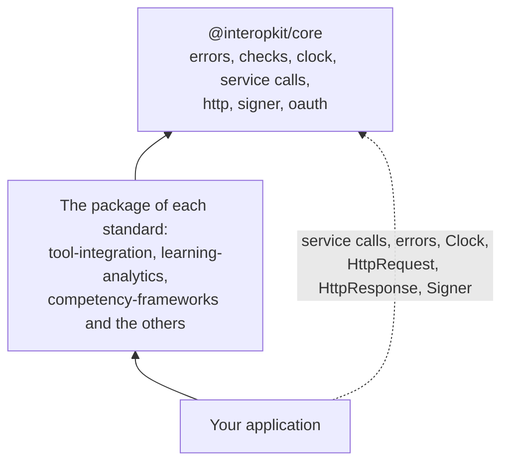

# @interopkit/core

The shared foundation of the interopkit packages: their errors, the checks of their arguments and the findings of their
readers, a clock and a random source, the call to a service over HTTP with a deadline, a size limit and no redirects, requests
and answers as plain data, the signing port, and OAuth 2.0 clients. Most users install the package of a standard, such as
[`@interopkit/tool-integration`](https://github.com/interopkit/interopkit/tree/main/packages/tool-integration#readme) or
[`@interopkit/competency-frameworks`](https://github.com/interopkit/interopkit/tree/main/packages/competency-frameworks#readme),
which depends on it.



It runs in Node.js, browsers, Deno, Bun and edge runtimes such as Cloudflare Workers: it uses web standards only, reads no
environment variable, writes no log, and calls the network only through the `fetch` that the caller passes. Its dependencies are
[valibot](https://valibot.dev) and [oauth4webapi](https://github.com/panva/oauth4webapi).

```bash
npm install @interopkit/core
```

## API

| Subpath                   | Exports                                                                                                                                                                                                                                                                                                                                                                                |
| ------------------------- | -------------------------------------------------------------------------------------------------------------------------------------------------------------------------------------------------------------------------------------------------------------------------------------------------------------------------------------------------------------------------------------- |
| `@interopkit/core`        | `InteropkitError`, the base class; `DataError`, for invalid input; `ServiceError`, for a service that fails, with `status` and `body`                                                                                                                                                                                                                                                  |
|                           | `Clock`, `SYSTEM_CLOCK`, `readClock`, `checkClock`; `Random`, `SYSTEM_RANDOM`; `Signer`, `signerFromCryptoKey`, `signCompactJws`                                                                                                                                                                                                                                                       |
|                           | `CallOptions`, the `signal` that ends a caller's wait, `untilAborted`, `createKeyedCache` with `KeyedCache` and `KeyedCacheOptions` for shared loads, and `callPort` with `PortOutcome`, which turns the failure of a port into a value; `Fetch`, `ServiceCall`, `ServiceInit`, `ServiceResponse`, `RequestOptions`, `HttpMethod`, `requestService`, `callService`, `DEFAULT_TIMEOUT_MS`, `DEFAULT_MAX_BYTES`                                                                                                                                        |
|                           | `totalCountOf`, `hasNextLink`, `retryAfterSeconds`, `linkTarget`: the paging and retry headers of an answer; `ServiceErrorOptions`, `CryptoKeySignerOptions` |
| `@interopkit/core/oauth`  | `clientCredentialsToken`, `authorizationRequest`, `exchangeCode`, `refreshAccessToken`, `revokeToken`, `registerClient`, `createTokenCache`, `TokenCacheOptions`, `GRANT_TYPES`, `GrantType`; `AuthorizationServer`, `OAuthClient`, `ClientAuthentication`, `OAuthCallOptions`, `AccessToken`, `PendingAuthorization`, `AuthorizationRequestParameters`, `ClientMetadata`, `RegisteredClient`                                                                             |
| `@interopkit/core/http`   | `HttpRequest`, `HttpResponse`, `checkHttpRequest`; `readText`, `readJson`, `ReadJsonOptions`, `readQuery`, `readForm`, `ReadFormOptions`; `jsonResponse`; `negotiate`; `readOffsetPage`, `offsetPageLinks`, `OffsetPage`, `PageSizes`, `ListExtent`; `statusInfoResponse`, `StatusInfoOptions`; `AccessDecision`, `AccessRefusal`, `readAccessDecision`, `ReadAccessDecisionOptions`                                                                                                                                                                                                                                                        |
| `@interopkit/core/checks` | Checks of one value: `describe`, `isRecord`, `checkRecord`, `checkArray`, `checkFunction`, `checkProperties`, `checkString`, `checkNonEmptyString`, `checkHttpsUrl`, `checkRemoteUrl`, `checkNonNegativeInteger`, `checkPositiveInteger`, `checkAbortSignal`                                                                                                                                             |
|                           | Schemas: `parseWith`, `pathOf`, `issueText`, `findingsOf`, `Finding`, `guardSchema`, `looseRecord`, `openRecord`, `strictRecord`, `jsonObjectSchema`, `mapSchema`, `methodsSchema`, `finiteSchema`, `httpsUrlSchema`, `remoteUrlSchema`, `nonEmptyStringSchema`, `nonNegativeIntegerSchema`, `positiveIntegerSchema`, `positiveSchema`, `uuidSchema`, `dateSchema`, `dateTimeSchema`, `absoluteUriSchema` |
|                           | Formats: `isDate`, `parseDateTime`, `isDateTime`, `isUuid`, `isAbsoluteUri`, `isLanguageTag`, `languageTagSchema`. JSON: `copyJson`, `JsonValue`, `JsonObject`, `JsonValueCopy`, `JsonObjectCopy`, `MAX_JSON_DEPTH`, `MAX_JSON_TOKENS`, `nestsDeeperThan`, `hasMoreTokensThan`; `Schema` |
|                           | Findings: `Finding`, `findingsOf`, `refusalOf`, `createFindingSink`, `FindingSink`, `safeParseBounded`, `BoundedParse`, `DEFAULT_MAX_FINDINGS` |

```ts
import { callService, DEFAULT_TIMEOUT_MS } from "@interopkit/core";

const fetch = async () => new Response('{"keys":[]}');
const body = await callService(
  { fetch, timeoutMs: DEFAULT_TIMEOUT_MS },
  "The key set at https://platform.example/jwks",
  "https://platform.example/jwks",
  { method: "GET", headers: { accept: "application/json" } },
);
// => '{"keys":[]}'
```

A call that fails rejects with a `ServiceError` whose `status` is the HTTP status, or 0 when the service did not answer. The
guides say more: [service calls](https://github.com/interopkit/interopkit/blob/main/docs/core/service.md),
[requests and answers](https://github.com/interopkit/interopkit/blob/main/docs/core/http.md),
[signing](https://github.com/interopkit/interopkit/blob/main/docs/core/signer.md),
[OAuth clients](https://github.com/interopkit/interopkit/blob/main/docs/core/oauth.md),
[signals](https://github.com/interopkit/interopkit/blob/main/docs/core/signals.md),
[checks](https://github.com/interopkit/interopkit/blob/main/docs/core/checks.md),
[errors](https://github.com/interopkit/interopkit/blob/main/docs/core/errors.md),
[clock](https://github.com/interopkit/interopkit/blob/main/docs/core/clock.md) and
[random](https://github.com/interopkit/interopkit/blob/main/docs/core/random.md).

## License

[Apache-2.0](LICENSE). Copyright Fariz Wakan. LTI, Caliper Analytics and 1EdTech are trademarks of 1EdTech Consortium, Inc.;
see [NOTICE](NOTICE).
