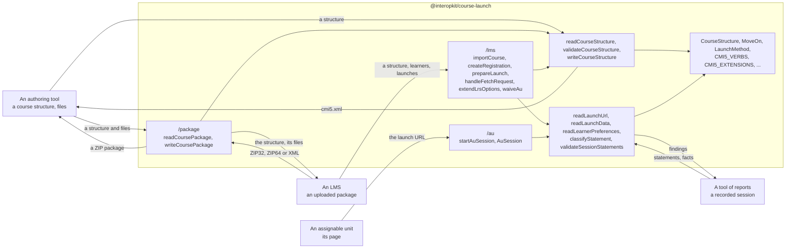

# @interopkit/course-launch

cmi5 for JavaScript and TypeScript: the course structure with its reader, validator and writer, course packages, the LMS role
over an xAPI LRS, and the assignable unit runtime.

[cmi5](https://github.com/AICC/CMI-5_Spec_Current) (Quartz) is the specification of ADL for launching the units of a course and
tracking them with xAPI. The package has its vocabularies, the course structure with a reader that enforces its schema and the
rules of cmi5, a validator that lists every finding and a writer, course packages in ZIP or XML, read within limits and written,
the rules of the statements of a session with the readers of what a launch gives, the LMS role over the LRS of
`@interopkit/learning-records`, and the runtime of an assignable unit. It knows nothing of any product.

```bash
npm install @interopkit/course-launch
```

## Quick start

```ts
import { readCourseStructure } from "@interopkit/course-launch";

const xml = `<courseStructure xmlns="https://w3id.org/xapi/profiles/cmi5/v1/CourseStructure.xsd">
  <course id="https://example.org/courses/geology">
    <title><langstring lang="en-US">Introduction to Geology</langstring></title>
    <description><langstring lang="en-US">Plate tectonics and the history of the Earth.</langstring></description>
  </course>
  <au id="https://example.org/courses/geology/au/1" moveOn="CompletedOrPassed" masteryScore="0.8">
    <title><langstring lang="en-US">Plate tectonics</langstring></title>
    <description><langstring lang="en-US">How the plates move.</langstring></description>
    <url>https://content.example.org/geology/1/index.html</url>
  </au>
</courseStructure>`;
const [unit] = readCourseStructure(xml).children;
unit?.kind === "au" ? [unit.moveOn, unit.masteryScore] : undefined;
// => ["CompletedOrPassed", 0.8]
```

## Architecture



It runs in Node.js, browsers, Deno, Bun and edge runtimes such as Cloudflare Workers: it uses web standards only, reads no
environment variable, writes no log and makes no request but through the client of an LRS that the host passes. Its dependencies
are `@interopkit/core`, `@interopkit/learning-records` (the model and the rules of xAPI, its client and its LRS),
[valibot](https://valibot.dev), [saxes](https://github.com/lddubeau/saxes), [uuid](https://github.com/uuidjs/uuid) (`/lms`) and
[zip.js](https://gildas-lormeau.github.io/zip.js/) (`/package`).

## API

| Subpath                             | Exports                                                                                                                                                                                                                                                                                                                                                                                                                                                                                                                                                                                                                                                |
| ----------------------------------- | ------------------------------------------------------------------------------------------------------------------------------------------------------------------------------------------------------------------------------------------------------------------------------------------------------------------------------------------------------------------------------------------------------------------------------------------------------------------------------------------------------------------------------------------------------------------------------------------------------------------------------------------------------ |
| `@interopkit/course-launch`         | `readCourseStructure`, `validateCourseStructure`, `writeCourseStructure`, `CourseReadOptions`, `CourseWriteOptions`: read a course structure into the model and throw `DataError` on an error, list its findings, and write it; the model (`CourseStructure`, `AssignableUnit`, `Block`, `Objective`, `LangString`, `ExtensionElement`; each finding an `Issue` of `@interopkit/core/checks`) and the vocabularies (`MOVE_ON_VALUES`, `LAUNCH_METHODS`, `LAUNCH_MODES`, `CMI5_VERBS`, `AU_VERBS`, `CMI5_CATEGORIES`, `CMI5_EXTENSIONS`, `CMI5_ACTIVITY_TYPES`, `COURSE_STRUCTURE_NAMESPACE`, `LAUNCH_DATA_STATE_ID`, `LEARNER_PREFERENCES_PROFILE_ID`) |
| `@interopkit/course-launch`         | `readLaunchUrl`, `readLaunchData`, `readLearnerPreferences`, `writeLearnerPreferences`, `classifyStatement`, `validateSessionStatements`, `SessionFacts`: read the launch URL, the launch data and the preferences of a learner, tell the kind of a statement, and judge the statements of a session; the types `LaunchParameters`, `LaunchData`, `LearnerPreferences` and `AUDIO_PREFERENCES`                                                                                                                                                                                                                                                         |
| `@interopkit/course-launch/package` | `readCoursePackage`, `writeCoursePackage`, `CoursePackage`, `CoursePackageReadOptions`: read a ZIP package of 32 or 64 bits or the XML of a structure alone, and write a ZIP package                                                                                                                                                                                                                                                                                                                                                                                                                                                                   |
| `@interopkit/course-launch/au`      | `startAuSession`, `AuSession`, `AuOptions`, `AuResume`, `Recorded`, `PriorOutcome`, `OutcomeOptions`, `AllowedStatementInput`: the runtime of an assignable unit, which fetches its token once, reads its launch data, preferences and registration, and sends the statements of its session, each judged by the rules of cmi5 first                                                                                                                                                                                                                                                                                                                   |
| `@interopkit/course-launch/lms`     | `importCourse`, `createRegistration`, `prepareLaunch`, `handleFetchRequest`, `extendLrsOptions`, `abandonSession`, `waiveAu`, `deriveCourseProgress`, the `Cmi5Store` port and its records: import a course with the ids of the LMS, register learners, launch units with a fetch URL of one use, make the host's LRS judge and satisfy by the rules of cmi5, abandon sessions and waive units                                                                                                                                                                                                                                                         |

## Supported

[Supported](https://interopkit.wakan.dev/_interopkit/course-launch/supported/) lists what of cmi5 the package covers and what it leaves out. It passes CATAPULT's LMS and content suites at `806c0ba` ([evidence](https://interopkit.wakan.dev/_interopkit/course-launch/evidence/)).

## Documentation

[Choosing](https://interopkit.wakan.dev/_interopkit/course-launch/choosing/) says when the package fits, when another library fits better,
and what each has that the package lacks.

| Guide                                                                                 | For                                                                                                                       |
| ------------------------------------------------------------------------------------- | ------------------------------------------------------------------------------------------------------------------------- |
| [Architecture](https://interopkit.wakan.dev/_interopkit/course-launch/architecture/)  | The modules, their layers, and what the package owns                                                                      |
| [Course structure](https://interopkit.wakan.dev/_interopkit/course-launch/structure/) | Reading, validating and writing `cmi5.xml`: the rules, options, limits and errors                                         |
| [Course package](https://interopkit.wakan.dev/_interopkit/course-launch/package/)     | Reading and writing ZIP and XML packages within limits, and what a package may not hold                                   |
| [Rules of a session](https://interopkit.wakan.dev/_interopkit/course-launch/rules/)   | The launch URL, the launch data, the preferences, and the rules of the statements of a session                            |
| [Assignable unit](https://interopkit.wakan.dev/_interopkit/course-launch/au/)         | The runtime of a unit: its start, its statements, a reload, and what it skips and what the LMS refuses                    |
| [LMS](https://interopkit.wakan.dev/_interopkit/course-launch/lms/)                    | Registrations, launches, the fetch URL, the rules of cmi5 on the host's LRS, satisfaction, abandoned sessions and waivers |
| [Evidence](https://interopkit.wakan.dev/_interopkit/course-launch/evidence/)          | The requirement map, CATAPULT's suites and the other counterparties and oracles                                           |
| [Performance](https://interopkit.wakan.dev/_interopkit/course-launch/performance/)    | Speed against libxml2, saxes and zip.js, the size of each entry point and the peak memory                                 |
| [Comparators](https://interopkit.wakan.dev/_interopkit/course-launch/comparators/)    | The other implementations of cmi5 and how their capabilities map to the package                                           |
| [Supported](https://interopkit.wakan.dev/_interopkit/course-launch/supported/)        | What of cmi5 the package covers, and what it leaves out                                                                   |
| [Spec gaps](https://interopkit.wakan.dev/_interopkit/course-launch/spec-gaps/)        | Where the specification, its schema and CATAPULT differ, and the reading taken                                            |

## License

[Apache-2.0](https://github.com/interopkit/interopkit/blob/main/packages/course-launch/LICENSE). Copyright Fariz Wakan. See [NOTICE](https://github.com/interopkit/interopkit/blob/main/packages/course-launch/NOTICE).

IEEE is a trademark of the Institute of Electrical and Electronics Engineers, Inc.
interopkit is not affiliated with, endorsed by or approved by IEEE or ADL.
