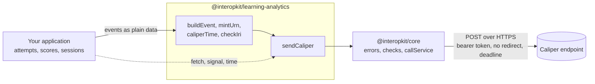

# @interopkit/learning-analytics

[Caliper Analytics 1.2](https://www.imsglobal.org/spec/caliper/v1p2) events and a sensor that sends them to an endpoint. It
builds the events of the Assessment Profile and the Grading Profile, gives them identifiers that stay the same when an event
is reported again, and posts them in one envelope with a bearer token. It knows nothing of any product: the host says what
happened, and which of its events becomes which Caliper event is the host's mapping.



It runs in Node.js, browsers, Deno, Bun and edge runtimes such as Cloudflare Workers: it uses web standards only, reads no
environment variable, writes no log, and calls the network only through the `fetch` that the caller passes. Its dependencies
are `@interopkit/core`, [uuid](https://github.com/uuidjs/uuid) and [valibot](https://valibot.dev).

```bash
npm install @interopkit/learning-analytics
```

## API

| Subpath                          | Exports                                                                                                                                       |
| -------------------------------- | --------------------------------------------------------------------------------------------------------------------------------------------- |
| `@interopkit/learning-analytics` | `buildEvent`, `EventInput`: a checked event with its `@context`                                                                               |
|                                  | `mintUrn`: the identifier of an event from the parts that identify it. `caliperTime`: epoch milliseconds as Caliper writes a time. `checkIri` |
|                                  | `sendCaliper`, `SendCaliperOptions`, `CaliperSender`, `DEFAULT_CALIPER_TIMEOUT_MS`: the sensor                                                |
|                                  | `CALIPER_CONTEXT`, `CaliperEvent`, `CaliperEntity`, `CaliperEventType`, `CaliperProfile`, `CaliperAction`: the model                          |

```ts
import { buildEvent, caliperTime, mintUrn, sendCaliper } from "@interopkit/learning-analytics";

const event = buildEvent({
  id: mintUrn(["event", "session-1", 1]),
  type: "AssessmentEvent",
  profile: "AssessmentProfile",
  actor: { id: "urn:uuid:3f0c8a8e-7b8e-4b6a-9c1d-2a4f6e8b0c1d", type: "Person" },
  action: "Started",
  object: { id: "https://exam.example/tests/42", type: "Assessment" },
  eventTime: caliperTime(1_700_000_000_000, "The time of the event"),
  edApp: "https://exam.example",
});
event.id; // => "urn:uuid:017072c6-a4a4-5227-a083-38da34a6f364"

const sent = [];
const fetch = async (url, init) => {
  sent.push({ url, method: init.method, authorization: init.headers.Authorization });
  return new Response(null, { status: 200 });
};
await sendCaliper([event], {
  endpoint: "https://lrs.example/caliper",
  token: "abc123",
  fetch,
  sensor: "https://exam.example/sensors/1",
  sendTime: 1_700_000_001_000,
});
sent; // => [{ url: "https://lrs.example/caliper", method: "POST", authorization: "Bearer abc123" }]
```

A call that fails rejects with a `ServiceError` whose `status` is the HTTP status, or 0 when the endpoint did not answer. A
resend sends the same events, so with the same identifiers, and a new `sendTime`.

## What this version builds

| Part of Caliper 1.2 | Built                                                                                                 |
| ------------------- | ----------------------------------------------------------------------------------------------------- |
| Event types         | `AssessmentEvent`, `AssessmentItemEvent`, `NavigationEvent`, `GradeEvent`: 4 of 21                    |
| Actions             | `Started`, `Paused`, `Resumed`, `Submitted`, `Skipped`, `Completed`, `NavigatedTo`, `Graded`: 8 of 80 |
| Entity types        | `Person`, `SoftwareApplication`, `Assessment`, `AssessmentItem`, `Attempt`, `Score`: 6 of 69          |
| Profiles            | Assessment and Grading: 2 of 15, and not every row of their tables                                    |
| Sensor              | One envelope of events, `POST` with a bearer token, as in section 5                                   |

[The guide](https://github.com/interopkit/interopkit/blob/main/docs/learning-analytics/guide.md) lists what is not included
and why, the options with their defaults, the limits, the errors and what to do about them, and the differences from the
references. A complete sensor, which sends again after a failure, is in the
[example](https://github.com/interopkit/interopkit/tree/main/examples/learning-analytics#readme).

## License

[Apache-2.0](LICENSE). Copyright Fariz Wakan. Caliper Analytics, Sensor API and 1EdTech are trademarks of 1EdTech
Consortium, Inc.; see [NOTICE](NOTICE). This package implements Caliper Analytics 1.2 and is not certified by 1EdTech.
