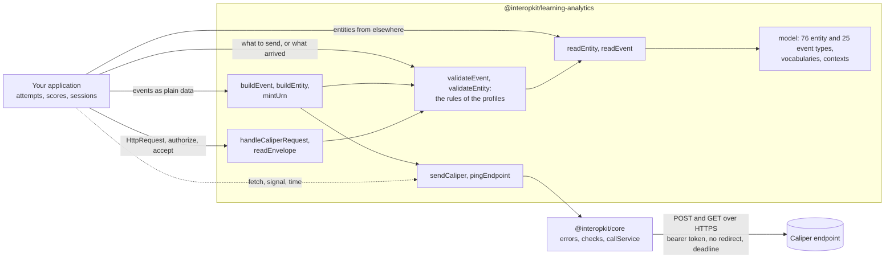

# @interopkit/learning-analytics

Caliper Analytics 1.2 for JavaScript and TypeScript: the event and entity model, a sensor that sends events, and the endpoint
that receives and checks them; reads Caliper 1.1.

It covers every entity of [Caliper Analytics 1.2](https://www.imsglobal.org/spec/caliper/v1p2) and of the Library Use Profile,
and gives events identifiers that stay the same when an event is reported again. It knows nothing of any product: which event of
the host becomes which Caliper event is the host's mapping.

```bash
npm install @interopkit/learning-analytics
```

## Quick start

```ts
import { formatDateTime } from "@interopkit/core/checks";
import { buildEvent, mintUrn, sendCaliper } from "@interopkit/learning-analytics";

const event = buildEvent({
  id: mintUrn(["event", "session-1", 1]),
  type: "AssessmentEvent",
  profile: "AssessmentProfile",
  actor: { id: "urn:uuid:3f0c8a8e-7b8e-4b6a-9c1d-2a4f6e8b0c1d", type: "Person" },
  action: "Started",
  object: { id: "https://exam.example/tests/42", type: "Assessment" },
  eventTime: formatDateTime(1_700_000_000_000),
  edApp: "https://exam.example",
});
event.id; // => "urn:uuid:017072c6-a4a4-5227-a083-38da34a6f364"

const sent = [];
const fetch = async (url, init) => {
  sent.push({ url, method: init.method, authorization: init.headers.Authorization });
  return new Response(null, { status: 200 });
};
await sendCaliper([event], {
  endpoint: "https://lrs.example/caliper",
  token: "abc123",
  fetch,
  sensor: "https://exam.example/sensors/1",
  sendTime: 1_700_000_001_000,
});
sent; // => [{ url: "https://lrs.example/caliper", method: "POST", authorization: "Bearer abc123" }]
```

A call that fails rejects with a `ServiceError` whose `status` is the HTTP status, or 0 when the endpoint did not answer. A
resend sends the same events, so with the same identifiers, and a new `sendTime`.

## Architecture



It runs in Node.js, browsers, Deno, Bun and edge runtimes such as Cloudflare Workers: it uses web standards only, reads no
environment variable, writes no log, and calls the network only through the `fetch` that the caller passes. Its dependencies are
`@interopkit/core`, [uuid](https://github.com/uuidjs/uuid) and [valibot](https://valibot.dev).

## API

| Subpath                                   | Exports                                                                                                                                                                                                                                                                                                                                                                                                     |
| ----------------------------------------- | ----------------------------------------------------------------------------------------------------------------------------------------------------------------------------------------------------------------------------------------------------------------------------------------------------------------------------------------------------------------------------------------------------------- |
| `@interopkit/learning-analytics`          | `readEntity`, `readEvent`, `ReadOptions`: an entity describe or an event from outside, of Caliper 1.2 or, with `version: "1.1"`, of 1.1, checked against its class and returned as a copy                                                                                                                                                                                                                   |
|                                           | `validateEvent`, `validateEntity`, `ValidateOptions`: what is wrong with a value, and where it departs from the rules of its profile, as findings                                                                                                                                                                                                                                                           |
|                                           | `buildEvent`, `buildEntity`, `BuildOptions`: a checked event or entity with its `@context`; `buildEvent` also checks the rules of the event's profile                                                                                                                                                                                                                                                       |
|                                           | `mintUrn`: the identifier of an event from the parts that identify it. A time is written by `formatDateTime` of `@interopkit/core/checks`                                                                                                                                                                                                                                                                   |
|                                           | `sendCaliper`, `pingEndpoint`, `SendCaliperOptions`, `CaliperSender`, `PingResult`: the sensor, which sends events and entity describes and asks an endpoint for its configuration                                                                                                                                                                                                                          |
|                                           | `EndpointConfiguration`: what an endpoint says of itself (section 6.2)                                                                                                                                                                                                                                                                                                                                      |
| `@interopkit/learning-analytics/endpoint` | `handleCaliperRequest`, `CaliperEndpointOptions`: answers a POST of an envelope of 1.2 or 1.1 in a fixed order of checks (405, 401, 415, 413, 400, 422) and a GET with its configuration                                                                                                                                                                                                                    |
|                                           | `readEnvelope`, `ReceivedEnvelope`: an envelope read into events and entities, with the findings; the handler adds the principal that sent it                                                                                                                                                                                                                                                               |
|                                           | An interface for each of the 76 entity types (`Person`, `CourseSection`, `AssessmentItem`, `Score` and the rest), `CaliperEntity`, `EntityDocument`, `Ref`, `Context`, an interface for each of the 25 event types, `CaliperEvent`, `EventInput`                                                                                                                                                            |
|                                           | `CALIPER_CONTEXT`, `CALIPER_1_1_CONTEXT`, `LIBRARY_PROFILE_CONTEXT`, `CALIPER_VERSIONS`, `CaliperVersion`, and the vocabularies `ACTIONS`, `PROFILES`, `ROLES`, `STATUSES`, `LTI_MESSAGE_TYPES`, `SYSTEM_IDENTIFIER_TYPES`, `METRICS`, `ENTITY_TYPES`, `EVENT_TYPES` and the ranges `AGENT_TYPES`, `ORGANIZATION_TYPES`, `COURSE_OFFERING_TYPES`, `DIGITAL_RESOURCE_TYPES`, `QUESTION_TYPES`, `SCALE_TYPES` |

## Supported

| Part of Caliper 1.2 | Built                                                                                                                        |
| ------------------- | ---------------------------------------------------------------------------------------------------------------------------- |
| Entities            | All 69 of Appendix B, the 2 of Appendix C and the 4 of the Library Use Profile, read and built                               |
| Vocabularies        | The 82 actions, the 16 profile terms, 57 roles, statuses, LTI message types, identifier types, metrics                       |
| Event types         | All 21 of Appendix A and the 3 of the Library Use Profile, with their actions, actors and objects                            |
| Profiles            | Their terms, the 91 rows of section 3 and the conformance tables of the certification guide, as findings                     |
| Sensor              | One envelope of events and entity describes, `POST` with an optional bearer token, a size limit, and the ping of section 6.2 |
| Endpoint            | The role of section 6: 200, 400, 401, 415, 422 and the configuration, with `authorize` before any parsing                    |
| Caliper 1.1         | Read, never written: the events and entities of 1.1 and its six extension profiles, and envelopes of 1.1 at the endpoint     |

[Supported](https://interopkit.wakan.dev/_interopkit/learning-analytics/supported/) lists what the package includes and what it leaves out.

## Documentation

| Page                                                                                                                                                                       | Gives                                                                                             |
| -------------------------------------------------------------------------------------------------------------------------------------------------------------------------- | ------------------------------------------------------------------------------------------------- |
| [Architecture](https://interopkit.wakan.dev/_interopkit/learning-analytics/architecture/)                                                                                  | The modules, the data that flows, and what the package leaves to the host                         |
| [Model](https://interopkit.wakan.dev/_interopkit/learning-analytics/model/)                                                                                                | The entities, the events, the vocabularies and reading                                            |
| [Building](https://interopkit.wakan.dev/_interopkit/learning-analytics/build/), [judging](https://interopkit.wakan.dev/_interopkit/learning-analytics/validate/)           | Events with stable identifiers; the findings of the rules of the profiles                         |
| [Sending](https://interopkit.wakan.dev/_interopkit/learning-analytics/send/), [receiving](https://interopkit.wakan.dev/_interopkit/learning-analytics/endpoint/)           | The sensor and the endpoint                                                                       |
| [Caliper 1.1](https://interopkit.wakan.dev/_interopkit/learning-analytics/versions/)                                                                                       | Reading 1.1 documents and envelopes                                                               |
| [Spec gaps](https://interopkit.wakan.dev/_interopkit/learning-analytics/spec-gaps/)                                                                                        | Where the specifications disagree, and the choice made                                            |
| [Choosing](https://interopkit.wakan.dev/_interopkit/learning-analytics/choosing/)                                                                                          | When the package fits, when another library fits better, and what each has that the package lacks |
| [Evidence](https://interopkit.wakan.dev/_interopkit/learning-analytics/evidence/), [performance](https://interopkit.wakan.dev/_interopkit/learning-analytics/performance/) | What shows that it does what it says; speed, size and peak memory                                 |

A complete sensor, which sends again after a failure, and an endpoint that receives both versions are in the
[example](https://github.com/interopkit/interopkit/tree/main/examples/learning-analytics#readme).

## License

[Apache-2.0](https://github.com/interopkit/interopkit/blob/main/packages/learning-analytics/LICENSE). Copyright Fariz Wakan. See [NOTICE](https://github.com/interopkit/interopkit/blob/main/packages/learning-analytics/NOTICE).

LTI® is a trademark of 1EdTech® Consortium, Inc. (1edtech.org).
Caliper Analytics® is a trademark of 1EdTech® Consortium, Inc. (1edtech.org).
interopkit is not affiliated with, endorsed by or approved by 1EdTech Consortium, Inc.
