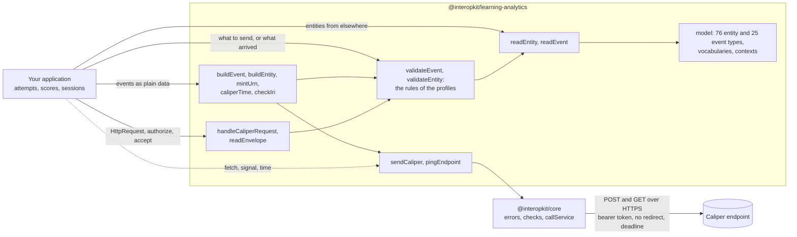

# @interopkit/learning-analytics

[Caliper Analytics 1.2](https://www.imsglobal.org/spec/caliper/v1p2) events and entities, a sensor that sends them to an
endpoint, and the endpoint that receives them. It has the model of every entity of Caliper 1.2 and of the Library Use Profile,
reads and judges what arrives from elsewhere, builds events, gives them identifiers that stay the same when an event is
reported again, posts them in one envelope, and answers the requests of sensors. It knows nothing of any product: the host says
what happened, and which of its events becomes which Caliper event is the host's mapping.



It runs in Node.js, browsers, Deno, Bun and edge runtimes such as Cloudflare Workers: it uses web standards only, reads no
environment variable, writes no log, and calls the network only through the `fetch` that the caller passes. Its dependencies
are `@interopkit/core`, [uuid](https://github.com/uuidjs/uuid) and [valibot](https://valibot.dev).

```bash
npm install @interopkit/learning-analytics
```

## API

| Subpath                          | Exports                                                                                                                                       |
| -------------------------------- | --------------------------------------------------------------------------------------------------------------------------------------------- |
| `@interopkit/learning-analytics` | `readEntity`, `readEvent`: an entity describe or an event from outside, checked against its class and returned as a copy                      |
|                                  | `validateEvent`, `validateEntity`, `CaliperFinding`, `ValidateOptions`: what is wrong with a value, and where it departs from the rules of its profile, as findings |
|                                  | `buildEvent`, `buildEntity`, `BuildOptions`: a checked event or entity with its `@context`; `buildEvent` also checks the rules of the event's profile |
|                                  | `mintUrn`: the identifier of an event from the parts that identify it. `caliperTime`: epoch milliseconds as Caliper writes a time. `checkIri` |
|                                  | `sendCaliper`, `pingEndpoint`, `SendCaliperOptions`, `CaliperSender`, `PingResult`, `DEFAULT_CALIPER_TIMEOUT_MS`: the sensor, which sends events and entity describes and asks an endpoint for its configuration |
|                                  | `EndpointConfiguration`: what an endpoint says of itself (section 6.2)                                                                        |
| `@interopkit/learning-analytics/endpoint` | `handleCaliperRequest`, `CaliperEndpointOptions`: answers a POST of an envelope in a fixed order of checks (405, 401, 415, 413, 400, 422) and a GET with its configuration |
|                                  | `readEnvelope`, `ReceivedEnvelope`: an envelope read into events and entities, with the principal that sent it and the findings                |
|                                  | An interface for each of the 76 entity types (`Person`, `CourseSection`, `AssessmentItem`, `Score` and the rest), `CaliperEntity`, `EntityDocument`, `Ref`, `Context`, an interface for each of the 25 event types, `CaliperEvent`, `EventInput` |
|                                  | `CALIPER_CONTEXT`, `LIBRARY_PROFILE_CONTEXT`, and the vocabularies `ACTIONS`, `PROFILES`, `ROLES`, `STATUSES`, `LTI_MESSAGE_TYPES`, `SYSTEM_IDENTIFIER_TYPES`, `METRICS`, `ENTITY_TYPES`, `EVENT_TYPES` and the ranges `AGENT_TYPES`, `ORGANIZATION_TYPES`, `COURSE_OFFERING_TYPES`, `DIGITAL_RESOURCE_TYPES`, `QUESTION_TYPES`, `SCALE_TYPES` |

```ts
import { buildEvent, caliperTime, mintUrn, sendCaliper } from "@interopkit/learning-analytics";

const event = buildEvent({
  id: mintUrn(["event", "session-1", 1]),
  type: "AssessmentEvent",
  profile: "AssessmentProfile",
  actor: { id: "urn:uuid:3f0c8a8e-7b8e-4b6a-9c1d-2a4f6e8b0c1d", type: "Person" },
  action: "Started",
  object: { id: "https://exam.example/tests/42", type: "Assessment" },
  eventTime: caliperTime(1_700_000_000_000, "The time of the event"),
  edApp: "https://exam.example",
});
event.id; // => "urn:uuid:017072c6-a4a4-5227-a083-38da34a6f364"

const sent = [];
const fetch = async (url, init) => {
  sent.push({ url, method: init.method, authorization: init.headers.Authorization });
  return new Response(null, { status: 200 });
};
await sendCaliper([event], {
  endpoint: "https://lrs.example/caliper",
  token: "abc123",
  fetch,
  sensor: "https://exam.example/sensors/1",
  sendTime: 1_700_000_001_000,
});
sent; // => [{ url: "https://lrs.example/caliper", method: "POST", authorization: "Bearer abc123" }]
```

A call that fails rejects with a `ServiceError` whose `status` is the HTTP status, or 0 when the endpoint did not answer. A
resend sends the same events, so with the same identifiers, and a new `sendTime`.

## What this version builds

| Part of Caliper 1.2          | Built                                                                                               |
| ---------------------------- | --------------------------------------------------------------------------------------------------- |
| Entities                     | All 69 of Appendix B, the 2 of Appendix C and the 4 of the Library Use Profile, read and built      |
| Vocabularies                 | The 82 actions, the 16 profile terms, 57 roles, statuses, LTI message types, identifier types, metrics |
| Event types                  | All 21 of Appendix A and the 3 of the Library Use Profile, with their actions, actors and objects    |
| Profiles                     | Their terms, the 91 rows of section 3 and the conformance tables of the certification guide, as findings |
| Sensor                       | One envelope of events and entity describes, `POST` with an optional bearer token, a size limit, and the ping of section 6.2 |
| Endpoint                     | The role of section 6: 200, 400, 401, 415, 422 and the configuration, with `authorize` before any parsing |

The guides say what each part holds: the [architecture](https://github.com/interopkit/interopkit/blob/main/docs/learning-analytics/architecture.md),
the [model](https://github.com/interopkit/interopkit/blob/main/docs/learning-analytics/model.md), what is
[supported](https://github.com/interopkit/interopkit/blob/main/docs/learning-analytics/supported.md) and what is not yet, and
the places where the [specifications disagree](https://github.com/interopkit/interopkit/blob/main/docs/learning-analytics/spec-gaps.md).
A complete sensor, which sends again after a failure, is in the
[example](https://github.com/interopkit/interopkit/tree/main/examples/learning-analytics#readme).

## License

[Apache-2.0](LICENSE). Copyright Fariz Wakan. Caliper Analytics, Sensor API and 1EdTech are trademarks of 1EdTech
Consortium, Inc.; see [NOTICE](NOTICE). This package implements Caliper Analytics 1.2 and is not certified by 1EdTech.
