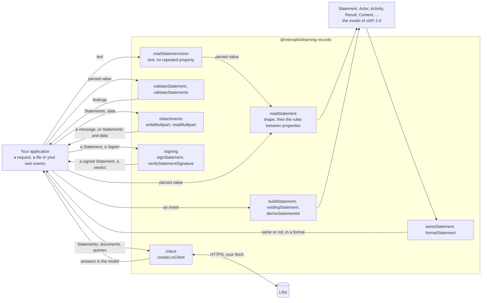

# @interopkit/learning-records

xAPI [2.0](https://opensource.ieee.org/xapi/xapi-base-standard-documentation) (IEEE 9274.1.1-2023): the model of a Statement,
readers that check it against the rules of an LRS and of a Learning Record Provider, validators that list every finding, a
reader of the text of a request that refuses a property given twice, builders of Statements, the comparison and the formats
of Statements, the message that carries Attachments, the signature of a Statement, and a client of an LRS. It knows nothing of any product: the host says where a Statement comes from and what it is for.



It runs in Node.js, browsers, Deno, Bun and edge runtimes such as Cloudflare Workers: it uses web standards only, reads no
environment variable, writes no log and makes no request. Its dependencies are `@interopkit/core`,
[valibot](https://valibot.dev), [momoa](https://github.com/humanwhocodes/momoa), [uuid](https://github.com/uuidjs/uuid),
[@noble/hashes](https://github.com/paulmillr/noble-hashes), [jose](https://github.com/panva/jose) (`/signing`) and
[@remix-run/multipart-parser](https://github.com/remix-run/remix/tree/main/packages/multipart-parser) (`/attachments`).

```bash
npm install @interopkit/learning-records
```

## API

| Subpath                                    | Exports                                                                                                                                                                                                                                                                                                      |
| ------------------------------------------ | ------------------------------------------------------------------------------------------------------------------------------------------------------------------------------------------------------------------------------------------------------------------------------------------------------------ |
| `@interopkit/learning-records`             | `readStatement`, `ReadOptions`: read a Statement into the model for the rules of an LRS or of a provider, and throw `DataError` on an error                                                                                                                                                                  |
|                                            | `validateStatement`, `validateStatements`, `StatementIssue`: judge a Statement or a batch and return every finding, errors and warnings, as data                                                                                                                                                             |
|                                            | `readStatementJson`, `ReadStatementJsonOptions`: parse the text of a request, and refuse a property that occurs twice                                                                                                                                                                                        |
|                                            | `buildStatement`, `StatementInput`, `voidingStatement`: build the Statement of an event, or the one that voids another, checked against the rules of a provider                                                                                                                                              |
|                                            | `deriveStatementId`, `mboxSha1sum`, `formatDuration`, `parseDuration`, `formatTimestamp`: the id of an event, the hash of an address, and the durations and times of the standard                                                                                                                            |
|                                            | `sameStatement`: whether two Statements are the same by the rules of immutability                                                                                                                                                                                                                            |
|                                            | `formatStatement`, `FormatOptions`, `StatementFormat`: a Statement as `ids`, `exact` or `canonical`                                                                                                                                                                                                          |
|                                            | `Statement`, `SubStatement`, `StatementRef`, `StatementResult`, `Actor`, `Agent`, `Group`, `Activity`, `ActivityDefinition`, `Result`, `Context`, `Attachment`, `AttachmentData` and the other types                                                                                                         |
|                                            | `INTERACTION_TYPES`, `CONTEXT_ACTIVITY_TYPES`, `RULE_ROLES`, `VERB_VOIDED` and the types of the vocabularies                                                                                                                                                                                                 |
| `@interopkit/learning-records/attachments` | `writeMultipart`, `readMultipart`, `attachmentHash`, `MultipartLimits`, `MultipartMessage`, `MultipartContent`: write and read the `multipart/mixed` message of Statements and Attachment data, and hash the data                                                                                            |
| `@interopkit/learning-records/client`      | `createLrsClient`, `LrsClient`, `LrsClientConfig`, `StatementPage`, `WriteOutcome`, `SendOptions`, `GetStatementOptions`, `WriteOptions`, `DeleteOptions`, `ListOptions`: send and query Statements, read and write the three kinds of document, and ask for Activities, Agents and About, over your `fetch` |
| `@interopkit/learning-records/signing`     | `signStatement`, `verifyStatementSignature`, `SIGNATURE_USAGE_TYPE`, `SignedStatement`, `SignatureCheck`: sign a Statement over a `Signer` of `@interopkit/core`, and verify the signature                                                                                                                   |

```ts
import { readStatement, readStatementJson, validateStatement } from "@interopkit/learning-records";

const text = JSON.stringify({
  id: "6690e6c9-3ef0-4ed3-8b37-7f3964730bee",
  actor: { name: "Example Learner", mbox: "mailto:learner@example.org" },
  verb: { id: "http://adlnet.gov/expapi/verbs/completed", display: { "en-US": "completed" } },
  object: { id: "https://example.org/activities/course-1" },
  result: { score: { scaled: 0.9 }, duration: "PT1H30M" },
  context: { contextActivities: { parent: { id: "https://example.org/activities/program-1" } } },
  timestamp: "2024-06-13T20:46:03.250+02:00",
});
const statement = readStatement(readStatementJson(text));
statement.result?.duration; // => "PT1H30M"
statement.context?.contextActivities?.parent?.length; // => 1

validateStatement(statement, { role: "provider" }).map((finding) => `${finding.severity} ${finding.rule} at ${finding.path}`); // => ["error timestamp-not-utc at timestamp"]
validateStatement({ actor: { mbox: "learner@example.org" } }).map((finding) => `${finding.rule} at ${finding.path}`); // => ["invalid-format at actor.mbox", "missing-property at verb", "missing-property at object"]
```

`readStatement` returns the model, or throws a `DataError` that names the path of the first error and counts the others.
`validateStatement` does not throw for a value, and returns each finding with its `path`, its `rule`, a `message` and its
`severity`. A warning does not keep a Statement from being read.

## What this version includes

| Part of xAPI 2.0                | Included                                                                                                                                                                                     |
| ------------------------------- | -------------------------------------------------------------------------------------------------------------------------------------------------------------------------------------------- |
| The Statement and what it holds | Every property of the tables of 4.2.2: Actors, Verbs, Objects with Activity Definitions and the ten interactions, Results, Contexts, SubStatements, Attachments                              |
| Rules of an LRS                 | What an LRS shall reject (4.2.1, 4.2.4, 4.2.5, 4.2.7), the batch rule of 4.1.6.1, and what it shall not reject                                                                               |
| Rules of a provider             | What a Learning Record Provider shall and should do (5.2): UTC, the properties the LRS sets, precision, empty objects, lists of Activities                                                   |
| Data types                      | IRIs, UUIDs, RFC 3339 times, ISO 8601 durations, language tags, extension keys, `mailto` IRIs, hashes and media types                                                                        |
| Interaction patterns            | The form of every `correctResponsesPattern` by interaction type, and its characterstring parameters                                                                                          |
| Building                        | A Statement from an event with the time in UTC, an id that a resend repeats, the Statement that voids another, durations and the hash of an address                                          |
| Comparing and formats           | Whether two Statements are the same by the rules of immutability, and a Statement as `ids`, `exact` or `canonical`                                                                           |
| Text of a request               | `readStatementJson`: RFC 8259 syntax, limits of size, depth and tokens, and a property given twice refused                                                                                   |
| Attachments                     | The `multipart/mixed` message of Statements and Attachment data, matched by SHA-2 hash, within limits                                                                                        |
| Signed Statements               | A compact JWS in an Attachment with RS256, RS384 or RS512 and an `x5c` chain, signed over a `Signer` and verified against the leaf and the equivalence of the payload                        |
| Client                          | The seven resources over `fetch`: Statements and their twelve filters with pages, State and the two profiles under ETags with the preconditions of the version, Agents, Activities and About |

[The model guide](https://github.com/interopkit/interopkit/blob/main/docs/learning-records/model.md) has the options with their
defaults, the findings and their rules, the limits, the errors and what to do about them, what is not included and why, and the
differences from the references. The guides of [building](https://github.com/interopkit/interopkit/blob/main/docs/learning-records/build.md),
[comparing](https://github.com/interopkit/interopkit/blob/main/docs/learning-records/compare.md),
[formats](https://github.com/interopkit/interopkit/blob/main/docs/learning-records/format.md),
[attachments](https://github.com/interopkit/interopkit/blob/main/docs/learning-records/attachments.md),
[signing](https://github.com/interopkit/interopkit/blob/main/docs/learning-records/signing.md) and
[the client](https://github.com/interopkit/interopkit/blob/main/docs/learning-records/client.md) do the same.

## License

[Apache-2.0](LICENSE). Copyright Fariz Wakan. xAPI is the standard IEEE 9274.1.1; see [NOTICE](NOTICE). This package implements
xAPI 2.0 and is not certified or endorsed by IEEE or ADL.
