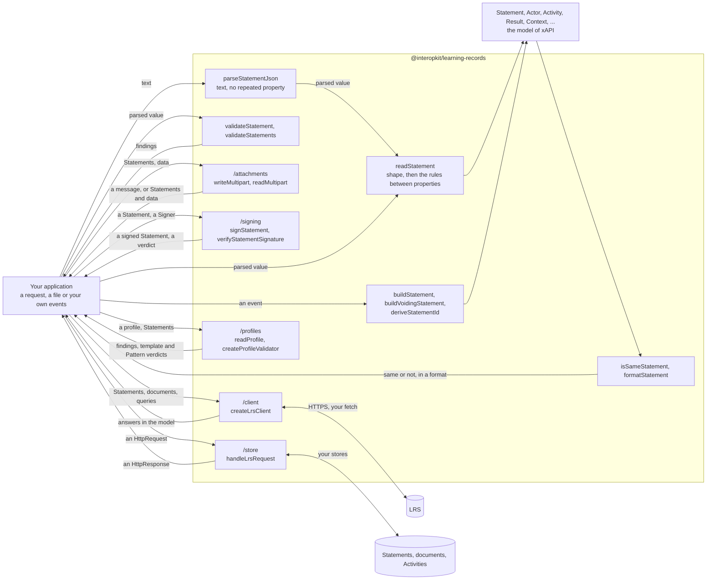

# @interopkit/learning-records

xAPI 2.0 (IEEE 9274.1.1) and 1.0.3 for JavaScript and TypeScript: the Statement model, validators for the rules of an LRS and a
provider, builders, signatures, an LRS client, an LRS request handler, and xAPI Profiles 1.0 with Statements matched to a
profile's templates and patterns.

It follows xAPI [2.0](https://opensource.ieee.org/xapi/xapi-base-standard-documentation) (IEEE 9274.1.1-2023),
[1.0.3](https://github.com/adlnet/xAPI-Spec/tree/1.0.3) and [xAPI Profiles 1.0](https://github.com/adlnet/xapi-profiles). It
knows nothing of any product: the host says where a Statement comes from and what it is for.

```bash
npm install @interopkit/learning-records
```

## Quick start

```ts
import { readStatement, parseStatementJson, validateStatement } from "@interopkit/learning-records";

const text = JSON.stringify({
  id: "6690e6c9-3ef0-4ed3-8b37-7f3964730bee",
  actor: { name: "Example Learner", mbox: "mailto:learner@example.org" },
  verb: { id: "http://adlnet.gov/expapi/verbs/completed", display: { "en-US": "completed" } },
  object: { id: "https://example.org/activities/course-1" },
  result: { score: { scaled: 0.9 }, duration: "PT1H30M" },
  context: { contextActivities: { parent: { id: "https://example.org/activities/program-1" } } },
  timestamp: "2024-06-13T20:46:03.250+02:00",
});
const statement = readStatement(parseStatementJson(text));
statement.result?.duration; // => "PT1H30M"
statement.context?.contextActivities?.parent?.length; // => 1

validateStatement(statement, { role: "provider" }).map(
  (finding) => `${finding.severity} ${finding.rule} at ${finding.path}`,
); // => ["error timestamp-not-utc at timestamp"]
validateStatement({ actor: { mbox: "learner@example.org" } }).map((finding) => `${finding.rule} at ${finding.path}`); // => ["invalid-format at actor.mbox", "missing-property at verb", "missing-property at object"]
```

`readStatement` returns the model, or throws a `DataError` that names the path of the first error and counts the others.
`validateStatement` does not throw for a value, and returns each finding with its `path`, its `rule`, a `message` and its
`severity`. A warning does not keep a Statement from being read.

## Architecture



It runs in Node.js, browsers, Deno, Bun and edge runtimes such as Cloudflare Workers: it uses web standards only, reads no
environment variable, writes no log and makes no request. Its dependencies are `@interopkit/core`,
[valibot](https://valibot.dev), [uuid](https://github.com/uuidjs/uuid),
[@noble/hashes](https://github.com/paulmillr/noble-hashes), [jose](https://github.com/panva/jose) (`/signing`) and
[@remix-run/multipart-parser](https://github.com/remix-run/remix/tree/main/packages/multipart-parser) (`/attachments`).

## API

| Subpath                                    | Exports                                                                                                                                                                                                                                                                                                                                                                                                                                         |
| ------------------------------------------ | ----------------------------------------------------------------------------------------------------------------------------------------------------------------------------------------------------------------------------------------------------------------------------------------------------------------------------------------------------------------------------------------------------------------------------------------------- |
| `@interopkit/learning-records`             | `readStatement`, `ReadOptions`: read a Statement into the model for the rules of an LRS or of a provider, and throw `DataError` on an error                                                                                                                                                                                                                                                                                                     |
|                                            | `validateStatement`, `validateStatements`: judge a Statement or a batch and return every finding, errors and warnings, as data, each an `Issue` of `@interopkit/core/checks`                                                                                                                                                                                                                                                                    |
|                                            | `parseStatementJson`, `ParseStatementJsonOptions`: parse the text of a request, and refuse a property that occurs twice; a limit throws `LimitError` of `@interopkit/core`                                                                                                                                                                                                                                                                      |
|                                            | `buildStatement`, `BuildOptions`, `StatementInput`, `buildVoidingStatement`: build the Statement of an event, or the one that voids another, checked against the rules of a provider                                                                                                                                                                                                                                                            |
|                                            | `deriveStatementId`, `mboxSha1sum`, `formatDuration`, `parseDuration`, `isDuration`: the id of an event, the hash of an address, and the durations of the standard; a Timestamp is written by `formatDateTime` of `@interopkit/core/checks`                                                                                                                                                                                                     |
|                                            | `isSameStatement`, `isSameActor`, `convertStatementVersion`, `findStatementTime`: whether two Statements are the same by the rules of immutability, whether two Actors are by their identifier, a Statement in the form of 1.0.3, and the time of a Statement of either version                                                                                                                                                                 |
|                                            | `formatStatement`, `FormatOptions`, `StatementFormat`: a Statement as `ids`, `exact` or `canonical`                                                                                                                                                                                                                                                                                                                                             |
|                                            | `Statement`, `SubStatement`, `StatementRef`, `StatementResult`, `Actor`, `Agent`, `Group`, `Activity`, `ActivityDefinition`, `Result`, `Context`, `Attachment`, `AttachmentData` and the other types                                                                                                                                                                                                                                            |
|                                            | `INTERACTION_TYPES`, `CONTEXT_ACTIVITY_TYPES`, `RULE_ROLES`, `VERB_VOIDED` and the types of the vocabularies                                                                                                                                                                                                                                                                                                                                    |
| `@interopkit/learning-records/attachments` | `writeMultipart`, `readMultipart`, `hashAttachment`, `MultipartLimits`, `MultipartMessage`, `MultipartContent`: write and read the `multipart/mixed` message of Statements and Attachment data, and hash the data                                                                                                                                                                                                                               |
| `@interopkit/learning-records/client`      | `createLrsClient`, `LrsClient`, `LrsClientOptions`, `StatementPage`, `StatementWithAttachments`, `WriteOutcome`, `SendOptions`, `ReadStatementsOptions`, `GetStatementOptions`, `WriteOptions`, `DeleteOptions`, `ListOptions`: send and query Statements, read and write the three kinds of document, and ask for Activities, Agents and About, over your `fetch`                                                                              |
| `@interopkit/learning-records/store`       | `handleLrsRequest`, `LrsOptions`, `LrsLimits`, `StatementStore`, `DocumentStore`, `ActivityStore`, `AgentStore`, `Access`, `LrsGrant`, `LrsAction`, `LRS_ACTIONS`, `matchesStatementQuery`, `MatchOptions`, `readBasicAuthorization`: answer the seven resources of an LRS over your stores                                                                                                                                                     |
| `@interopkit/learning-records/profiles`    | `readProfile`, `validateProfile`, `ProfileReadOptions`: read and judge an xAPI Profile; `createProfileValidator`, `ProfileValidator`, `ProfileValidatorOptions`, `StatementVerdict`, `StatementsVerdict`, `RegistrationVerdict`, `PatternVerdict`: judge Statements against its Statement Templates and Patterns; `Profile`, `Concept`, `StatementTemplate`, `StatementTemplateRule`, `Pattern` and the other types, vocabularies and constants |
| `@interopkit/learning-records/signing`     | `signStatement`, `verifyStatementSignature`, `SIGNATURE_USAGE_TYPE`, `SignedStatement`, `SignatureCheck`: sign a Statement over a `Signer` of `@interopkit/core`, and verify the signature                                                                                                                                                                                                                                                      |

## Supported

| Part of xAPI                    | Included                                                                                                                                                                                                                       |
| ------------------------------- | ------------------------------------------------------------------------------------------------------------------------------------------------------------------------------------------------------------------------------ |
| The Statement and what it holds | Every property of the tables of 4.2.2: Actors, Verbs, Objects with Activity Definitions and the ten interactions, Results, Contexts, SubStatements, Attachments                                                                |
| Rules of an LRS                 | What an LRS shall reject (4.2.1, 4.2.4, 4.2.5, 4.2.7), the batch rule of 4.1.6.1, and what it shall not reject                                                                                                                 |
| Rules of a provider             | What a Learning Record Provider shall and should do (5.2): UTC, the properties the LRS sets, precision, empty objects, lists of Activities                                                                                     |
| Data types                      | IRIs, UUIDs, RFC 3339 times, ISO 8601 durations, language tags, extension keys, `mailto` IRIs, hashes and media types                                                                                                          |
| Interaction patterns            | The form of every `correctResponsesPattern` by interaction type, and its characterstring parameters                                                                                                                            |
| Building                        | A Statement from an event with the time in UTC, an id that a resend repeats, the Statement that voids another, durations and the hash of an address                                                                            |
| Comparing and formats           | Whether two Statements are the same by the rules of immutability, and a Statement as `ids`, `exact` or `canonical`                                                                                                             |
| Text of a request               | `parseStatementJson`: RFC 8259 syntax, limits of size, depth and tokens, and a property given twice refused                                                                                                                    |
| Attachments                     | The `multipart/mixed` message of Statements and Attachment data, matched by SHA-2 hash, within limits                                                                                                                          |
| Signed Statements               | A compact JWS in an Attachment with RS256, RS384 or RS512 and an `x5c` chain, signed over a `Signer` and verified against the leaf and the equivalence of the payload                                                          |
| Client                          | The seven resources over `fetch`: Statements and their twelve filters with pages, State and the two profiles under ETags with the preconditions of the version, Agents, Activities and About                                   |
| xAPI 1.0.3                      | The rules of each role with `version: "1.0.3"`, builders, signatures, the client, and a route of the LRS with the alternate request syntax and the preconditions of 1.0.3                                                      |
| xAPI Profiles 1.0               | The model of a profile, the rules of its structure, and the Statement Template and Pattern algorithms, by registration and subregistration                                                                                     |
| LRS handler                     | All seven resources over plain requests and the ports of your stores: versions, errors, limits, access, voiding, filters and pages, Attachments and signatures, documents under ETags with merge, Agents, Activities and About |

[Supported](https://interopkit.wakan.dev/_interopkit/learning-records/supported/) lists what the package includes and what it leaves out.

## Documentation

| Page                                                                                                                                                                                                                                        | Gives                                                                                                                                                                                                                             |
| ------------------------------------------------------------------------------------------------------------------------------------------------------------------------------------------------------------------------------------------- | --------------------------------------------------------------------------------------------------------------------------------------------------------------------------------------------------------------------------------- |
| [Model](https://interopkit.wakan.dev/_interopkit/learning-records/model/)                                                                                                                                                                   | The readers and validators, the findings and their rules, the limits and the errors                                                                                                                                               |
| [Building](https://interopkit.wakan.dev/_interopkit/learning-records/build/), [comparing](https://interopkit.wakan.dev/_interopkit/learning-records/compare/), [formats](https://interopkit.wakan.dev/_interopkit/learning-records/format/) | Statements from events, immutability, and the three formats                                                                                                                                                                       |
| [Attachments](https://interopkit.wakan.dev/_interopkit/learning-records/attachments/), [signing](https://interopkit.wakan.dev/_interopkit/learning-records/signing/)                                                                        | The `multipart/mixed` message, and signed Statements                                                                                                                                                                              |
| [Client](https://interopkit.wakan.dev/_interopkit/learning-records/client/), [LRS handler](https://interopkit.wakan.dev/_interopkit/learning-records/store/)                                                                                | The two sides of the seven resources                                                                                                                                                                                              |
| [Versions](https://interopkit.wakan.dev/_interopkit/learning-records/versions/)                                                                                                                                                             | What differs in xAPI 1.0.3                                                                                                                                                                                                        |
| [Profiles](https://interopkit.wakan.dev/_interopkit/learning-records/profiles/)                                                                                                                                                             | xAPI Profiles, their templates and their Patterns                                                                                                                                                                                 |
| [Choosing](https://interopkit.wakan.dev/_interopkit/learning-records/choosing/), [comparators](https://interopkit.wakan.dev/_interopkit/learning-records/comparators/)                                                                      | When the package fits, and what other LRSs and clients have that it lacks                                                                                                                                                         |
| [Evidence](https://interopkit.wakan.dev/_interopkit/learning-records/evidence/)                                                                                                                                                             | The rules of both versions, both ADL conformance suites, SQL LRS and Learning Locker's validator as oracles, an example LRS, four runtimes, and for profiles the rules of Part Two, ADL's matching of Patterns and ADL's profiles |
| [Performance](https://interopkit.wakan.dev/_interopkit/learning-records/performance/)                                                                                                                                                       | The speed of every hot path, the size of each entry point and the peak memory of each reader                                                                                                                                      |

## License

[Apache-2.0](https://github.com/interopkit/interopkit/blob/main/packages/learning-records/LICENSE). Copyright Fariz Wakan. See [NOTICE](https://github.com/interopkit/interopkit/blob/main/packages/learning-records/NOTICE).

IEEE is a trademark of the Institute of Electrical and Electronics Engineers, Inc.
interopkit is not affiliated with, endorsed by or approved by IEEE or ADL.
