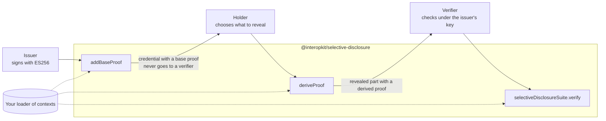

# @interopkit/selective-disclosure

The `ecdsa-sd-2023` Data Integrity cryptosuite of the W3C Recommendation
[Data Integrity ECDSA Cryptosuites v1.0](https://www.w3.org/TR/vc-di-ecdsa/), for any verifiable credential, a learning one or
not: an issuer signs a credential so that its holder can reveal part of it, and a verifier checks what is revealed. It implements this one suite, in its three roles, and no other
selective disclosure: not SD-JWT, not BBS.



It uses Web Crypto and no other platform API, reads no environment variable, writes no log and makes no request: the caller
passes the loader of JSON-LD contexts, the signer and the key. Its dependency `@digitalbazaar/di-sd-primitives` loads
`node:crypto` on Node.js and has a `browser` field that swaps in Web Crypto, which a bundler for browsers or workers applies
(esbuild with `--platform=browser`); the bundle needs no Node.js compatibility. CI runs the tests on Node.js 22 and 24 only. Its dependencies are `@interopkit/core`,
[`@digitalbazaar/di-sd-primitives`](https://github.com/digitalbazaar/di-sd-primitives), [cborg](https://github.com/rvagg/cborg),
[@noble/curves](https://github.com/paulmillr/noble-curves) and [@scure/base](https://github.com/paulmillr/scure-base).

```bash
npm install @interopkit/selective-disclosure
```

## API

| Subpath                            | Exports                                                                                                                  |
| ---------------------------------- | ------------------------------------------------------------------------------------------------------------------------ |
| `@interopkit/selective-disclosure` | `addBaseProof`, `BaseProofOptions`: the issuer's base proof, which signs every statement that a holder may hide          |
|                                    | `deriveProof`, `DeriveProofOptions`: the holder's disclosure of the parts they choose, with a derived proof              |
|                                    | `selectiveDisclosureSuite`, `VerifyProofOptions`: the name of the cryptosuite and `verify`, the check of a derived proof |
|                                    | `isBaseProof`: whether a proof is a base proof, which a verifier must not receive                                        |
|                                    | `JsonDocument`: a document or a proof as plain JSON                                                                      |

```ts
import { createCryptoKeySigner } from "@interopkit/core";
import { addBaseProof, deriveProof, isBaseProof, selectiveDisclosureSuite } from "@interopkit/selective-disclosure";

// The contexts of the credential: a host serves the ones it has checked, here from memory.
const contexts = new Map([
  ["https://example.org/contexts/v1", { "@context": { "@vocab": "https://example.org/vocab#", id: "@id", type: "@type" } }],
]);
const credential = {
  "@context": ["https://example.org/contexts/v1"],
  type: ["VerifiableCredential"],
  issuer: "https://example.org/issuers/1",
  credentialSubject: { type: "Person", name: "Sam Taylor", birthDate: "2001-05-17" },
};

// The issuer signs with ES256. A KMS or an HSM gives a Signer as well.
const pair = await crypto.subtle.generateKey({ name: "ECDSA", namedCurve: "P-256" }, true, ["sign", "verify"]);
const signer = createCryptoKeySigner(pair.privateKey, { algorithm: "ES256", keyId: "https://example.org/issuers/1#key-1" });
const publicKeyJwk = await crypto.subtle.exportKey("jwk", pair.publicKey);

const base = await addBaseProof(credential, {
  signer,
  mandatoryPointers: ["/issuer"],
  created: "2026-11-01T09:30:00Z",
  contexts: async (url) => contexts.get(url),
});
isBaseProof(base.proof); // => true

// The holder reveals the issuer, which is mandatory, and the name.
const disclosure = await deriveProof(base, {
  selectivePointers: ["/credentialSubject/name"],
  contexts: async (url) => contexts.get(url),
});
isBaseProof(disclosure.proof); // => false
JSON.stringify(disclosure.credentialSubject); // => "{\"type\":\"Person\",\"name\":\"Sam Taylor\"}"

// The verifier reads the disclosure as JSON and checks it under the issuer's key.
const received = JSON.parse(JSON.stringify(disclosure));
const { proof, ...document } = received;
const valid = await selectiveDisclosureSuite.verify(document, proof, {
  publicKeyJwk,
  contexts: async (url) => contexts.get(url),
});
valid; // => true
```

`verify` answers `false` for anything wrong with the document or the proof, and throws a `DataError` for a call that is wrong.
A verifier that gets a base proof answers `false` and tells the holder to derive a disclosure first: a base proof holds the key
of the HMAC and the signature of every statement that the holder hides.

## What this version includes

| Part of the Recommendation                                               | Included                                                                                                           |
| ------------------------------------------------------------------------ | ------------------------------------------------------------------------------------------------------------------ |
| Create Base Proof, Add Derived Proof, Verify Derived Proof (3.6)         | All three, on the curve P-256                                                                                      |
| Selective disclosure functions (3.4) and `ecdsa-sd-2023` functions (3.5) | The primitives of Digital Bazaar for 3.4, and this package for 3.5: CBOR proof values, label maps, disclosure data |
| Test vectors (appendix A.7 and A.8)                                      | Both reproduced byte for byte, base and derived proofs                                                             |

[The proofs guide](https://github.com/interopkit/interopkit/blob/main/docs/selective-disclosure/proofs.md) has the options with
their defaults, the limits, the errors and what to do about them, what is not included and why, the privacy of disclosures, and
the differences from the references.

## License

[Apache-2.0](LICENSE). Copyright Fariz Wakan. W3C is a trademark of the World Wide Web Consortium; see [NOTICE](NOTICE). This
package implements `ecdsa-sd-2023` and is not certified by W3C.
