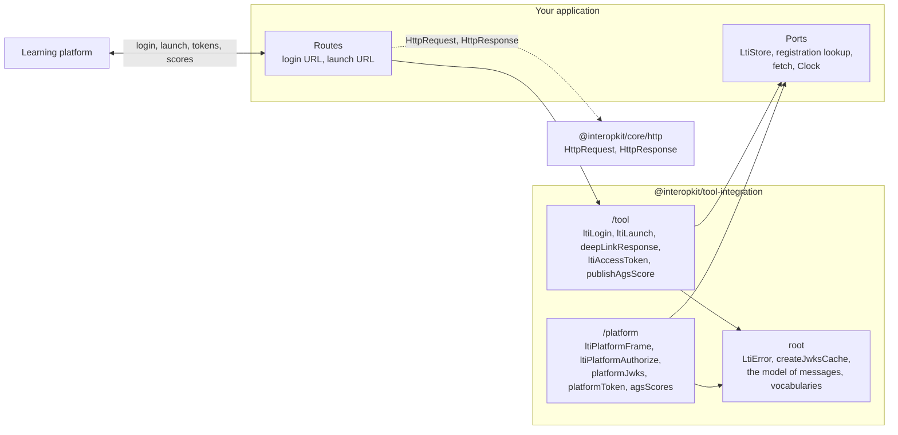

# @interopkit/tool-integration

Version 0.1 is not the whole of LTI Advantage: both roles have the launch, access tokens and the score service of Assignment and Grade Services, the tool role also has Deep Linking, and neither role has Names and Role Provisioning or Dynamic Registration ([what is supported](https://github.com/interopkit/interopkit/blob/main/docs/tool-integration/supported.md)).

LTI 1.3 for learning platforms and tools, in both roles. In the tool role your application is launched by a learning
platform: it answers its login, validates the launch, answers a Deep Linking request, and publishes scores back to the platform's
gradebook. In the platform role your application launches tools: it starts their login, issues the `id_token`, publishes its key
set, issues access tokens, and serves the line item and receives the scores of each launch. A handler takes an `HttpRequest` and returns an `HttpResponse` of [`@interopkit/core/http`](https://github.com/interopkit/interopkit/blob/main/docs/core/http.md): plain objects that any web framework can build.
You pass in the stores, the registrations, a `fetch` and a clock.



It runs in Node.js, browsers, Deno, Bun and Cloudflare Workers: it uses web standards only, reads no environment variable,
writes no log, and calls the network only through the `fetch` that you pass. Its dependencies are
[`@interopkit/core`](https://github.com/interopkit/interopkit/tree/main/packages/core#readme),
[jose](https://github.com/panva/jose) and [valibot](https://valibot.dev). It implements the specifications and is not
certified by 1EdTech; [Supported](https://github.com/interopkit/interopkit/blob/main/docs/tool-integration/supported.md) lists
what it includes and what it does not.

```bash
npm install @interopkit/tool-integration
```

## API

| Subpath                                 | Exports                                                                                                                                                                                                                                                                                                                                                                                                                                            |
| --------------------------------------- | -------------------------------------------------------------------------------------------------------------------------------------------------------------------------------------------------------------------------------------------------------------------------------------------------------------------------------------------------------------------------------------------------------------------------------------------------- |
| `@interopkit/tool-integration`          | `LtiError`, with a `reason` and an HTTP `status`; `createJwksCache`, `JwksCache`, `JwksCacheOptions`; the model of the messages: `LtiMessage`, `ToolMessage`, the seven message types (`ResourceLinkMessage`, `DeepLinkingRequestMessage`, `SubmissionReviewMessage`, `StartProctoringMessage`, `EndAssessmentMessage`, `DeepLinkingResponseMessage`, `StartAssessmentMessage`, `OtherMessage`) and their parts; `KeySet`; the vocabularies `SYSTEM_ROLES`, `INSTITUTION_ROLES`, `CONTEXT_ROLES`, `CONTEXT_SUB_ROLES`, `LTI_SYSTEM_ROLES`, `CONTEXT_TYPES`; `canonicalizeRole`, `canonicalizeContextType`, `APPROVED_ALGORITHMS`, `SCOPES`, `MESSAGE_TYPES` |
| `@interopkit/tool-integration/platform` | `ltiPlatformLogin`, `ltiPlatformFrame`, `ltiPlatformAuthorize`, `platformEndpoints`, `platformJwks`, `platformToken`, `platformStorage`, `agsLineItem`, `agsScores`, `readAgsScore`; `ToolLaunch`, `ToolRegistration`, `PlatformConfig`, `PlatformEndpoints`, `PlatformFrame`, `AgsScore`; the options `PlatformOptions`, `PlatformLoginOptions`, `PlatformAuthorizeOptions`, `PlatformTokenOptions`, `AgsScoresOptions`, `PlatformStorageOptions` |
| `@interopkit/tool-integration/tool`     | `ltiLogin`, `ltiLaunch`, `deepLinkResponse`, `ltiAccessToken`, `publishAgsScore`; `PlatformRegistration`, `LtiStore`, `LoginRecord`, `AgsScoreInput`, `AccessToken`, `DeepLinkItem`, `DeepLinkLineItem`; the options `ToolOptions`, `LtiLoginOptions`, `LtiLaunchOptions`, `AccessTokenOptions`                                                           |

```ts
import { createJwksCache } from "@interopkit/tool-integration";
import { ltiLogin } from "@interopkit/tool-integration/tool";

const keys = await crypto.subtle.generateKey(
  { name: "RSASSA-PKCS1-v1_5", modulusLength: 2048, publicExponent: new Uint8Array([1, 0, 1]), hash: "SHA-256" },
  false,
  ["sign"],
);
const registration = {
  issuer: "https://lms.example.edu",
  clientId: "962fa4d8-bcbf-49a0-94b2-2de05ad274af",
  deploymentIds: ["07940580-b309-415e-a37c-914d387c1150"],
  authenticationUrl: "https://lms.example.edu/auth",
  jwksUrl: "https://lms.example.edu/jwks",
  accessTokenUrl: "https://lms.example.edu/token",
  redirectUri: "https://tool.example.com/lti/launch",
  keyId: "tool-1",
  signingKey: keys.privateKey,
};
const logins = new Map();
const options = {
  registration: async () => registration,
  clock: { now: () => Date.now() },
  store: {
    put: async (state, record) => void logins.set(state, record),
    get: async (state) => logins.get(state),
    delete: async (state) => logins.delete(state),
  },
  jwks: createJwksCache({ fetch }),
};

const login = new URL("https://tool.example.com/lti/login");
login.search = new URLSearchParams({
  iss: registration.issuer,
  login_hint: "user-1",
  target_link_uri: "https://tool.example.com/lti/launch",
}).toString();
const response = await ltiLogin({ method: "GET", url: login.href, headers: {}, body: new Uint8Array() }, options);
response.status; // => 302
logins.size; // => 1
```

A failure throws `LtiError` for a check of the specifications (with its `reason`), `DataError` for a malformed request or
option, and `ServiceError` for a platform that does not answer. The [guide](https://github.com/interopkit/interopkit/blob/main/docs/tool-integration/tool.md)
has the routes, the store, every check of a launch, Deep Linking, scores, the failure paths and the signals; the [platform guide](https://github.com/interopkit/interopkit/blob/main/docs/tool-integration/platform.md) has the same for the platform role.

## License

[Apache-2.0](LICENSE). Copyright Fariz Wakan. LTI, Learning Tools Interoperability and 1EdTech are trademarks of 1EdTech
Consortium, Inc.; see [NOTICE](NOTICE).
