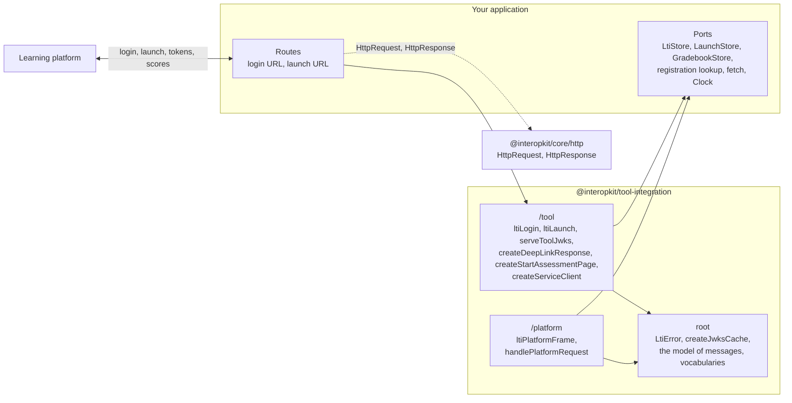

# @interopkit/tool-integration

Both roles have the launch of every message type, key sets, access tokens, the Assignment and Grade Services, Names and Role Provisioning, Context Groups, the AfA PNP Connector, Deep Linking, Proctoring Services and Dynamic Registration ([what is supported](https://github.com/interopkit/interopkit/blob/main/docs/tool-integration/supported.md)).

LTI 1.3 for learning platforms and tools, in both roles. In the tool role your application is launched by a learning
platform: it answers its login, validates the launch of every message type, serves its key set, answers a Deep Linking request,
sends a proctored candidate back to start, reads and writes the platform's gradebook, reads its members, groups and preferences
records, and controls a proctored attempt through its services, and registers itself with a platform through Dynamic Registration. In the platform role your application launches tools: it keeps the message of a launch in your store and starts the
tool's login, and one handler answers the tool's authentication request with the `id_token`, publishes the key set, issues
access tokens, serves the storage page, the grade services over your gradebook, the roster services over your roster, groups and records and the Assessment Control Service over your attempts, Dynamic Registration over your registrations, and two functions read the tool's Deep Linking response and Start Assessment message. A handler takes an `HttpRequest` and returns an `HttpResponse` of [`@interopkit/core/http`](https://github.com/interopkit/interopkit/blob/main/docs/core/http.md): plain objects that any web framework can build.
You pass in the stores, the registrations, a `fetch` and a clock.



It runs in Node.js, browsers, Deno, Bun and Cloudflare Workers: it uses web standards only, reads no environment variable,
writes no log, and calls the network only through the `fetch` that you pass. Its dependencies are
[`@interopkit/core`](https://github.com/interopkit/interopkit/tree/main/packages/core#readme),
[jose](https://github.com/panva/jose) and [valibot](https://valibot.dev). It implements the specifications and is not
certified by 1EdTech; [Supported](https://github.com/interopkit/interopkit/blob/main/docs/tool-integration/supported.md) lists
what it includes and what it does not.

```bash
npm install @interopkit/tool-integration
```

## API

| Subpath                                 | Exports                                                                                                                                                                                                                                                                                                                                                                                                                                            |
| --------------------------------------- | -------------------------------------------------------------------------------------------------------------------------------------------------------------------------------------------------------------------------------------------------------------------------------------------------------------------------------------------------------------------------------------------------------------------------------------------------- |
| `@interopkit/tool-integration`          | `LtiError`, with a `reason` and an HTTP `status`; `createJwksCache`, `JwksCache`, `JwksCacheOptions`; the model of the messages: `LtiMessage`, `ToolMessage`, the seven message types (`ResourceLinkMessage`, `DeepLinkingRequestMessage`, `SubmissionReviewMessage`, `StartProctoringMessage`, `EndAssessmentMessage`, `DeepLinkingResponseMessage`, `StartAssessmentMessage`, `OtherMessage`) and their parts; `KeySet`; the vocabularies `SYSTEM_ROLES`, `INSTITUTION_ROLES`, `CONTEXT_ROLES`, `CONTEXT_SUB_ROLES`, `LTI_SYSTEM_ROLES`, `CONTEXT_TYPES`; `canonicalizeRole`, `canonicalizeContextType`, `APPROVED_ALGORITHMS`, `SCOPES`, `MESSAGE_TYPES`; the models of the bodies of the services: `LineItem`, `LineItemInput`, `Score`, `Result`, `Membership`, `Member`, `GroupContainer`, `GroupSetContainer`, `ContentItem` and its five types, `PlatformConfiguration`, `ToolConfiguration`, `ToolRegistrationResult`, `ControlRequest`, `ControlStatus`, `PreferencesRecord`, their queries, and the vocabularies `ACTIVITY_PROGRESS`, `GRADING_PROGRESS`, `MEMBER_STATUSES`, `CONTENT_ITEM_TYPES`, `CONTROL_ACTIONS`, `ATTEMPT_STATUSES` |
| `@interopkit/tool-integration/platform` | `ltiPlatformLogin`, `ltiPlatformFrame`, `handlePlatformRequest`, `readDeepLinkingResponse`, `readStartAssessment`, `createRegistrationInitiation`, `toToolRegistration`, `buildPlatformEndpoints`, `buildCapabilitiesScript`; `MessageInput` and its five types (`ResourceLinkInput`, `DeepLinkingRequestInput`, `SubmissionReviewInput`, `StartProctoringInput`, `EndAssessmentInput`) with `MessageInputBase`, `MessageServicesInput` and `DeepLinkingInputSettings`; `ToolRegistration`, `PlatformConfig`, `PlatformEndpoints`, `PlatformFrame`, `CapabilitiesScript`, `LaunchToCheck`; the ports `LaunchStore`, `Substitution`, `GradebookStore`, `RosterStore`, `GroupStore`, `PreferencesStore`, `AssessmentControl`, `RegistrationStore` with `RegistrationRefusal`, and `PlatformServices`, with `ServiceCaller`, `StorePage`, `StoredLineItem`, `StoredResult`, `ReceivedScore`, `StoreLineItemQuery`, `StoreResultQuery`, `StoreMemberQuery`, `StoreMemberPage`, `StoreGroupQuery`; `ReceivedDeepLinkingResponse`, `ReceivedStartAssessment`, `RegisteredTool`, `RegistrationGrant`; the options `PlatformOptions`, `PlatformLoginOptions`, `PlatformRequestOptions`, `PlatformDiscovery`, `ToolMessageOptions`, `RegistrationInitiationOptions`, `CapabilitiesScriptOptions` |
| `@interopkit/tool-integration/tool`     | `ltiLogin`, `ltiLaunch`, `serveToolJwks`, `createDeepLinkResponse`, `createStartAssessmentPage`, `createServiceClient`, `advanceScoreTimestamp`, `readRegistrationInitiation`, `discoverPlatform`, `registerTool`, `toPlatformRegistration`, `createRegistrationClosePage`; `PlatformRegistration`, `LtiStore`, `LoginRecord`, `DeepLinkingResponseInput`, `StartAssessmentInput`, `RegistrationInitiation`, `ToolConfigurationInput`, `PlatformRegistrationInput`, `ServiceClient`, `GradesClient`, `MembersClient`, `GroupsClient`, `PreferencesClient`, `ControlClient`, `RegistrationClient`, `Page`, `MemberPage`; the options `ToolOptions`, `LtiLoginOptions`, `LtiLaunchOptions`, `ServeToolJwksOptions`, `ServiceClientOptions`, `DiscoverPlatformOptions`, `RegisterToolOptions` |

```ts
import { signerFromCryptoKey } from "@interopkit/core";
import { createJwksCache } from "@interopkit/tool-integration";
import { ltiLogin } from "@interopkit/tool-integration/tool";

const keys = await crypto.subtle.generateKey(
  { name: "RSASSA-PKCS1-v1_5", modulusLength: 2048, publicExponent: new Uint8Array([1, 0, 1]), hash: "SHA-256" },
  false,
  ["sign"],
);
const registration = {
  issuer: "https://lms.example.edu",
  clientId: "962fa4d8-bcbf-49a0-94b2-2de05ad274af",
  deploymentIds: ["07940580-b309-415e-a37c-914d387c1150"],
  authenticationUrl: "https://lms.example.edu/auth",
  jwksUrl: "https://lms.example.edu/jwks",
  accessTokenUrl: "https://lms.example.edu/token",
  redirectUri: "https://tool.example.com/lti/launch",
  signer: signerFromCryptoKey(keys.privateKey, { algorithm: "RS256", keyId: "tool-1" }),
};
const logins = new Map();
const clock = { now: () => Date.now() };
const options = {
  registration: async () => registration,
  clock,
  store: {
    put: async (state, record) => void logins.set(state, record),
    get: async (state) => logins.get(state),
    delete: async (state) => logins.delete(state),
  },
  jwks: createJwksCache({ fetch, clock }),
};

const login = new URL("https://tool.example.com/lti/login");
login.search = new URLSearchParams({
  iss: registration.issuer,
  login_hint: "user-1",
  target_link_uri: "https://tool.example.com/lti/launch",
}).toString();
const response = await ltiLogin({ method: "GET", url: login.href, headers: {}, body: new Uint8Array() }, options);
response.status; // => 302
logins.size; // => 1
```

A failure throws `LtiError` for a check of the specifications (with its `reason`), `DataError` for a malformed request or
option, and `ServiceError` for a platform that does not answer. The [guide](https://github.com/interopkit/interopkit/blob/main/docs/tool-integration/tool.md)
has the routes, the store, every check of a launch, the key set and its rotation, scores, the failure paths and the
signals; the [roster guide](https://github.com/interopkit/interopkit/blob/main/docs/tool-integration/roster.md) has the members, the groups and the preferences record; the [Deep Linking guide](https://github.com/interopkit/interopkit/blob/main/docs/tool-integration/deep-linking.md) has the items and both roles; the [proctoring guide](https://github.com/interopkit/interopkit/blob/main/docs/tool-integration/proctoring.md) has the Start Assessment message and the Assessment Control Service in both roles; the [registration guide](https://github.com/interopkit/interopkit/blob/main/docs/tool-integration/registration.md) has Dynamic Registration in both roles; the [platform guide](https://github.com/interopkit/interopkit/blob/main/docs/tool-integration/platform.md) has the same for the platform role.

[The evidence guide](https://github.com/interopkit/interopkit/blob/main/docs/tool-integration/evidence.md) shows what the package
was checked against: the examples and vocabularies of the specifications, tokens that another library signs, tools of other authors
(`@lti-tool/core`, `lti-core` and PyLTI1p3) that launch from the platform role and use its services, the speed of the launch and of
the pages of the services, and four runtimes.

## License

[Apache-2.0](LICENSE). Copyright Fariz Wakan. LTI, Learning Tools Interoperability and 1EdTech are trademarks of 1EdTech
Consortium, Inc.; see [NOTICE](NOTICE).
