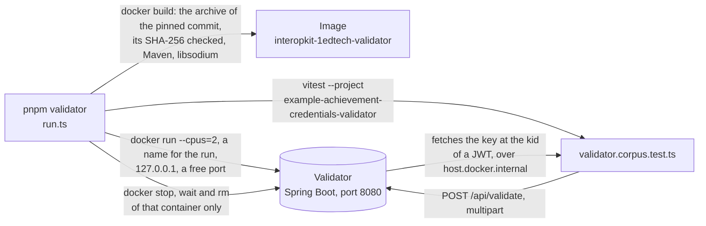

# The public validator of 1EdTech

The [public validator](https://github.com/1EdTech/digital-credentials-public-validator) of Open Badges and CLR (Apache-2.0, Java) is
the application that 1EdTech runs at vc.1ed.tech. `pnpm validator` builds it from a pinned commit, starts it in a container and
sends it the credentials of `examples/achievement-credentials` as a person does in its web page: as JSON, as a compact JWS and
inside a PNG and an SVG.



| File                                                             | Holds                                                                                                                                                                      |
| ---------------------------------------------------------------- | -------------------------------------------------------------------------------------------------------------------------------------------------------------------------- |
| `validator.lock.json`                                            | The repository, the commit and the SHA-256 of the archive that GitHub serves for it                                                                                        |
| `Dockerfile`                                                     | The image: the archive, downloaded with a stall timeout and three retries and checked against the hash, `mvn package`, and the library of Ed25519 that the validator loads |
| `run.ts`                                                         | Builds the image, starts the container, waits until it lists its validators, runs the test, and always removes its container                                               |
| `examples/achievement-credentials/test/validator.corpus.test.ts` | The credentials that the validator is sent, the outcome that each comes to, and the verdict of `verifyCredential` beside it                                                |

## Running it

| Need                                       | Why                                                                                                             |
| ------------------------------------------ | --------------------------------------------------------------------------------------------------------------- |
| Docker                                     | The container; the first build downloads Maven and the dependencies of the validator, and takes several minutes |
| `pnpm schemas` first                       | The credentials are signed under the contexts that it downloads at their pins                                   |
| Network access to GitHub and Maven Central | The archive and the dependencies of the build                                                                   |

```sh
pnpm schemas
pnpm validator
```

| Setting   | Value                                                                                                                                                                                                                                                                                           |
| --------- | ----------------------------------------------------------------------------------------------------------------------------------------------------------------------------------------------------------------------------------------------------------------------------------------------- |
| Source    | The commit in `validator.lock.json`; the archive must have its SHA-256, or the build stops before it unpacks anything                                                                                                                                                                           |
| Images    | `maven@sha256:1a352420f7aba21f5ad08df31bab55f74c013fb491f1ae8ab1dd7ff9ed698584` builds and runs it, pinned by digest                                                                                                                                                                            |
| Container | `CONTAINER_NAME` or `COMPOSE_PROJECT_NAME` when it is set, so that the unit that runs it names its own (`CONTAINER_NAME=my-unit pnpm validator`), and else `interopkit-validator-<8 hex digits>`, with `--cpus=2` and a port on 127.0.0.1; no other container is stopped, waited for or removed |
| Cleanup   | `docker stop`, `docker wait` and `docker rm` of that container run when the test passes, when it fails and when the start fails                                                                                                                                                                 |
| Tests     | The Vitest project `example-achievement-credentials-validator`; `pnpm test` leaves it out                                                                                                                                                                                                       |

## What it says of each input

The validator has three inspectors: Open Badges 3.0 (`OB30Inspector`), Open Badges 2.0 (`OB20Inspector`) and CLR 2.0
(`CLR20Inspector`). The test sends each input to the inspector of its kind and compares the outcome with the table, and asks
`verifyCredential` about the same input.

| Input                                                                          | Outcome of the validator    | `verifyCredential`                                 |
| ------------------------------------------------------------------------------ | --------------------------- | -------------------------------------------------- |
| An achievement credential with an `eddsa-rdfc-2022` proof                      | VALID                       | Verified                                           |
| The same, baked into a PNG or an SVG                                           | VALID                       | Verified, from what `readPng` and `readSvg` return |
| An achievement credential in a JWS signed with ES256                           | VALID                       | Verified, with the key at the `kid`                |
| The same, baked into a PNG or an SVG                                           | VALID                       | Verified, from what `readPng` and `readSvg` return |
| An `ecdsa-sd-2023` disclosure of an achievement credential                     | VALID                       | Verified                                           |
| A CLR with an `eddsa-rdfc-2022` proof, holding a credential with its own proof | VALID                       | Verified                                           |
| An achievement credential whose name changed after it was signed               | ERROR, `EmbeddedProofProbe` | Not verified, `proof` failed                       |

The validator and the package differ where the validator reads less, and the test pins each difference, so that a new build of the
validator that changes one fails it:

| Where                                                                                                                     | The validator                                                                                                                                      | The package                                                                                                               |
| ------------------------------------------------------------------------------------------------------------------------- | -------------------------------------------------------------------------------------------------------------------------------------------------- | ------------------------------------------------------------------------------------------------------------------------- |
| A JWS signed with EdDSA                                                                                                   | FATAL, `ExternalProofProbe`: `alg` must be `RS256` or `ES256`                                                                                      | Verifies it, with the key of the `did:key`: Open Badges 8.2 asks for RS256 at least and does not forbid another algorithm |
| A CLR in a JWS                                                                                                            | EXCEPTION, `CredentialParseProbe`: its CLR inspector leaves a setting of the JWT unset, and the payload of a CLR has no `vc` claim to read instead | Reads the payload of a CLR in a JWT, as CLR 7.2.4 writes it                                                               |
| The key of a JWT                                                                                                          | Fetched from the address in the `kid`, which the test serves over HTTP as one JWK                                                                  | A key that the issuer publishes (`verifyIssuerKey`); an address that the issuer does not host binds nothing               |
| A credential of an issuer at an address, signed by a key that the issuer does not publish, under a method at that address | VALID: it reads the key from the method and the controller from its address, which anyone can write                                                | `issuer` is not passed and `verified` is false: the issuer lists no such key                                              |

The inspector of Open Badges 2.0 is not run. It fetches the documents of a badge from the public Internet, which a badge of the
example cannot reach; [the guide of Open Badges 2.0](../../docs/achievement-credentials/open-badges-2.md) compares the package
with `openbadges-validator-core`, which that validator recommends for 2.0, in `v2-validator.corpus.test.ts`.

CLR Standard® is a trademark of 1EdTech® Consortium, Inc. (1edtech.org).
W3C® is a trademark of the World Wide Web Consortium.
interopkit is not affiliated with, endorsed by or approved by 1EdTech Consortium, Inc. or W3C.
