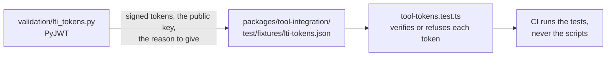

# validation

Python scripts that write the reference fixtures in `packages/*/test/fixtures/`, and the containers of counterparties. The
scripts sign with libraries that share no code with the packages, so that a test compares the packages with an independent
implementation. A counterparty is an application that runs beside the packages: [opensalt](opensalt/README.md) is a CASE server
and editor, which `pnpm opensalt` starts in containers and runs the client and provider of the example against.
[adl-lrs](adl-lrs/README.md) is the conformance suite of ADL, which `pnpm adl-lrs` runs against the example LRS of xAPI.
[sql-lrs](sql-lrs/README.md) is an LRS that `pnpm sql-lrs` starts in a container, as the oracle of the rules and a counterparty of the client.
[w3c-suites](w3c-suites/README.md) holds the interoperability suites of the W3C, which `pnpm w3c-suites` runs against the VC-API service of
the credentials example, and [1edtech-validator](1edtech-validator/README.md) the public validator of 1EdTech, which `pnpm validator`
builds and starts in a container and runs the credentials of that example through.



| Script               | Writes                                                                                                                                                                     | Needs                                                       |
| -------------------- | -------------------------------------------------------------------------------------------------------------------------------------------------------------------------- | ----------------------------------------------------------- |
| `lti_tokens.py`      | Launch tokens that PyJWT signs: one that verifies, and twelve that the tool must refuse, each with the reason                                                              | `PyJWT` and `cryptography`, pinned in `requirements.txt`    |
| `baked_images.py` | PNG images with a credential in an `iTXt` chunk, written with `struct` and `zlib`; SVG images with a credential element, parsed back with ElementTree; and the images that a reader must refuse, with Open Badges 2.0 assertions as 2.0 Baking writes them | The standard library of Python |
| `xapi_signatures.py` | Statements that jwcrypto signs with RS256, RS384 and RS512 and an X.509 chain, and thirty-odd signatures that `verifyStatementSignature` must refuse, each with the reason | `jwcrypto` and `cryptography`, pinned in `requirements.txt` |
| `caliper_ids.py`     | The name-based UUIDs of version 5 that Python's `uuid` computes, which `mintUrn` must equal, with the worked example of RFC 9562                                           | The standard library of Python                              |
| `ob2_badges.py`      | Open Badges 2.0 badges as a server hosts them: hosted assertions, assertions that jwcrypto signs in RS256 with the key in PEM, their BadgeClasses, issuers, keys and revocation list, recipients hashed by the standard library of Python, and the outcome that each was built for (valid, revoked, expired, outside the policy of its issuer, a changed payload, a key the issuer does not list) | `jwcrypto` and `cryptography`, pinned in `requirements.txt` |

Run it from the repository root in a virtual environment:

```bash
python3 -m venv validation/.venv
validation/.venv/bin/pip install -r validation/requirements.txt
validation/.venv/bin/python validation/lti_tokens.py
validation/.venv/bin/python validation/caliper_ids.py
validation/.venv/bin/python validation/xapi_signatures.py
validation/.venv/bin/python validation/baked_images.py
validation/.venv/bin/python validation/ob2_badges.py
```

A script generates its RSA keys at each run, so the signatures differ between runs; the cases and the reasons do not. Commit
the regenerated fixture. CI runs only the TypeScript tests.
