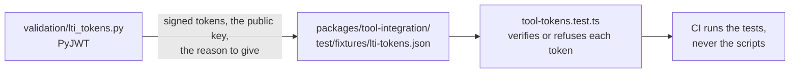

# validation

Python scripts that write the reference fixtures in `packages/*/test/fixtures/`. They sign with libraries that share no code
with the packages, so that a test compares the packages with an independent implementation.



| Script          | Writes                                                                                                        | Needs                                                    |
| --------------- | ------------------------------------------------------------------------------------------------------------- | -------------------------------------------------------- |
| `lti_tokens.py` | Launch tokens that PyJWT signs: one that verifies, and twelve that the tool must refuse, each with the reason | `PyJWT` and `cryptography`, pinned in `requirements.txt` |

Run it from the repository root in a virtual environment:

```bash
python3 -m venv validation/.venv
validation/.venv/bin/pip install -r validation/requirements.txt
validation/.venv/bin/python validation/lti_tokens.py
```

The script generates the RSA key at each run, so the signatures differ between runs; the cases and the reasons do not. Commit
the regenerated fixture. CI runs only the TypeScript tests.
