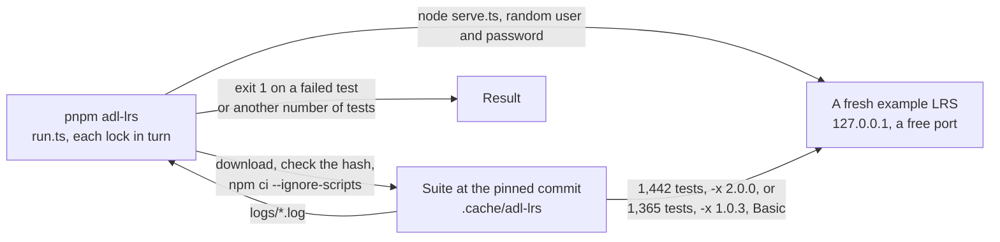

# The ADL conformance suite

The [LRS conformance test suite](https://github.com/adlnet/lrs-conformance-test-suite) of ADL (MIT) sends the requests that the
standard asks an LRS to answer, and checks each answer. `pnpm adl-lrs` runs its tests of xAPI 2.0 and of xAPI 1.0.3 against the
example LRS of `examples/learning-records`, which answers with `handleLrsRequest` over stores in memory, with HTTP Basic.



| File                | Holds                                                                                                                            |
| ------------------- | -------------------------------------------------------------------------------------------------------------------------------- |
| `suite.lock.json`   | One entry for each version: the repository, the branch, the commit, the SHA-256 of the archive of that commit, the version and the number of tests |
| `package-lock.json` | The dependencies of the suite with their hashes: the suite has no lockfile of its own, and the two branches list the same ones   |
| `run.ts`            | Downloads the suite, starts the LRS, runs the suite, and reads its log                                                           |

## Running it

| Need                                     | Why                                                                                     |
| ---------------------------------------- | --------------------------------------------------------------------------------------- |
| Network access to GitHub and npm, once   | The suite and its 500 packages are downloaded into `.cache/adl-lrs/`, which git ignores |
| Node.js 22 or later, and `tar` and `npm` | The suite is a Node project of 2015 to 2023, run by its own `bin/console_runner.js`     |

```sh
pnpm adl-lrs      # builds the packages first: the example LRS imports them as a host does, from their `dist/`
```

Each suite takes about 30 seconds after the first run. The port is free and on the loopback address, and the user and the password are
random for the run and never printed.

| Setting       | Value                                                                                                                        |
| ------------- | ---------------------------------------------------------------------------------------------------------------------------- |
| Pinned commits | `d17a26a0139523db65909fe5e9fdd6701c786013` of the branch `LRS-2.0` for 2.0.0, and `5bc232d349c60faded8240da698f195106091638` of `master` for 1.0.3 |
| Hash          | The archive that GitHub serves for the commit must have the SHA-256 of the lock, or the run stops before it unpacks anything |
| Install       | `npm ci --ignore-scripts` from the lockfile: no package of the suite runs a script on the machine                            |
| Tests         | 1,442 and 1,365; a suite with another number fails the run, so a new commit of the suite is noticed and not trusted          |
| Failure       | Each test that fails is printed with its groups and the error of the assertion, and the run exits with 1                     |

## What it found

Every failure of the suite is a rule that the handler did not follow, and the fix is in the handler. The first run of 2.0 failed
116 of the 1,442 tests, from these causes; each has a test in `packages/learning-records` and a rule in `scripts/rules/learning-records.ts`.
The first run of 1.0.3 failed 2 of the 1,365 tests, both from one cause: a PUT of a profile with no precondition where no document
exists was written, and the route of 1.0.3 refuses it with 400.

| Group of the suite that failed                                         | Cause in the handler                                                                                                                |
| ---------------------------------------------------------------------- | ----------------------------------------------------------------------------------------------------------------------------------- |
| Concurrency, State, Agent Profile, Activity Profile, Document Resource | A POST or a DELETE of a document with no precondition was refused with 409, and only a PUT is                                       |
| Concurrency                                                            | `If-Match: 1234`, which names no tag, was 400 and not 412                                                                           |
| Concurrency                                                            | The explanation of a 409 was JSON, and the suite reads text                                                                         |
| Activity Profile                                                       | A DELETE of a document that is not there was 404, and the suite expects 204                                                         |
| Statement Resource, Voided Statement, Document Resource, batches       | `X-Experience-API-Consistent-Through` was missing from a 400 and a 404 of the Statements resource                                   |
| Timestamps                                                             | A timestamp was kept with its offset, a time with no seconds and a space between date and time were refused, and `-00:00` was taken |
| Authority                                                              | An authority that is a Group of one, of three or an identified Group was taken                                                      |
| Context                                                                | `revision` and `platform` were taken in a context whose Object is not an Activity                                                   |
| Version                                                                | A Statement `version` of `0.9.9`, `1.1.0` or a text that is no version was taken                                                    |
| Attachments                                                            | The length of an Attachment was compared to its data, and a part that no Attachment names was taken                                 |
| Signed Statements                                                      | A signature that no key verifies was taken whatever its payload                                                                     |
| Activities                                                             | The store of Activities saw one definition of an Activity from a batch, and not each                                                |
| Agents                                                                 | The example answered a Person without the name, `openid` and account of the Agent (a fault of the example)                          |
| About                                                                  | The example asked for a credential for About, which the suite asks without one (a choice of the example's host)                     |

The suite is not the standard: it carries tests of xAPI 1.0.3 into 2.0 that the IEEE books do not state, among them the rules for
`authority`, `revision`, `platform` and `version`, and one test, a timestamp with no seconds, that SQL LRS fails. The handler
follows the suite where the books are silent, and `docs/learning-records/spec-gaps.md` lists each such place.
