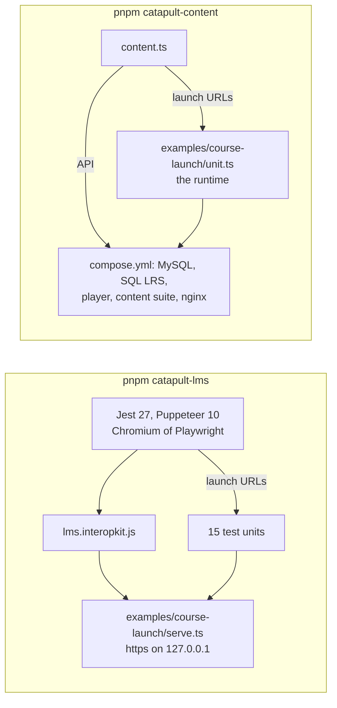

# CATAPULT

ADL's CATAPULT at `806c0ba` (v1.0.8), whose archive `suite.lock.json` pins by its SHA-256, run against the cmi5 example:
`pnpm catapult-lms` runs its LMS suite against the example LMS, and `pnpm catapult-content` runs its content suite and its
player against units played by the runtime of `@interopkit/course-launch/au`. Neither runs in `pnpm test`; both build the
packages first, write their logs to `.cache/catapult/` as they go, and fail on a suite of another size.

| File | Holds |
| --- | --- |
| `suite.lock.json` | The commit and hash of the archive, the 87 tests of the LMS suite and the tests that do not apply (none), and the 54 sessions of the content suite |
| `lms.ts` | Downloads the archive, installs the LMS suite from its lockfile without a browser, builds its packages, starts the example LMS with a certificate of the run, runs the suite and reads its JUnit file |
| `lms.interopkit.js` | The adapter of the suite: import, launch URL, waive and abandon through the automation of `serve.ts` |
| `jest-puppeteer.config.js` | The Chromium of the repository's Playwright, which takes the certificate of the run |
| `content.ts` | Builds the images, starts the stack in a project of the run, plays every unit in three launch modes and a planted violation, and removes the project and its volumes |
| `player.Dockerfile`, `cts.Dockerfile`, `nginx.conf`, `compose.yml` | The player and the content suite over the pinned sources, on the linux/amd64 image of `node:18`, and nginx with the certificate of the run |

## The LMS suite

| Step | Why |
| --- | --- |
| `npm ci --ignore-scripts` with `PUPPETEER_SKIP_DOWNLOAD` | The lockfile of the suite, and no browser of its own: the run uses the Chromium of Playwright, which Puppeteer 10 drives |
| `npx webpack` in `lts/pkg` with `--openssl-legacy-provider` | Builds the 15 test units and zips the packages; webpack 5.45 hashes with MD4 |
| `examples/course-launch/serve.ts` | The example LMS over https: the LRS at `/xapi/`, the fetch URL at `/fetch`, the files of each package at `/content/<course>/`, and the automation that the adapter calls with a credential of the run |
| `npx jest --runInBand --testTimeout=60000` | One test at a time, with time for a unit on a loaded machine; `NODE_EXTRA_CA_CERTS` trusts the certificate of the run |

## The content suite

| Step | Why |
| --- | --- |
| The images of the player and the suite | Their own Dockerfiles fail: `npm ci` refuses the player's lockfile, the shipped `node_modules` holds a `knex-stringcase` that `lib/db.js` cannot call, and the suite's lockfile needs npm 7; ours install from the lockfiles, with `knex-stringcase` 1.5.5 and `bcrypt` rebuilt |
| MySQL 8.0 and SQL LRS by digest | MySQL 8.0.17 has no arm64 image; SQL LRS is the image of `validation/sql-lrs/` |
| nginx with the certificate of the run | The suite builds its addresses from `x-forwarded-proto`, and the runtime takes https alone |
| The first test of a course is tried again | The suite writes the preferences of a learner into its LRS as it makes a test, and fails while the LRS starts |

Locally, run each from a fresh clone in `/Users/nb-dk-0715/Documents/gates/<unit>/` with `COMPOSE_PROJECT_NAME` set to the unit:
the images are built for linux/amd64, which an arm64 host emulates.
