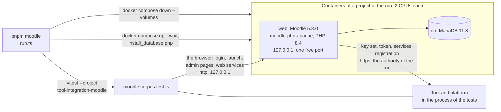

# Moodle as a counterparty

[Moodle](https://moodle.org) 5.3 (GPL, not a dependency) is a learning platform that plays both roles of LTI 1.3: as a platform
it launches tools, and its "Publish as LTI tool" makes it a tool that a platform launches. `pnpm moodle` starts it in containers
and runs both roles of `@interopkit/tool-integration` against it, one at a time: a tool built on the package that Moodle
launches, and a platform built on the package that launches Moodle.



| File                                                   | Holds                                                                                                                                    |
| ------------------------------------------------------ | ---------------------------------------------------------------------------------------------------------------------------------------- |
| `run.ts`                                               | Fetches the source of Moodle at its pinned commit, installs its PHP packages, starts the project, installs Moodle, runs the flows, and always removes the project and its volumes |
| `compose.yaml`                                         | The web server and the database, from images pinned by digest                                                                             |
| `config.php`                                           | The configuration of Moodle: its address, its database and the settings that let it reach the machine that runs the tests               |
| `setup.php`                                            | What a person does in the interface of Moodle that is not LTI: users, a course, an activity, a grade, a published course, the tasks of the cron |
| `trust-authority.sh`                                   | Makes the container trust the certificate authority that the run made                                                                    |
| `packages/tool-integration/test/moodle.corpus.test.ts` | The flows                                                                                                                                |
| `packages/tool-integration/test/moodle-driver.ts`      | The browser's side of Moodle: sign in, the forms of its pages, a web service, and the commands of `setup.php`                            |

The flows go through the pages and endpoints that a browser and a tool use. `setup.php` does what a person does to prepare them and
to read the gradebook afterwards.

| Role of Moodle | Flow                                                                                                                                                                                  |
| -------------- | ------------------------------------------------------------------------------------------------------------------------------------------------------------------------------------- |
| Platform       | Dynamic Registration from `startltiadvregistration.php` to the activation of the tool; the launch of an activity, with the login and the launch compared on `target_link_uri`; the line item, the container, a created line item and a score, read back in the gradebook; the members; a Deep Linking request answered with an item |
| Tool           | Dynamic Registration from "Register a platform" to the activation of the platform; the launch of a published course, which provisions and enrols the learner; the members that Moodle reads from the platform; the grade that Moodle posts to the platform's line item |

## Running it

| Need                                              | Why                                                                                                                 |
| ------------------------------------------------- | ------------------------------------------------------------------------------------------------------------------- |
| Docker with Compose, `git` and `openssl`          | The containers, the source of Moodle at a commit, and the certificates                                              |
| About 1 GB of disk and 4 CPUs while it runs       | The source with its packages (about 800 MB, kept in `.cache/moodle/`), and 2 CPUs for each container                 |
| Network access to GitHub, Docker Hub and Packagist the first time | The source, the images and the PHP packages are not cached                                                     |

```sh
pnpm moodle
```

A run takes about three minutes once the source is cached: Moodle installs its database in about two. Nothing is kept between runs but
the source.

| Setting         | Value                                                                                                                                                                              |
| --------------- | ---------------------------------------------------------------------------------------------------------------------------------------------------------------------------------- |
| Moodle          | The commit `42622298fe06f9626d988d60b2bf589bd8f850e8` of `moodle/moodle`, the tag `v5.3.0` (2026-10-03); `run.ts` checks the commit                                                  |
| Images          | `moodlehq/moodle-php-apache:8.4-bookworm`, `mariadb:11.8` and `composer:2`, each by digest in `compose.yaml` and `run.ts`; `moodle-docker` is a set of files for development and not an image, so the Compose file is this folder's own |
| Containers      | `ik-lev-moodle-<8 hex digits>-web-1` and `-db-1` of a project of the run, 2 CPUs each; no other container is stopped or removed                                                    |
| Ports           | The web server on a free port of 127.0.0.1. Moodle names itself `https://moodle.test:<port>`, which only the tests use; the tests reach it in plain HTTP with that `Host`         |
| The machine     | The tool and the platform answer over `https` on free ports of all interfaces, as `tool.example.org` and `platform.example.org`, which the web container maps to the machine (`host-gateway`) |
| Trust           | A certificate authority of the run, valid for two days, is mounted into the web container and installed there; Moodle's cURL helper may reach the private address and port (`config.php`) |
| Secrets         | The passwords of the database and of the administrator, the keys of the tool and of the platform, and the authority are random for the run                                          |
| Cleanup         | `docker compose down --volumes` of that project runs when the flows pass, when they fail and when the start fails                                                                    |
| Tests           | The Vitest project `tool-integration-moodle`; `pnpm test` leaves it out                                                                                                              |

## What it showed

What Moodle does differently from the specifications, and what the package does about it, is in
[the evidence guide](../../docs/tool-integration/evidence.md).
