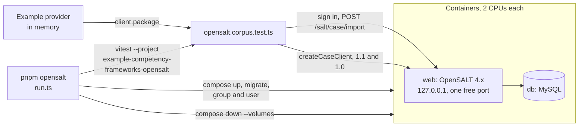

# OpenSALT as a counterparty

[OpenSALT](https://github.com/opensalt/opensalt) (MIT) is a PHP application that edits, stores and publishes CASE frameworks.
`pnpm opensalt` starts it in containers, imports the frameworks of the example provider into it, and runs the client and the
platform of the example against it. It proves that what the provider serves is what another implementation takes in, and
that what another implementation serves is what the client reads.



| File           | Holds                                                                                                                                 |
| -------------- | ------------------------------------------------------------------------------------------------------------------------------------- |
| `compose.yaml` | The web application and its database, from the images the project publishes, pinned by digest, and the check of the database's health |
| `run.ts`       | Starts the containers with secrets made for the run, migrates, makes a user, runs the flows, and always removes everything            |
| `session.ts`   | Signs in with the login form and imports a framework the way the editor of OpenSALT does                                              |

The flows are in `examples/competency-frameworks/test/opensalt.corpus.test.ts`. What each proves, and what OpenSALT does
differently from the references, is in [the evidence guide](../../docs/competency-frameworks/evidence.md).

## The version under test

| Part     | Image                                                                                               | Built from                                                                                        |
| -------- | --------------------------------------------------------------------------------------------------- | ------------------------------------------------------------------------------------------------- |
| web      | `opensalt/opensalt:web-4.x@sha256:79f1b2efa04768ddb716d857b1b18d7cfe290d3e8b1604ef44b5aa64dcc19c35` | `7f50be9d86261bf7cff9b051ab4fb572e95020ed` of the `develop` branch, version 4.0.0-dev, 2026-10-26 |
| database | `opensalt/opensalt:db-4.x@sha256:3a483fbf93f3dc6b37b85f7ff5ec03bf54745bba3b90f4be5311a89a7e423b8a`  | MySQL 8, as the project builds it                                                                 |

The tag `web-4.x` moves, and the digest does not. The last release tag of the repository is 3.2.1 (2023); the 4.x images are
what the project builds from its `develop` branch, whose README describes CASE 1.1-compatible content. To test a newer build,
take its digests with `docker buildx imagetools inspect opensalt/opensalt:web-4.x`, change them in `compose.yaml`, run the
flows, and record each difference in the evidence guide.

## Running it

| Need                                            | Why                                                                                                    |
| ----------------------------------------------- | ------------------------------------------------------------------------------------------------------ |
| Docker with Compose                             | The containers. The images exist for linux/amd64 only, so an arm64 host emulates them, which is slower |
| About 1.5 GB of images and 4 CPUs while it runs | Each container is capped at 2 CPUs (`cpus` in `compose.yaml`), so that a shared machine is not slowed  |
| Network access to Docker Hub the first time     | The images are not cached                                                                              |

```sh
pnpm opensalt
```

Nothing is kept between runs.

| Setting  | Value                                                                                                                                                                                                                                    |
| -------- | ---------------------------------------------------------------------------------------------------------------------------------------------------------------------------------------------------------------------------------------- |
| Project  | `CONTAINER_NAME` or `COMPOSE_PROJECT_NAME` when it is set, so that the unit that runs it names its own (`CONTAINER_NAME=my-unit pnpm opensalt`), and else `interopkit-opensalt-<8 hex digits>`; no other container is stopped or removed |
| Port     | A free port on 127.0.0.1, chosen for the run (`OPENSALT_PORT`); the application is not reachable from other hosts                                                                                                                        |
| Database | `compose.yaml` checks it every 5 s, after 30 s of grace, up to 60 failures, and `docker compose up --wait` waits for it at most 360 s; the check of the image gives up after three tries 30 s apart, which an emulated start can exceed  |
| Secrets  | The database passwords, the application secret (also the key of the update hub, which must hold 256 bits) and the password of the user are random for each run, and exist only in the environment of the processes and the containers    |
| User     | A user of the role `SUPER_USER` in a group of its own, made with the commands of the application                                                                                                                                         |
| Cleanup  | `docker compose down --volumes --remove-orphans` runs when the flows pass, when they fail and when the start fails                                                                                                                       |
| Flows    | The Vitest project `example-competency-frameworks-opensalt`; `pnpm test` leaves it out                                                                                                                                                   |

## Why the import is not a fetch by OpenSALT

OpenSALT can import a framework from a URL, and `pnpm opensalt` does not use that: the route (`/salt/case/importRemote`)
accepts only public HTTPS addresses and refuses every address in a private range, which a container network and a test
machine are. The flows take the package from the example provider with the client and send it to the route that the editor
uses for a file (`/salt/case/import`), which checks the file against the JSON schema of CASE 1.1.

CASE® is a trademark of 1EdTech® Consortium, Inc. (1edtech.org).
interopkit is not affiliated with, endorsed by or approved by 1EdTech Consortium, Inc.
