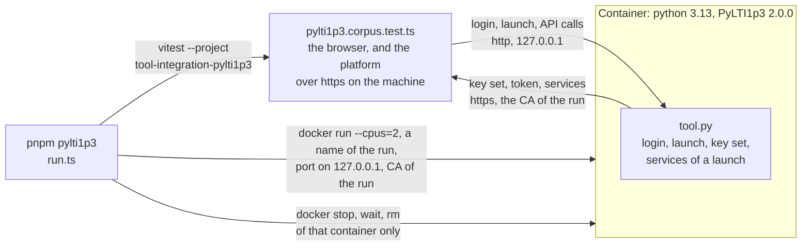

# PyLTI1p3 as a counterparty

[PyLTI1p3](https://github.com/dmitry-viskov/pylti1.3) 2.0.0 (MIT) is a Python library for the tool role of LTI 1.3. `pnpm pylti1p3`
starts a small tool built on it in a container, and runs the platform role of `@interopkit/tool-integration` against it: the
platform is the one that launches, signs, issues tokens and serves the grade, roster and groups services, and every check of
the launch, every request to a service and every answer is PyLTI1p3's.



| File                                                     | Holds                                                                                                                                                                |
| -------------------------------------------------------- | -------------------------------------------------------------------------------------------------------------------------------------------------------------------- |
| `run.ts`                                                 | Makes a certificate authority and a certificate for the platform, starts the container, waits until it answers, runs the flows, and always removes its own container |
| `tool.py`                                                | The tool: the adapters of PyLTI1p3 over the HTTP server of the standard library, and the routes below                                                                |
| `requirements.txt`                                       | PyLTI1p3 and what it needs, each pinned to a release at least 3 days old                                                                                             |
| `../containers/`                                         | What this runner and the runner of Moodle share: the commands of Docker, a free port, and the certificates                                                           |
| `packages/tool-integration/test/pylti1p3.corpus.test.ts` | The flows: the browser, the platform and what each asserts                                                                                                           |

| Route of the tool                    | Does                                                                                                                       |
| ------------------------------------ | -------------------------------------------------------------------------------------------------------------------------- |
| `POST /admin/configure`              | Registers the platform (issuer, client, endpoints, deployments) with a new key of the tool, so that each flow starts clean |
| `GET /lti/login`, `POST /lti/launch` | `OIDCLogin.redirect` and `MessageLaunch.get_launch_data`, with the cookies and the cache of the library                    |
| `GET /lti/jwks`                      | The key set of the tool, which the platform fetches                                                                        |
| `/api/<launch>/ags/...`              | `get_lineitem`, `get_lineitems`, `find_or_create_lineitem`, `put_grade`, `get_grades`                                      |
| `/api/<launch>/nrps/...`             | `get_members` and `get_context`                                                                                            |
| `/api/<launch>/groups/...`           | `get_groups` and `get_sets`                                                                                                |
| `/api/<launch>/deep-linking/items`   | `DeepLink.get_response_jwt`, with the return URL of the request                                                            |

A launch is read back from the cache of the library with `MessageLaunch.from_cache`, as an application does between requests.

## Running it

| Need                                  | Why                                                                                                                      |
| ------------------------------------- | ------------------------------------------------------------------------------------------------------------------------ |
| Docker                                | The container; its image is multi-architecture, so an arm64 host runs it natively                                        |
| The `openssl` command                 | Node.js cannot make certificates; the run makes an authority and a certificate for `lms.example.edu`, valid for two days |
| Network access to Docker Hub and PyPI | The image is pulled the first time, and the container installs the pinned packages at each start, which takes about 15 s |

```sh
pnpm pylti1p3
```

| Setting   | Value                                                                                                                                                                                                                                                                                                                                |
| --------- | ------------------------------------------------------------------------------------------------------------------------------------------------------------------------------------------------------------------------------------------------------------------------------------------------------------------------------------ |
| Image     | `python:3.13-slim@sha256:ae14d4ce8771606477a81446e7ef429edd6762305fc50c84507c1041fa8285d1`, which the tag `3.13-slim` names                                                                                                                                                                                                          |
| Container | `CONTAINER_NAME` or `COMPOSE_PROJECT_NAME` when it is set, so that the unit that runs it names its own (`CONTAINER_NAME=my-unit pnpm pylti1p3`), and else `interopkit-pylti1p3-<8 hex digits>`, 2 CPUs; no other container is stopped, waited for or removed                                                                         |
| Tool port | A free port on 127.0.0.1; the tool is not reachable from other hosts                                                                                                                                                                                                                                                                 |
| Platform  | In the process of the tests, over `https` on a free port of all interfaces for the run, since the container reaches the machine through `host.docker.internal` (`--add-host lms.example.edu:host-gateway`) and on Linux that is the bridge and not the loopback address; it serves a platform with random keys and a store in memory |
| Trust     | The certificate authority of the run is given to the container as `CA_PEM`, and `tool.py` makes `requests` trust it; Python 3.13 verifies strictly, so the certificates carry key identifiers                                                                                                                                        |
| Secrets   | The keys of the platform and of the tool, the hint key and the authority exist for the run only                                                                                                                                                                                                                                      |
| Cleanup   | `docker stop`, `docker wait` and `docker rm` of that container run when the flows pass, when they fail and when the start fails                                                                                                                                                                                                      |
| Tests     | The Vitest project `tool-integration-pylti1p3`; `pnpm test` leaves it out                                                                                                                                                                                                                                                            |

## What it showed

The flows pass for a platform that signs with RS256 and with ES256: PyLTI1p3 reads the algorithm of the key set and accepts both.
Each difference between PyLTI1p3 and the specifications, and what the platform does about it, is in
[the evidence guide](../../docs/tool-integration/evidence.md).

LTI® is a trademark of 1EdTech® Consortium, Inc. (1edtech.org).
interopkit is not affiliated with, endorsed by or approved by 1EdTech Consortium, Inc.
