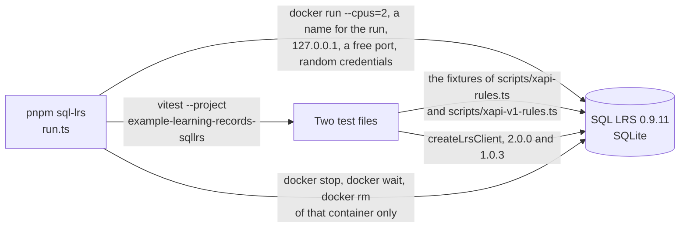

# SQL LRS as an oracle and a counterparty

[SQL LRS](https://github.com/yetanalytics/lrsql) 0.9.11 (Apache-2.0) is an LRS of Yet Analytics that passes the ADL suite for
xAPI 2.0. `pnpm sql-lrs` starts it in a container and asks it two things: whether it takes and refuses the Statements of the
rules of each version as the reader of an LRS does, and whether the client, the platform and the dashboard of the example work against a
different implementation of the other side.



| File                                                            | Holds                                                                                                                                   |
| --------------------------------------------------------------- | --------------------------------------------------------------------------------------------------------------------------------------- |
| `run.ts`                                                        | Starts the container, waits until it is healthy, runs the tests, and always stops and removes its own container                         |
| `examples/learning-records/test/sqllrs-verdicts.corpus.test.ts` | The verdict of SQL LRS on the fixture of each of the 153 rules of 2.0 and the 179 of 1.0.3, against the verdict of the reader of an LRS |
| `examples/learning-records/test/sqllrs.corpus.test.ts`          | The platform and the dashboard of the example, and the client of 1.0.3, against SQL LRS                                                 |

## Running it

| Need                                            | Why                                                                                                          |
| ----------------------------------------------- | ------------------------------------------------------------------------------------------------------------ |
| Docker                                          | The container. The image is linux/amd64 only, so an arm64 host emulates it and takes about a minute to start |
| About 150 MB of image, and 2 CPUs while it runs | The container is capped at 2 CPUs (`--cpus=2`), so that a shared machine is not slowed                       |
| Network access to Docker Hub the first time     | The image is not cached                                                                                      |

```sh
pnpm sql-lrs
```

A run takes about two minutes. Nothing is kept between runs.

| Setting     | Value                                                                                                                                                                                                                                                                         |
| ----------- | ----------------------------------------------------------------------------------------------------------------------------------------------------------------------------------------------------------------------------------------------------------------------------- |
| Image       | `yetanalytics/lrsql@sha256:bf5661ab216d07175f6e429951bf53c79f6070d54812285ea4c208f991cf0a04`, which the tag `v0.9.11` names                                                                                                                                                   |
| Container   | `CONTAINER_NAME` or `COMPOSE_PROJECT_NAME` when it is set, so that the unit that runs it names its own (`CONTAINER_NAME=my-unit pnpm sql-lrs`), and else `interopkit-sqllrs-<8 hex digits>`, chosen for the run, 2 CPUs; no other container is stopped, waited for or removed |
| Port        | A free port on 127.0.0.1; the LRS is not reachable from other hosts                                                                                                                                                                                                           |
| Credentials | The user and the password of the default key, and the password of the admin, are random for the run and exist only in the environment of the processes                                                                                                                        |
| Cleanup     | `docker stop`, `docker wait` and `docker rm` of that container run when the tests pass, when they fail and when the start fails                                                                                                                                               |
| Tests       | The Vitest project `example-learning-records-sqllrs`; `pnpm test` leaves it out                                                                                                                                                                                               |

## What each file shows

The verdicts do not compare the two on one fixed Statement: each fixture is the Statement of a provider with one change, so a
difference is about one rule. The test lists the differences and fails when a new one appears or one of the six goes.

| Where SQL LRS answers otherwise                                                                                                 | The text of the standard                                                                                                  |
| ------------------------------------------------------------------------------------------------------------------------------- | ------------------------------------------------------------------------------------------------------------------------- |
| A score whose `min` is not less than its `max` is taken                                                                         | `min`: "Decimal number less than max (if present)" (LRS 4.2.2.4); the reader refuses it                                   |
| A language map with the keys `zh-Hant-TW`, `ja` and `x-private` is refused                                                      | An LRS "shall reject a Statement with invalid RFC 5646 language tags" (4.2.7), and these are valid; the reader takes them |
| An interaction with properties its type does not have, or two components of one id, or a component list for fill-in, is refused | An LRS "may return 400" there, and the books ask a warning at most; the reader warns                                      |
| A submitted authority that is an anonymous Group of two Agents is refused                                                       | "Agent or Group" (4.2.2.5); the reader takes it, and the LRS replaces it in any case                                      |

SQL LRS also answers 500 to the full Statement of the tests, which has `contextGroups`, and to a Statement with a signature
whose data are not sent; the fixtures leave both out.

The flows pin what the two do differently as a client and a server:

| Flow                                                                  | What SQL LRS does                                                                                                                                                          |
| --------------------------------------------------------------------- | -------------------------------------------------------------------------------------------------------------------------------------------------------------------------- |
| A batch that the LRS holds already is sent again                      | Answers 200 with `[]`, not the ids; the client resolves with the ids of the batch                                                                                          |
| A signed Statement that has another Attachment besides the signature  | Answers 400 "Statement signature does not match statement": it compares the payload with the Statement without its Attachments, though the standard signs the complete one |
| A Statement with `version` 2.0.0 sent to the 1.0.3 route              | Answers 400; the client of 1.0.3 refuses it before any request, and a builder of 1.0.3 writes `1.0.0`                                                                      |
| A second State write with no precondition on the 1.0.3 route          | Answers 409, as it does on 2.0.0, where 1.0.3 asks that State go without headers; the LRS of the package replaces the document                                             |
| A Statement of 2.0 read on the 1.0.3 route                            | Answers it as it holds it, with `contextAgents` and `version` 2.0.0; the client of 1.0.3 reads it into the form of 1.0.3                                                   |
| The form of 1.0.3 of a Statement of 2.0 sent again on the 1.0.3 route | Answers 409, since it compares with the whole Statement; the LRS of the package answers 204                                                                                |     |

IEEE is a trademark of the Institute of Electrical and Electronics Engineers, Inc.
interopkit is not affiliated with, endorsed by or approved by IEEE or ADL.
