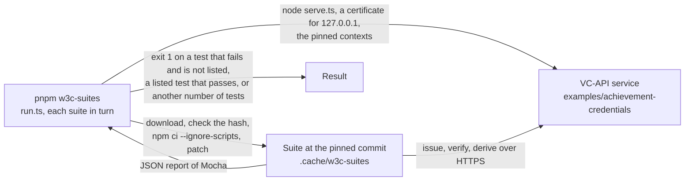

# The interoperability suites of the W3C

Four test suites of the W3C send credentials to an issuer and a verifier over HTTP, the VC-API, and check each answer. `pnpm
w3c-suites` runs them at pinned commits against the VC-API service of `examples/achievement-credentials`, which issues with
`addProof`, verifies with `verifyProof` and `verifyCredentialStatus`, derives with `deriveDisclosure` and serves the status lists
that it fills.



| Suite                                 | Commit    | Counted    | Tests | Passes | Skipped by the suite | Listed as failing | What it checks of the service                                                               |
| ------------------------------------- | --------- | ---------- | ----: | -----: | -------------------: | ----------------: | ------------------------------------------------------------------------------------------- |
| `vc-di-eddsa-test-suite`              | `1e86cc4` | 2026-11-04 |    44 |     44 |                    0 |                 0 | Issuing and verifying with `eddsa-rdfc-2022`: the proof, its data model, its algorithms     |
| `vc-di-ecdsa-test-suite`              | `94dca21` | 2026-11-04 |    59 |     55 |                    1 |                 3 | `ecdsa-rdfc-2019` and `ecdsa-sd-2023` on P-256: issuing, deriving, verifying                |
| `vc-bitstring-status-list-test-suite` | `960ab9a` | 2026-11-04 |    56 |     40 |                   16 |                 0 | The status list credentials that the service issues, and a credential verified against them |
| `vc-data-model-2.0-test-suite`        | `6283645` | 2026-11-04 |    59 |     44 |                    0 |                15 | Issuing and verifying credentials of the Data Model 2.0, and refusing those that are not    |

Each count is that of a run on the date given, at the commit given, and not a statement that the package conforms to the
specifications that a suite tests. The lock pins the commit and the size of each suite, and a test of `scripts/` fails when this
table differs from the lock.

`vc-jose-cose-test-suite` is not run. Its implementations are Docker images with a command line that issues and verifies
credentials and presentations with JOSE, COSE and SD-JWT, and not services over HTTP. The package writes the JWS form of Open
Badges 8.2, which differs from the VC-JOSE-COSE form (the guide of [jwt](../../docs/achievement-credentials/jwt.md) lists the
difference), it verifies the form of VC-JOSE-COSE, and it secures nothing with COSE or SD-JWT. The public validator of 1EdTech
checks the JWS form that Open Badges names (see [1edtech-validator](../1edtech-validator/README.md)).

## Running it

| Need                                              | Why                                                                                                |
| ------------------------------------------------- | -------------------------------------------------------------------------------------------------- |
| `pnpm schemas` first                              | The service serves the contexts that `pnpm schemas` pins, and no other                             |
| Network access to GitHub and npm, once            | Each suite and its 300 packages are downloaded into `.cache/w3c-suites/`, which git ignores         |
| Node.js 24, `tar`, `npm`, `patch` and `openssl`   | The suites are Node projects; the data model suite needs Node.js 24; `openssl` makes the certificate |

```sh
pnpm schemas
pnpm w3c-suites            # builds the packages, which the service imports from their `dist/`, then runs every suite
pnpm w3c-suites ecdsa      # the suite that is named
```

Each suite takes seconds. The service listens on a free port of the loopback address, with a certificate that `openssl` makes
for the run, which the suites accept as they accept every certificate.

| Setting          | Value                                                                                                                                                                                       |
| ---------------- | ------------------------------------------------------------------------------------------------------------------------------------------------------------------------------------------- |
| Pinned commits   | In `suites.lock.json`, with the SHA-256 of the archive that GitHub serves for each; a different hash stops the run before anything is unpacked                                                 |
| Install          | `npm ci --ignore-scripts` from the lockfile of the suite; the dependencies that the lockfile takes from GitHub come over HTTPS                                                                |
| Patches          | `patches/eddsa.patch` and `patches/ecdsa.patch` give the credentials of the suites the `validFrom` that Open Badges requires, and the ECDSA suite the mandatory pointer to it                 |
| Contexts         | The documents that `pnpm schemas` downloaded, which the service serves at their pins, and no other                                                                                           |
| Unbound keys     | The service verifies with keys that the issuer does not publish only for `ecdsa`, whose vector of `ecdsa-rdfc-2019` is signed for an issuer at `https://vc.example` that publishes nothing |
| Tests            | The number of each suite and of its skipped tests are in the lock; a suite of another size fails the run, so that a new commit is noticed and not trusted                                    |
| Failure          | A test that fails and is not listed is printed with its error, a listed test that passes is printed, and the run exits with 1                                                              |

## What each patch changes

The suites send credentials of the generic form of the Data Model: an `id`, a type and a subject. Open Badges requires more of a
credential (`validFrom`, a subject that says something, an issuer with a `type` when it is a Profile), so the patches add what
Open Badges requires and change nothing of what a suite tests.

| Patch         | Change                                                                                                                                                                         |
| ------------- | ------------------------------------------------------------------------------------------------------------------------------------------------------------------------------ |
| `eddsa.patch` | `validFrom` in `tests/vc-generator/validVc.js`                                                                                                                                  |
| `ecdsa.patch` | `validFrom` in the two documents of the 2.0 mocks, `/validFrom` beside `/issuer` as mandatory pointers, and a credential of the Data Model 2.0 with a `validFrom` as the default of `data-integrity-test-suite-assertion`, whose default is a credential of 1.1 |

## What it found

Every failure of a suite that the package could cause is fixed in the package, with a test and, where a rule keeps a credential
from being forged, an entry of `scripts/rules/<package>.ts`. The first runs found these:

| Suite                   | What failed                                                                                                         | Cause in the package                                                                                                                                              |
| ----------------------- | ------------------------------------------------------------------------------------------------------------------- | ----------------------------------------------------------------------------------------------------------------------------------------------------------------- |
| `ecdsa`                 | The base proof of a credential whose subject holds only its `id` was refused | The default mandatory pointers named `/credentialSubject/id`, which selects nothing in a document whose subject has no other property, and left out an `issuer` that is an address, which a disclosure could then hide |
| `model`                 | A credential with an empty `credentialSubject` was issued                                                           | No rule of the readers said that a subject makes a claim (`subject-empty`)                                                                                         |
| `model`                 | A credential that ends before it begins was issued and verified                                                     | No rule compared `validUntil` with `validFrom`, or `expirationDate` with `issuanceDate` (`validity-period`)                                                        |
| `model`                 | Related resources that are strings, lack an `id` or a digest, or name one resource twice were issued                | The readers carried `relatedResource` as an extension, with no rule of its form (`related-resource-*`)                                                           |
| `eddsa`                 | A proof that names a `previousProof` verified as if it named none, and then a proof chain was refused               | `verifyProof` read each proof on its own, and did not check a proof of a chain over the credential with the proofs that it names (Data Integrity 4.5)                  |

## What the suites ask that Open Badges does not

The tests that fail are listed in `suites.lock.json`, each with its reason, and the run fails when one of them passes. Each was
weighed against what makes the package complete: a capability of the specifications that a library of Open Badges and CLR
serves, with a reference to test it by. None is a rule that the package breaks for a credential of Open Badges or CLR.

| Tests | Suite    | Why they do not apply                                                                                                                                                                                                  |
| ----: | -------- | ---------------------------------------------------------------------------------------------------------------------------------------------------------------------------------------------------------------------- |
|     7 | `model`  | They send Verifiable Presentations. Open Badges 9 and CLR 8 verify credentials, and a presentation is the envelope of a protocol of delivery (OpenID for Verifiable Presentations, the VC API, the Credential Handler API) that the host speaks: it verifies the presentation with the library of its protocol and passes each credential to `verifyCredential` |
|     7 | `model`  | They send credentials that Open Badges narrows, with the section that says so: an `issuer` that is a Profile has a `type` (B.1.7), a credential has one subject and at most one refresh service (B.1.2), an `evidence` has the type `Evidence` (B.1.9) |
|     1 | `model`  | It asks the issuer to compare the digest of a related resource with the resource. The package fetches no resource that a credential names, and a context comes only from its pin, which hashes the parsed document and not the bytes that a digest covers; the form of each related resource is checked |
|     3 | `ecdsa`  | They verify a derived proof of the vector of the specification, whose credential has no `validFrom` and names an issuer at `https://vc.example`; a signature of the authors cannot take the property that Open Badges requires. What they check of a proof value, its header and the count of its signatures is tested in `selective-disclosure` (`proof-value.test.ts`, `verify.test.ts`) |

The tests that the status suite skips are pending in the suite itself, and no test of it fails.

CLR Standard® is a trademark of 1EdTech® Consortium, Inc. (1edtech.org).
W3C® is a trademark of the World Wide Web Consortium.
interopkit is not affiliated with, endorsed by or approved by 1EdTech Consortium, Inc. or W3C.
